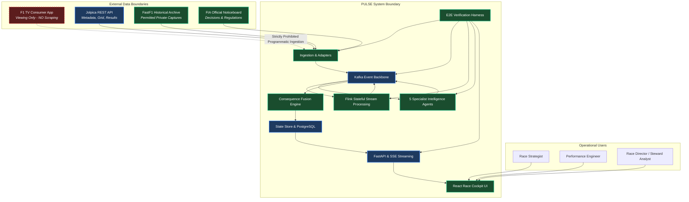
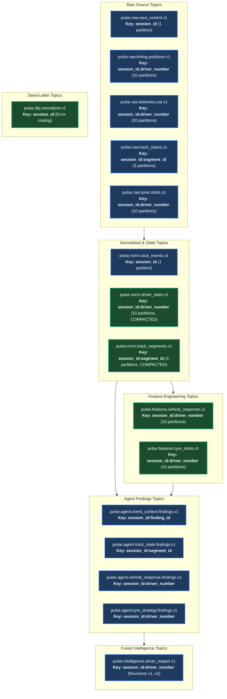
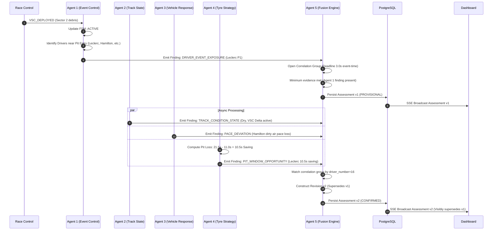
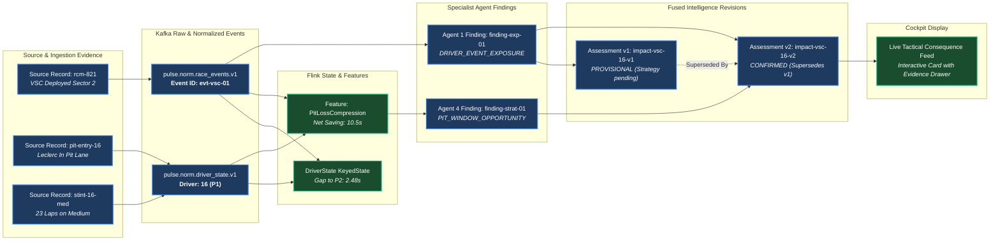
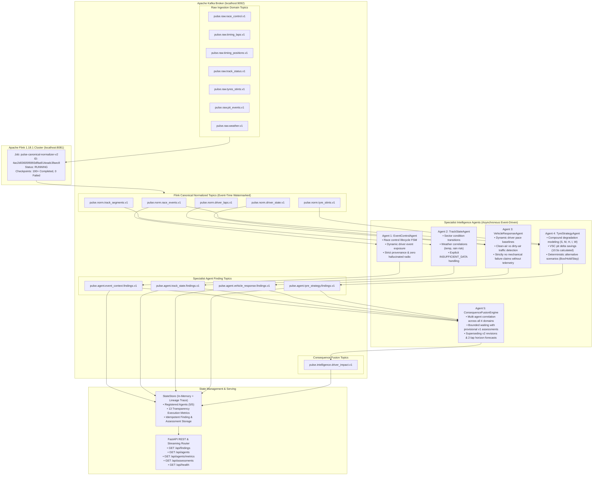

# PULSE Architecture Diagrams (v2.0)
**Visual Specification of Current Implemented vs New Target Architecture**  
**Author:** Principal Software Architect, F1 Data Systems Engineer, Kafka/Flink Lead  

---

## 1. System Context Diagram


*Legend: Blue = Current Implemented (Partial); Green = New Target Component; Red Dashed = Prohibited.*

---

## 2. High-Level Streaming Architecture

```mermaid
flowchart LR
    subgraph INGESTION[Ingestion Layer]
        S_SIM[Deterministic Simulator]:::current
        S_REPLAY[FastF1 Capture Replay]:::target
        S_JOLP[Jolpica Roster Fetcher]:::target
    end

    subgraph KAFKA_RAW[Kafka Raw Ingestion]
        T_RC[pulse.raw.race_control.v1]:::current
        T_TL[pulse.raw.timing.laps.v1]:::current
        T_TP[pulse.raw.timing.positions.v1]:::current
        T_TC[pulse.raw.telemetry.car.v1]:::current
        T_TK[pulse.raw.track_status.v1]:::current
    end

    subgraph FLINK_CLUSTER[Apache Flink Stream Engine]
        FJ1[Job 1: Normalizer & Watermarking]:::target
        FJ2[Job 2: Race State Reconstruction]:::target
        FJ3[Job 3: Feature Engineering Engine]:::target
    end

    subgraph KAFKA_PROC[Kafka Normalized & Feature Topics]
        T_NORM_EV[pulse.norm.race_events.v1]:::current
        T_NORM_DS[pulse.norm.driver_state.v1 - Compacted]:::target
        T_NORM_TS[pulse.norm.track_segments.v1 - Compacted]:::target
        T_FEAT_VR[pulse.features.vehicle_response.v1]:::target
        T_FEAT_ST[pulse.features.tyre_stints.v1]:::target
    end

    subgraph AGENT_LAYER[Specialist Analytics Layer]
        A1[Agent 1: Event Control]:::target
        A2[Agent 2: Track State]:::target
        A3[Agent 3: Vehicle Response]:::target
        A4[Agent 4: Tyre Strategy]:::target
        A5[Agent 5: Consequence Fusion]:::target
    end

    subgraph SERVING_LAYER[Serving & Presentation]
        DB[(PostgreSQL Store)]:::target
        FASTAPI[FastAPI + SSE Stream]:::current
        COCKPIT[React Cockpit Dashboard]:::target
    end

    INGESTION --> KAFKA_RAW
    KAFKA_RAW --> FJ1 --> FJ2 --> FJ3
    FJ1 --> T_NORM_EV
    FJ2 --> T_NORM_DS & T_NORM_TS
    FJ3 --> T_FEAT_VR & T_FEAT_ST

    T_NORM_EV --> A1
    T_NORM_TS --> A2
    T_NORM_DS & T_FEAT_VR --> A3
    T_NORM_DS & T_FEAT_ST --> A4

    A1 & A2 & A3 & A4 --> A5
    A5 --> DB --> FASTAPI --> COCKPIT

    classDef current fill:#1e3a5f,stroke:#3b82f6,stroke-width:2px,color:#fff;
    classDef target fill:#1a4d2e,stroke:#10b981,stroke-width:2px,color:#fff;
```



---

## 3. Kafka Topic Topology & Keying Structure



---

## 4. Apache Flink Job Topology

```mermaid
flowchart TD
    subgraph JOB1[Flink Job 1: Ingestion Normalizer & Watermarking]
        J1_SRC[Kafka Raw Sources]:::target
        J1_WM[Assign BoundedOutOfOrderness Watermarks<br/><i>Telemetry: 1.0s, Control: 3.0s, Idleness: 5.0s</i>]:::target
        J1_DEDUP[KeyedProcessFunction Deduplicator<br/><i>State: ValueState&lt;Boolean&gt; (TTL 1h)</i>]:::target
        J1_VAL[Schema & Unit Validator]:::target
        J1_DLQ[DLQ Sink: pulse.dlq.normalizer.v1]:::target
        J1_SINK[Sink: pulse.norm.*.v1]:::target

        J1_SRC --> J1_WM --> J1_DEDUP --> J1_VAL
        J1_VAL -->|Invalid| J1_DLQ
        J1_VAL -->|Valid| J1_SINK
    end

    subgraph JOB2[Flink Job 2: Stateful Race State Reconstruction]
        J2_SRC[Kafka pulse.norm.*.v1]:::target
        J2_KEY[KeyBy: driver_number or segment_id]:::target
        J2_STATE[KeyedStateStore<br/><i>DriverState, TrackSegmentState, PitCycleState</i>]:::target
        J2_SINK[Sink: pulse.norm.driver_state.v1 & track_segments.v1]:::target

        J2_SRC --> J2_KEY --> J2_STATE --> J2_SINK
    end

    subgraph JOB3[Flink Job 3: Streaming Feature Engineering]
        J3_SRC[Normalized State & Events]:::target
        J3_WIN[Sliding Event-Time Windows & Event Aligned Triggers]:::target
        J3_FEAT[Calculate Pace Deltas & Pit Compression Savings]:::target
        J3_SINK[Sink: pulse.features.*.v1]:::target

        J3_SRC --> J3_WIN --> J3_FEAT --> J3_SINK
    end

    classDef target fill:#1a4d2e,stroke:#10b981,stroke-width:2px,color:#fff;
```

---

## 5. Five-Agent Asynchronous Collaboration & Fusion Flow



---

## 6. Race-Control & Finding Lineage Graph



---

## 7. End-to-End Verification Harness Workflow (`pulse.testing.run_e2e`)

```mermaid
flowchart TD
    CLI["CLI Command: python -m pulse.testing.run_e2e<br/><i>--season 2026 --event Monaco --session R --mode replay</i>"]:::target

    subgraph STAGES[10-Stage Pipeline Verification]
        S1["Stage 1: Source Acquisition & Manifest Check<br/><i>Validate hashes & licensing</i>"]:::target
        S2["Stage 2: Kafka Producer Accounting<br/><i>Verify published event IDs</i>"]:::target
        S3["Stage 3: Kafka Consumer Lag & Offset Check<br/><i>Verify 0 lost commits</i>"]:::target
        S4["Stage 4: Flink Job Execution Check<br/><i>Query JobManager REST: state=RUNNING, checkpoints > 0</i>"]:::target
        S5["Stage 5: State Reconstruction Audit<br/><i>Verify driver & segment keys</i>"]:::target
        S6["Stage 6: Feature Generation Validation<br/><i>Verify schema conformance</i>"]:::target
        S7["Stage 7: 5-Agent Execution Accounting<br/><i>Verify FINDING_EMITTED, NO_FINDING, FILTERED</i>"]:::target
        S8["Stage 8: Fusion Engine Revision Chain Audit<br/><i>Verify v1 -> v2 superseding link</i>"]:::target
        S9["Stage 9: PostgreSQL Persistence Idempotency<br/><i>Verify zero duplicate writes</i>"]:::target
        S10["Stage 10: API & Dashboard Snapshot Reconciliation<br/><i>Verify /api/snapshot matches expected state</i>"]:::target
    end

    subgraph REPORTS[Automated Verification Deliverables]
        R_JSON["e2e_report.json"]:::target
        R_MD["e2e_report.md"]:::target
        R_RECON["stage_reconciliation.csv"]:::target
        R_METRICS["agent_metrics.csv"]:::target
    end

    CLI --> S1 --> S2 --> S3 --> S4 --> S5 --> S6 --> S7 --> S8 --> S9 --> S10
    S10 --> REPORTS

    classDef target fill:#1a4d2e,stroke:#10b981,stroke-width:2px,color:#fff;
```



---

## 8. Deployment Topology: Local Development vs Target Production

```mermaid
flowchart TB
    subgraph DOCKER_COMPOSE[Local Development Environment (Docker Compose)]
        subgraph InfraServices[Infrastructure Containers]
            KAFKA_LOCAL[Apache Kafka / Redpanda<br/><i>Port 9092</i>]:::current
            FLINK_JM[Flink JobManager<br/><i>Port 8081</i>]:::target
            FLINK_TM[Flink TaskManager]:::target
            PG_LOCAL[PostgreSQL 16<br/><i>Port 5432</i>]:::target
        end

        subgraph PulseServices[PULSE Containers]
            BACKEND[FastAPI Backend + 5 Agents<br/><i>Port 8000</i>]:::current
            FRONTEND[React Vite Dashboard<br/><i>Port 5173</i>]:::current
        end

        subgraph Observability[Telemetry & Metrics]
            PROM[Prometheus<br/><i>Port 9090</i>]:::target
            GRAF[Grafana<br/><i>Port 3000</i>]:::target
        end
    end

    KAFKA_LOCAL <--> FLINK_JM & FLINK_TM
    KAFKA_LOCAL <--> BACKEND
    PG_LOCAL <--> BACKEND
    BACKEND <--> FRONTEND
    BACKEND & FLINK_JM & KAFKA_LOCAL --> PROM --> GRAF

    classDef current fill:#1e3a5f,stroke:#3b82f6,stroke-width:2px,color:#fff;
    classDef target fill:#1a4d2e,stroke:#10b981,stroke-width:2px,color:#fff;
```

---

## 9. Verified Phase 2 Five-Agent Streaming Integration Topology




