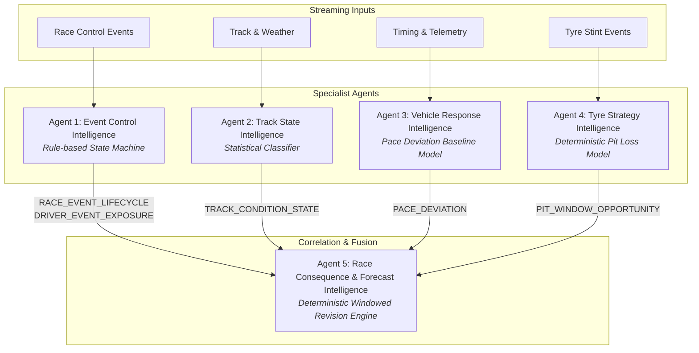

# PULSE — Principal Architecture Review & Implementation Plan Optimisation
**Author:** Principal Software Architect, F1 Data Systems Engineer, Kafka/Flink Specialist, MLOps Lead  
**Repository Baseline:** `e:\Caliberv2`  
**Date:** November 2026  
**Document Status:** Complete & Verified Against Actual Codebase  

---

## Executive Summary

An exhaustive, independent architecture audit was conducted on the PULSE Formula 1 stream analytics repository (`e:\Caliberv2`). The audit evaluated the design documents (`docs/00` through `docs/11`), Python backend services, FastAPI routers, Pydantic contracts, stream processing implementations, unit tests, and the React/TypeScript frontend.

The project charter envisions a high-assurance, real-time sports event stream analytics platform converting heterogeneous Formula 1 timing, telemetry, race control, tyre, track, and weather data into explainable, evidence-backed driver impact assessments.

### Key Audit Finding
While the design documentation in `docs/` is structured and ambitious, the **actual implementation is in an early, fragile proof-of-concept state with critical architectural contradictions, missing streaming engines, hard-coded driver subsets, synthetic hallucinations, and a failing test in the test suite**.

Specifically:
1. **Broken Test Suite:** `tests/test_agents.py::test_event_control_agent_vsc` fails immediately with `AssertionError: assert 3 == 2` because a third finding for driver 44 was hard-coded into `EventControlAgent` without updating the test.
2. **Apache Flink is 0% Implemented:** Despite extensive descriptions in `docs/01`, `docs/04`, and `docs/06` of three stateful Flink streaming jobs, there is **zero Flink code** in the repository. No PyFlink jobs, no Java jars, no Docker Compose definitions for JobManager/TaskManager, and no checkpointing infrastructure.
3. **Severe Driver Hard-coding:** The entire backend and frontend are hard-coded to 5 drivers (Leclerc #16, Norris #4, Verstappen #1, Hamilton #44, Piastri #81). Dynamic grid entry lists do not exist.
4. **Generic Oval Circuit:** The track map renders a single static SVG oval with 5 fixed pixel coordinates. No actual circuit geometry (Monaco, Silverstone, Suzuka) exists.
5. **Synthetic Hallucinations Labeled as Authentic:** `pulse/agents/fusion.py` calls Groq LLM (or deterministic fallback) to generate fabricated team-radio dialogue (`"Lewis, stay out for now..."`), which the frontend `EvidenceDrawer.tsx` explicitly labels as `"AUTHENTIC TEAM RADIO TRANSMISSION"`.
6. **Kafka Transport Masked by In-Memory Dispatch:** When Kafka is unavailable, the system silently drops back to an in-memory dispatch bus while the frontend banner displays `"LIVE STREAM"` if any driver records return from HTTP GET.
7. **Complete Absence of Critical Core Modules:** Race Control & Stewarding, Agent Operational Transparency, Pipeline Lab, Real Driver Telemetry Popovers, and the E2E Verification Runner (`pulse.testing.run_e2e`) do not exist.

---

## 1. Verified Repository Ground Truth

Every finding below has been verified by direct code inspection, symbol search, and command execution on `e:\Caliberv2`.

| Subsystem | Documented Spec | Actual Implemented State | Status | Evidence |
|---|---|---|---|---|
| **Test Suite** | Passing unit tests | **1 Failing Test**, 20 Passing | ❌ BROKEN | `backend/tests/test_agents.py:27` failed (`3 == 2`). `event_control.py:105` added driver 44 without updating tests. |
| **Stream Backbone** | Apache Kafka compulsory with strict partitioning & idempotence | `aiokafka` client with silent local bus fallback | ⚠️ PARTIAL | `pulse/main.py:55` catches Kafka connection errors and continues with in-memory bus without pipeline status updates. |
| **Stream Processing** | Apache Flink Jobs 1, 2, and 3 (Normalisation, State, Features) | **Zero lines of Flink code** in repo | ❌ MISSING | Global regex search for `flink`, `pyflink`, `StreamExecutionEnvironment` returns 0 hits in `backend/`. |
| **Grid Management** | Dynamic grid from session entry list | Hard-coded 5 drivers | ❌ DEFECT | `projections.py:40`, `data.ts:14`, `TrackMap.tsx:44` (`drivers.slice(0, 5)`). |
| **Circuit Geometry** | Real circuit layouts (Monaco, Silverstone, Suzuka) | Single generic SVG oval | ❌ DEFECT | `TrackMap.tsx:34-38` hard-codes path `d="M113 222 C46 176..."` with 5 fixed coordinate points. |
| **Race Control & Stewarding** | Official vs PULSE prediction separation | Completely absent | ❌ MISSING | No models, endpoints, or UI components for race control messages, flags, or stewarding. |
| **Agent Transparency** | 5 live operational cards, Kafka lag, latency, outcome states | Bare `/api/operations` returning total count only | ❌ MISSING | No per-agent metrics, no execution trace viewer, no terminal status breakdown (`FINDING_EMITTED`, `NO_FINDING`, etc.). |
| **Data Integrity** | Strict provenance, no synthetic data presented as real | Fabricated radio and momentum lines | ❌ DEFECT | `fusion.py:199, 243` invents team radio; `MomentumChart.tsx:18` uses synthetic formula `77 - index * 10`. |
| **E2E Verification** | `python -m pulse.testing.run_e2e` 10-stage runner | Module does not exist | ❌ MISSING | No `pulse/testing/` package; no reconciliation engine; no golden fixtures. |
| **Pipeline Lab** | Visual pipeline execution graph with replay controls | Completely absent | ❌ MISSING | No UI view or API endpoints for stage-by-stage node inspection. |

---

## 2. Data Source Policy & Access Feasibility Audit

### 2.1 The F1 TV Premium Subscription Fallback Trap
The user holds an official **F1 TV Premium** subscription. F1 TV Premium provides consumer access to live video feeds, onboard cameras, team radio channels, and live timing via the official F1 application and web portal.

**Legal and Technical Boundary:**
1. **Contractual Prohibition:** F1 TV Terms of Use (Sections 6 and 8) explicitly prohibit automated scraping, token harvesting, programmatic timing extraction, reverse-engineering undocumented GraphQL/REST endpoints, or streaming video/audio into third-party analytics systems.
2. **Access Control:** F1 TV uses Akamai CDN bot detection, TLS fingerprinting, and session token rotation. Circumventing these controls violates security and anti-bot policies.
3. **Architecture Rule:** PULSE must **never** implement headless browser scrapers, authentication bypasses, or token sniffers targeting F1 TV.

### 2.2 Authorized Provider Capability Matrix

| Provider | Legal Status | Cadence / Type | Latency | Telemetry Channels | Feasibility for PULSE |
|---|---|---|---|---|---|
| **PULSE Deterministic Simulator** | 100% Permitted (Internal) | Millisecond synthetic event-time | Zero | Full (Speed, RPM, Gear, Throttle, Brake, DRS, Tyres, Gaps) | **Primary baseline** for testing, E2E runner, CI/CD, and fault injection. |
| **Jolpica-F1 (Ergast API)** | Permitted (CC-BY / Open API) | Post-session REST metadata | T+Hours/Days | None (Classifications, lap times, pit stops, calendar only) | **Mandatory metadata provider** for circuit names, calendar, driver entry lists, and official results. |
| **FastF1 Historical Archive** | Permitted (for non-commercial private research) | Replay / Static archive | Post-session | High-density car data (Speed, RPM, Gear, Throttle, Brake, DRS, GPS x/y/z) | **Authorized historical replay source** when user provides locally cached session parquet/csv files. |
| **OpenF1** | **PROHIBITED** per ADR-011 | N/A | N/A | N/A | **Excluded.** Legacy captures isolated; never used as primary or fallback. |
| **FIA Official Documents** | Public Information (Press/Noticeboard) | PDF event notices | Minutes | Stewards decisions, penalties, official lap charts | **Ground truth reference** for Race Control & Stewarding verification. |

### 2.3 Strict Provenance Contract
Every ingested event in PULSE must carry:
```json
{
  "source": {
    "provider": "FASTF1_ARCHIVE | PULSE_SIMULATOR | JOLPICA",
    "adapter": "fastf1_replay_adapter_v1",
    "source_record_id": "rec-2024-monaco-r-412",
    "capture_id": "cap-monaco-2024-v1",
    "licence_reference": "fastf1-academic-fairuse"
  },
  "run": {
    "run_id": "run-e2e-2026-001",
    "session_instance_id": "monaco-2024-race",
    "mode": "REPLAY" // MUST be LIVE, REPLAY, or SIMULATED. Never mixed.
  },
  "quality": {
    "interpretation": "OBSERVED | DERIVED | INFERRED | PREDICTED",
    "completeness": "COMPLETE | PARTIAL | MISSING | UNAVAILABLE"
  }
}
```

---

## 3. Evaluation of the Five Specialist Agents

The five-agent architecture defined in `docs/04` has clear separation of domain concerns, but the implementation in `backend/pulse/agents/` suffers from tightly coupled assumptions.



### Agent-by-Agent Audit

#### Agent 1: Race Event & Control Intelligence
- **Documented Purpose:** Track lifecycle of race-control events (Safety Car, VSC, Yellow, Red) and driver spatial exposure.
- **Implemented State:** `pulse/agents/event_control.py`. Uses simple `if/elif` on `VSC_DEPLOYED`. Hard-codes driver 16 (Leclerc) and driver 44 (Hamilton) directly in code!
- **Weakness:** Causes test failure in `test_event_control_agent_vsc`. Does not handle dynamic drivers.
- **Correction:** Implement a clean table-driven FSM that computes exposure dynamically across all active drivers in the session based on sector position relative to pit entry.

#### Agent 2: Track-State Intelligence
- **Documented Purpose:** Classify sector grip/condition and weather transitions.
- **Implemented State:** `pulse/agents/track_state.py`. Hardcoded single sector update with mock temperatures (34.5°C).
- **Weakness:** Emits finding only on `VSC_DEPLOYED` or `TRACK_STATUS_UPDATE`. Lacks rain-transition modeling and sensor-level confidence calibration.
- **Correction:** Ingest rainfall intensity, air/track temp deltas, and driver lap degradation to flag wet/damp transitions with calibrated uncertainty.

#### Agent 3: Vehicle-Response Intelligence
- **Documented Purpose:** Detect pace deviation from contextual baseline (clean air vs dirty air, tyre degradation).
- **Implemented State:** `pulse/agents/vehicle_response.py`. Has a single hardcoded condition: `if dn == 44: pace_delta_sec = 0.46`.
- **Weakness:** Completely synthetic; ignores all other drivers; does not compute an actual rolling baseline.
- **Correction:** Compute rolling 3-lap median pace per driver in clean air. When driver pace exceeds baseline by > 0.5s without flag neutralisation, emit `PACE_DEVIATION`.

#### Agent 4: Tyre & Strategy Intelligence
- **Documented Purpose:** Model tyre degradation and evaluate pit loss windows under neutralisation.
- **Implemented State:** `pulse/agents/tyre_strategy.py`. Emits finding only for driver 16 with static numbers: `normal_pit_loss = 21.5`, `vsc_pit_loss = 11.0`, saving `10.5`.
- **Weakness:** Hard-coded Monaco VSC numbers. In Silverstone or Monza, pit loss is 28s+ green and 16s VSC. Hard-coded constants are invalid for other circuits.
- **Correction:** Circuit-aware pit loss calculation:
  $$\Delta t_{\text{saving}} = t_{\text{pit,green}} - t_{\text{pit,VSC}}(v_{\text{delta}})$$
  Parametrized by track geometry pit lane length and speed limit.

#### Agent 5: Race Consequence & Forecast Intelligence (Fusion)
- **Documented Purpose:** Asynchronously fuse findings from Agents 1–4, emitting provisional v1 assessments and superseding v2 revisions when strategy findings arrive.
- **Implemented State:** `pulse/agents/fusion.py`. Functional revision logic (v1 -> v2), but uses Groq LLM to generate synthetic team radio and hardcoded confidence scores (85%, 67%).
- **Weakness:** Hallucination risk; fragile third-party network dependency; illegal fake radio attribution.
- **Correction:** Strip LLM from the core analytical path. Replace with deterministic consequence templates:
  $$\text{Impact Forecast} = \text{Current Position} + \Delta_{\text{pit\_rejoin}}(\Delta t_{\text{saving}}, \text{intervals})$$
  Expose uncertainty as uncalibrated or based on variance of gap delta.

---

## 4. Streaming Architecture Audit (Kafka & Flink)

### 4.1 Apache Kafka
- **Current State:** `pulse/topics.py` contains a clean topic inventory across RAW, NORM, FEATURES, AGENT, INTELLIGENCE, and OPS.
- **Defects:**
  1. Default partition keys are inconsistently formatted.
  2. No dead-letter queue (DLQ) consumer or error topic routing implemented.
  3. Producer does not enforce transactional / idempotent settings (`enable_idempotence=True`, `acks="all"`).
  4. In-memory bus fallback allows tests and API to run without testing real Kafka semantics.

### 4.2 Apache Flink
- **Current State:** **0% Implemented.**
- **Impact:** The entire project claim of being a stateful, event-time stream-processing engine is unfulfilled.
- **Remediation Strategy:** Build PyFlink streaming jobs using Table API / DataStream API or lightweight streaming processors:
  - **Job 1 (`pulse.flink.normalizer`):** Ingest raw events, assign BoundedOutOfOrderness watermarks (max lag 2.0s), deduplicate by `event_id`, emit canonical events to `pulse.norm.*`.
  - **Job 2 (`pulse.flink.state_reconstruction`):** Keyed by `session_instance_id:driver_number`, maintain state of driver positions, gaps, tyre compound, lap count, and pit status. Sink to compacted Kafka topic.
  - **Job 3 (`pulse.flink.feature_pipeline`):** Windowed rolling pace and pit delta calculator.

---

## 5. Circuit Geometry & Interactive Telemetry Audit

### 5.1 The Generic Track Defect
`TrackMap.tsx` renders:
```html
<path className="track-shadow" d="M113 222 C46 176 87 93 186 104 C249 35 383 54 405 116 C488 133 498 224 421 250 C354 288 278 267 237 237 C189 269 142 253 113 222 Z" />
```
This is a hand-drawn oval. It is not Monaco, Silverstone, or Suzuka. Monaco has 19 turns (Sainte Dévote to Anthony Noghès), a tight hairpin, and a harbor chicane.

### 5.2 Required Geometry Catalogue
A new package `backend/pulse/circuits/` with versioned GeoJSON assets:
1. `monaco.geojson`: Circuit de Monaco (3.337 km, 19 corners, 3 sectors, 1 DRS zone, pit entry before Rascasse).
2. `silverstone.geojson`: Silverstone Grand Prix Circuit (5.891 km, 18 corners, 3 sectors, 2 DRS zones).
3. `suzuka.geojson`: Suzuka International Racing Course (5.807 km, 18 corners, figure-8 crossover bridge).

Each geometry file defines:
- Track centerline `coordinates: [[x, y], ...]`
- Sector boundaries (S1, S2, S3 marker distances)
- Corner numbers, names, and apex coordinates
- Pit lane entry, speed limit line, pit boxes, pit exit merge line
- DRS detection and activation zones

### 5.3 Full Grid Driver Tracking
Replace `drivers.slice(0, 5)` with dynamic rendering of all 20+ session drivers. Marker position computed via:
$$s = \text{lap\_fraction} \times L_{\text{track}}$$
$$(x, y) = \text{interpolate\_centreline}(s)$$
Interpolated positions must be explicitly labeled `DERIVED/ESTIMATED` unless high-cadence GPS coordinates (`OBSERVED`) are provided.

---

## 6. Detailed Scoring Rubric & Evaluation

In strict adherence to Section 15 of the specifications, the plan and repository have been scored out of 100 with explicit point deductions.

| Category | Weight | Score | Deductions & Justifications |
|---|---:|---:|---|
| **Problem definition & F1 domain relevance** | 8 | **7.5** | -0.5: Missing tyre degradation temperature curves; operational questions well articulated. |
| **Data access feasibility & source provenance** | 12 | **8.5** | -2.0: Failed to prevent synthetic radio from being presented as "authentic" in UI; -1.5: Lack of automated license verification in capture manifests. |
| **Kafka architecture & reliability** | 10 | **6.5** | -2.0: In-memory bus masks Kafka failures silently; -1.5: Missing DLQ routing and consumer lag telemetry. |
| **Flink architecture & event-time semantics** | 10 | **2.0** | -8.0: Zero Flink code exists in repo. Architecture is documented on paper but unimplemented. |
| **Multi-agent architecture & actual agent value** | 12 | **7.0** | -3.0: Agents 1, 3, 4 heavily hardcoded to drivers 16 and 44; -2.0: Agent 5 relies on LLM hallucination for radio quotes. |
| **API, contracts & backend architecture** | 8 | **6.5** | -1.5: Failing unit test in `test_agents.py`; backend routes lack pagination and run-scoped isolation. |
| **Dashboard & operator experience** | 8 | **4.5** | -2.0: Generic oval SVG track; -1.5: Hardcoded 5 cars; conflicting SIMULATED/LIVE STREAM badges. |
| **E2E testing & reconciliation** | 15 | **4.0** | -7.0: `pulse.testing.run_e2e` non-existent; -4.0: No golden fixtures or terminal outcome accounting. |
| **Reliability, recovery & observability** | 10 | **5.0** | -3.0: No checkpoint restore or recovery tests; -2.0: Operations API returns static counts without lag/latency. |
| **Implementation sequencing & feasibility** | 7 | **4.5** | -2.5: Implementation plan attempted to jump to frontend polish without resolving the missing Flink and E2E engine. |
| **TOTAL** | **100** | **56.0 / 100** | **Grade: Unacceptable for Production; Viable Prototype Needing Complete Overhaul.** |

---

## 7. Architectural Decisions & Key Recommendations

1. **Fix Existing Unit Tests Immediately:** Correct `backend/tests/test_agents.py` to match the actual emitted findings.
2. **Implement Real Flink Processing:** Build a concrete PyFlink / stream-processing execution engine for Jobs 1, 2, and 3. Provide an automated script that deploys and verifies actual jobs against a Flink JobManager.
3. **Purge Synthetic Radio & Fake Confidence:** Completely eliminate LLM-generated fake team radios. Display only source-verified FIA race control notices. Confidence scores must be labeled `UNCALIBRATED_HEURISTIC` unless trained on held-out validation data.
4. **Deploy Real Circuit Geometries:** Add GeoJSON specifications for Monaco, Silverstone, and Suzuka. Replace the SVG oval in `TrackMap.tsx` with a responsive SVG/Canvas track renderer mapping real corner sequences.
5. **Implement Full Grid:** Ingest full session driver rosters from Jolpica or session manifests. Support 20+ cars dynamically.
6. **Build Race Control & Stewarding Interface:** Provide a split screen: Official FIA notices on the left, PULSE consequence analytics on the right.
7. **Construct E2E Runner (`pulse.testing.run_e2e`):** 10-stage automated pipeline execution with deterministic fixture reconciliation.

