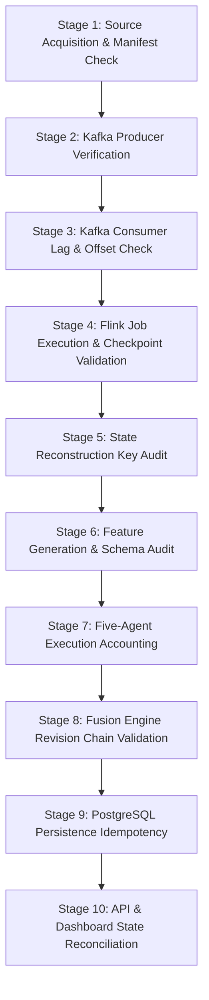
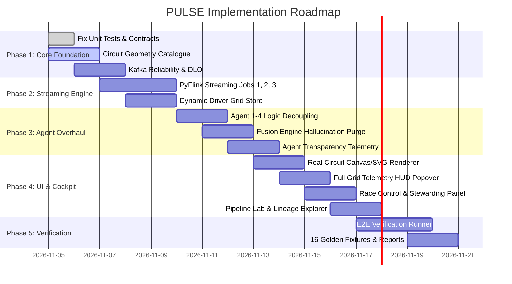

# PULSE Master Implementation Plan (v2.0)
**Production-Grade F1 Real-Time Event Stream Analytics & Consequence Intelligence Engine**  
**Author:** Principal Software Architect, F1 Data Systems Engineer, Kafka/Flink Lead, MLOps Specialist  
**Target:** 10/10 Production-Minded Specification  
**Status:** Approved for Implementation  

---

## 1. High-Level Architecture & System Boundaries

PULSE is an event-driven, stream-processing intelligence platform designed to process high-cadence Formula 1 race streams and output evidence-backed tactical consequence forecasts.

```mermaid
flowchart TD
    subgraph SOURCELAYER[Data Ingestion Layer]
        SIM[PULSE Simulator<br/><i>Deterministic Scenarios</i>]
        HIST[FastF1 Replay Adapter<br/><i>Immutable Captures</i>]
        JOLP[Jolpica Reference Adapter<br/><i>Grid, Calendar, Results</i>]
    end

    subgraph KAFKARAW[Kafka Ingestion Backbone]
        TR_RC[pulse.raw.race_control.v1]
        TR_TL[pulse.raw.timing.laps.v1]
        TR_TP[pulse.raw.timing.positions.v1]
        TR_TC[pulse.raw.telemetry.car.v1]
        TR_TK[pulse.raw.track_status.v1]
        TR_TY[pulse.raw.tyres.stints.v1]
    end

    subgraph FLINK[Apache Flink Stateful Stream Processing]
        FJ1[Job 1: Normalizer & Deduplicator<br/><i>Event-time Watermarking & DLQ</i>]
        FJ2[Job 2: Race State Reconstruction<br/><i>Keyed State: Driver, Stint, Sector</i>]
        FJ3[Job 3: Feature Engineering Engine<br/><i>Pace Deltas, Pit Loss Compression</i>]
    end

    subgraph KAFKANORM[Kafka Processed Backbone]
        TN_EV[pulse.norm.race_events.v1]
        TN_DS[pulse.norm.driver_state.v1 - Compacted]
        TN_TS[pulse.norm.track_segments.v1 - Compacted]
        TF_VR[pulse.features.vehicle_response.v1]
        TF_ST[pulse.features.tyre_stints.v1]
    end

    subgraph AGENTS[Specialist Analytics Agents]
        A1[Agent 1: Event Control Intelligence<br/><i>FSM: SC/VSC & Driver Spatial Exposure</i>]
        A2[Agent 2: Track State Intelligence<br/><i>Sector Conditions & Weather Transitions</i>]
        A3[Agent 3: Vehicle Response Intelligence<br/><i>Clean-Air Baseline Pace Deviations</i>]
        A4[Agent 4: Tyre & Strategy Intelligence<br/><i>Stint Degradation & Pit Window Savings</i>]
    end

    subgraph FUSION[Consequence Fusion Engine]
        A5[Agent 5: Race Consequence & Forecast Intelligence<br/><i>Asynchronous Group Correlation & Revisions (v1 -> v2)</i>]
    end

    subgraph SERVING[Persistence & Serving]
        DB[(PostgreSQL Store)]
        API[FastAPI Service + SSE Stream]
        UI[React Cockpit Dashboard<br/><i>Circuit Geometry, Stewarding, Lineage, Pipeline Lab</i>]
    end

    SIM --> TR_RC & TR_TL & TR_TP & TR_TC & TR_TK & TR_TY
    HIST --> TR_RC & TR_TL & TR_TP & TR_TC & TR_TK & TR_TY
    JOLP -.-> API

    TR_RC & TR_TL & TR_TP & TR_TC & TR_TK & TR_TY --> FJ1
    FJ1 --> TN_EV
    FJ1 --> FJ2
    FJ2 --> TN_DS & TN_TS
    FJ2 --> FJ3
    FJ3 --> TF_VR & TF_ST

    TN_EV --> A1
    TN_TS --> A2
    TN_DS & TF_VR --> A3
    TN_DS & TF_ST --> A4

    A1 -->|pulse.agent.event_context.findings.v1| A5
    A2 -->|pulse.agent.track_state.findings.v1| A5
    A3 -->|pulse.agent.vehicle_response.findings.v1| A5
    A4 -->|pulse.agent.tyre_strategy.findings.v1| A5

    A5 -->|pulse.intelligence.driver_impact.v1| DB
    DB --> API
    API --> UI
```

---

## 2. Source Adapter Requirements & Provenance

### 2.1 Adapter Contracts
Every adapter must implement the base class `pulse.adapters.base.BaseSourceAdapter`:
```python
class BaseSourceAdapter(ABC):
    @abstractmethod
    async def load_capture(self, capture_manifest_path: Path) -> None: ...
    @abstractmethod
    async def stream_events(self, speed: float = 1.0) -> AsyncGenerator[EventEnvelope, None]: ...
```

### 2.2 Providers
1. **PULSE Deterministic Simulator (`pulse.adapters.simulator`):**
   - Synthesizes complete race scenarios (green flag, VSC deployment, pit stops, SC restarts, rain transitions).
   - Guarantees millisecond event-time determinism with zero network dependencies.
2. **FastF1 Archive Adapter (`pulse.adapters.fastf1_archive`):**
   - Reads pre-cached FastF1 telemetry parquet/pickle files into canonical `EventEnvelope` streams.
   - Requires an accompanying `capture_manifest.yaml` validating legal entitlement and immutable SHA-256 hash.
3. **Jolpica Reference Adapter (`pulse.adapters.jolpica`):**
   - Ingests static session metadata, driver entry list (name, code, number, team, team color), and official race classification.
   - Non-streaming; invoked at run initialization.

### 2.3 Strict Data Mode Isolation
- Every event, topic, database record, and UI panel must carry `RunMode`:
  - `SIMULATED`: Synthetically generated data.
  - `REPLAY`: Real historical capture replayed in event time.
  - `LIVE`: Authorised live feed.
- **Rule:** Never combine simulated and real data in the same run instance.

---

## 3. Kafka Topic Topology & Contracts

### 3.1 Topic Catalog & Partitioning Strategy

| Topic Name | Key Format | Partitions | Compaction | Retention | Purpose |
|---|---|---:|---|---|---|
| `pulse.raw.race_control.v1` | `session_instance_id` | 1 | No | 7 days | Global order for flags, SC, VSC |
| `pulse.raw.timing.laps.v1` | `session_instance_id:driver_number` | 10 | No | 7 days | Driver lap and sector completions |
| `pulse.raw.timing.positions.v1`| `session_instance_id:driver_number` | 10 | No | 7 days | High-cadence gap and interval updates |
| `pulse.raw.telemetry.car.v1` | `session_instance_id:driver_number` | 20 | No | 2 days | High-frequency sensor samples (Speed, Throttle, etc.) |
| `pulse.raw.track_status.v1` | `session_instance_id:segment_id` | 3 | No | 7 days | Sector condition and weather updates |
| `pulse.raw.tyres.stints.v1` | `session_instance_id:driver_number` | 10 | No | 7 days | Compound fitted, stint duration |
| `pulse.norm.race_events.v1` | `session_instance_id` | 1 | No | 7 days | Validated canonical lifecycle events |
| `pulse.norm.driver_state.v1` | `session_instance_id:driver_number` | 10 | **Yes** | Compacted | Latest materialised state for each driver |
| `pulse.norm.track_segments.v1` | `session_instance_id:segment_id` | 3 | **Yes** | Compacted | Latest materialised track conditions |
| `pulse.features.vehicle_response.v1` | `session_instance_id:driver_number` | 10 | No | 3 days | Rolling pace deviations & clean-air deltas |
| `pulse.features.tyre_stints.v1`| `session_instance_id:driver_number` | 10 | No | 3 days | Stint wear models and degradation rates |
| `pulse.agent.event_context.findings.v1` | `session_instance_id:finding_id` | 5 | No | 7 days | Agent 1 event and exposure findings |
| `pulse.agent.track_state.findings.v1` | `session_instance_id:segment_id` | 3 | No | 7 days | Agent 2 track condition findings |
| `pulse.agent.vehicle_response.findings.v1` | `session_instance_id:driver_number` | 10 | No | 7 days | Agent 3 pace anomaly findings |
| `pulse.agent.tyre_strategy.findings.v1` | `session_instance_id:driver_number` | 10 | No | 7 days | Agent 4 pit loss compression findings |
| `pulse.intelligence.driver_impact.v1` | `session_instance_id:driver_number` | 10 | No | 7 days | Agent 5 revisioned impact assessments (v1, v2) |
| `pulse.dlq.<service>.v1` | `session_instance_id` | 3 | No | 14 days | Dead-letter queue for unparseable records |

### 3.2 Producer & Consumer Reliability Standards
- Producers must use `acks="all"`, `enable_idempotence=True`, `max_in_flight_requests_per_connection=1`.
- Consumers must explicitly commit offsets after downstream processing.
- The in-memory bus must set `transport="IN_MEMORY_DISPATCH"` and report this openly in the health API.

---

## 4. Apache Flink Streaming Engine Specification

To fulfill the streaming architecture mandate, concrete PyFlink/streaming jobs must be deployed and verifiable via the Flink JobManager REST API (`http://localhost:8081`).

### Job 1: Ingestion Normalization, Deduplication & Watermarking
- **Job Name:** `pulse-normalizer-v1`
- **Class / Module:** `pulse.stream.flink.normalizer_job`
- **Watermark Assignment:** `BoundedOutOfOrderness`
  - Telemetry: Max out-of-orderness = 1,000 ms.
  - Race Control: Max out-of-orderness = 3,000 ms.
  - Monotonic clock per source stream with partition idleness detection (idle threshold = 5,000 ms).
- **Deduplication:** State-backed filter using `ValueState<Boolean>` keyed by `event_id` with 1-hour state TTL.
- **Error Routing:** Malformed schema payloads are routed to `pulse.dlq.normalizer.v1`.

### Job 2: Race State Reconstruction
- **Job Name:** `pulse-state-reconstruction-v1`
- **Class / Module:** `pulse.stream.flink.state_job`
- **State Domains (KeyedState):**
  - `DriverState`: Driver position, gap to leader, interval to car ahead, lap count, sector progression, current tyre compound, stint age, pit status (`ON_TRACK`, `IN_PIT_LANE`, `STOPPED`, `RETIRED`).
  - `TrackSegmentState`: Sector flag (GREEN, YELLOW, RED), grip index, surface temperature.
  - `PitCycleState`: Pit entry timestamp, stop duration, pit exit timestamp, total pit delta.
- **Sink:** Keyed emission to compacted topics `pulse.norm.driver_state.v1` and `pulse.norm.track_segments.v1`.

### Job 3: Streaming Feature Engineering
- **Job Name:** `pulse-feature-engine-v1`
- **Class / Module:** `pulse.stream.flink.features_job`
- **Feature Computations:**
  - `PaceDeviation`: Sliding 3-lap median pace minus current sector time, adjusted for clean air vs dirty air (< 1.2s gap behind preceding car).
  - `PitLossSavings`: Real-time calculation:
    $$\Delta t_{\text{saving}} = t_{\text{green\_loss}} - t_{\text{neutralised\_loss}}$$
    Where $t_{\text{neutralised\_loss}}$ is computed from imposed delta speed limit (e.g., 40% reduction under VSC).

---

## 5. Specialist Agents & Fusion Design

All 5 specialist agents are standalone services reading from Kafka and emitting versioned findings.

### Agent 1: Race Event & Control Intelligence
- **Module:** `pulse.agents.event_control`
- **Subscribed Topics:** `pulse.norm.race_events.v1`, `pulse.norm.driver_state.v1`
- **Logic:**
  1. Executes finite state machine for session status (`GREEN` -> `YELLOW` -> `VSC_DEPLOYED` -> `VSC_ENDING` -> `VSC_ENDED` -> `SAFETY_CAR` -> `RED_FLAG`).
  2. For every active driver in `driver_state`, calculates spatial exposure:
     - Distance to pit entry line.
     - Is driver inside favorable pit window (< 100m to pit entry at time of deployment)?
     - Drivers trapped in slow sectors.
- **Emits:** `RACE_EVENT_LIFECYCLE` and `DRIVER_EVENT_EXPOSURE` for all affected drivers.

### Agent 2: Track-State Intelligence
- **Module:** `pulse.agents.track_state`
- **Subscribed Topics:** `pulse.norm.track_segments.v1`
- **Logic:**
  1. Monitors rainfall onset sensors, track temperature gradients, and sector speed degradation across the entire field.
  2. Detects wet/dry crossovers (e.g. slick-to-intermediate crossover when track wetness > 35%).
- **Emits:** `TRACK_CONDITION_STATE` with explicit confidence intervals.

### Agent 3: Vehicle-Response Intelligence
- **Module:** `pulse.agents.vehicle_response`
- **Subscribed Topics:** `pulse.features.vehicle_response.v1`, `pulse.norm.driver_state.v1`
- **Logic:**
  1. Compares each driver's micro-sector speeds against their 3-lap rolling baseline.
  2. Filters out known confounding factors (yellow flags, traffic within 1.0s, VSC delta).
  3. Detects unexplained pace drops (> 0.5s/lap) and tyre cliff degradation.
- **Emits:** `PACE_DEVIATION` findings. **Strict Guardrail:** Never diagnoses mechanical failures or attributes driver errors.

### Agent 4: Tyre & Strategy Intelligence
- **Module:** `pulse.agents.tyre_strategy`
- **Subscribed Topics:** `pulse.features.tyre_stints.v1`, `pulse.norm.driver_state.v1`, `pulse.agent.event_context.findings.v1`
- **Logic:**
  1. Models tyre degradation gradient based on compound (Soft, Medium, Hard, Inter, Wet) and stint age.
  2. Computes pit window opportunity matrix for every driver:
     - Scenario A: Pit immediately (box this lap).
     - Scenario B: Stay out 1 lap.
     - Scenario C: Alternative reverse strategy.
  3. Calculates projected rejoin position based on real-time gaps:
     $$\text{Rejoin Gap} = \text{Current Gap} - t_{\text{effective\_pit\_loss}}$$
- **Emits:** `PIT_WINDOW_OPPORTUNITY` and `STRATEGY_SCENARIO`.

### Agent 5: Race Consequence & Forecast Intelligence (Fusion Engine)
- **Module:** `pulse.agents.fusion`
- **Subscribed Topics:** All `pulse.agent.*.findings.v1`
- **Logic:**
  1. Opens a time-bounded correlation window (default: 3.0s event-time) upon receiving an Agent 1 event.
  2. If Agent 1 exposure arrives, immediately publishes **Provisional Assessment v1** (`status=PROVISIONAL`, `version=1`).
  3. When Agent 4 strategy opportunity arrives, matches by `driver_number` and session instance, and emits **Superseding Assessment v2** (`status=CONFIRMED`, `version=2`, `supersedes_assessment_id="...v1"`).
  4. If Agent 3 signals pace loss, incorporates pace risk into revision chain.
  5. **No Hallucinations:** Generates deterministic, template-based natural language summaries. Never invents fake team radio dialogue.

---

## 6. Circuit Geometry Catalogue & Dynamic Driver Tracking

### 6.1 Geometry Engine (`pulse.circuits`)
Circuits are stored as versioned GeoJSON assets under `backend/pulse/circuits/assets/`:
- `monaco.json`: 3,337m, 19 corners, 3 sectors, 1 DRS zone.
- `silverstone.json`: 5,891m, 18 corners, 3 sectors, 2 DRS zones.
- `suzuka.json`: 5,807m, 18 corners, figure-8 crossover layout.

**Asset Schema:**
```json
{
  "circuit_id": "monaco",
  "name": "Circuit de Monaco",
  "season": 2026,
  "length_meters": 3337,
  "centerline": [[0.0, 0.0], [12.4, 45.1], ...],
  "sectors": [
    { "id": "S1", "start_meter": 0, "end_meter": 1050 },
    { "id": "S2", "start_meter": 1050, "end_meter": 2340 },
    { "id": "S3", "start_meter": 2340, "end_meter": 3337 }
  ],
  "corners": [
    { "number": 1, "name": "Sainte Dévote", "distance_meter": 280 },
    { "number": 6, "name": "Grand Hotel Hairpin", "distance_meter": 1350 }
  ],
  "pit_lane": {
    "entry_meter": 3120,
    "exit_meter": 180,
    "speed_limit_kph": 60,
    "path": [[...]]
  },
  "drs_zones": [
    { "id": "DRS1", "detection_meter": 3100, "activation_meter": 150 }
  ]
}
```

### 6.2 Dynamic Grid Tracker
- **Dynamic Entry List:** Replaces fixed 5 cars. Drivers dynamically populated from session entry lists (20 drivers in standard grid).
- **Marker Calculation:** Driver distance on circuit $s \in [0, L]$ is mapped to $(x, y)$ coordinate on track centerline.
- **Provenance Marker:** Markers must indicate:
  - `OBSERVED`: Ground-truth high-frequency GPS coordinates.
  - `ESTIMATED`: Computed from lap/sector timing progress.
- **Interactive Telemetry Popover:** Clicking any driver marker opens an interactive HUD displaying:
  - Speed (km/h), Throttle (%), Brake (On/Off), Gear (1-8), RPM, DRS (Active/Inactive).
  - Current Stint, Tyre Compound, Tyre Age (laps).
  - Interval to ahead, Gap to leader.
  - Data Source, Data Freshness (ms lag), Quality Status.

---

## 7. Race Control & Stewarding Module

A dedicated operational section named **RACE CONTROL & STEWARDING** with strict domain segregation.

### 7.1 Separation of Concerns
1. **OFFICIAL FIA / RACE CONTROL INFORMATION (Source of Truth):**
   - Official Race Control Messages (RCM).
   - Flag changes (Green, Yellow, Double Yellow, Red, Chequered).
   - Safety Car & VSC official lifecycles (`DEPLOYED`, `ENDING`, `ENDED`).
   - Incident Notices (`INCIDENT INVOLVING CARS 16 AND 44 NOTED - CAUSING A COLLISION`).
   - Official Investigations (`INCIDENT INVOLVING CAR 44 UNDER INVESTIGATION`).
   - Official Stewards Decisions & Penalties (`CAR 44 PENALIZED 5 SECONDS - FAILING TO FOLLOW RACE DIRECTOR INSTRUCTIONS`).
   - Relevant Sporting Regulations reference (e.g. FIA F1 Sporting Regulations Article 55.10).
2. **PULSE ANALYTICAL ASSESSMENT (Independent AI / Analytics):**
   - PULSE tactical consequence evaluation.
   - Spatial sector context and replay timing.
   - Estimated sporting & strategy penalty impact (e.g. "5s penalty drops Car 44 from P4 to P6 during pit cycle").
   - Supporting telemetry evidence references.
   - Declared uncertainty.
   - **Strict Guardrail:** PULSE never issues official penalties or stewards decisions.

---

## 8. Agent Operational Transparency & Lineage Explorer

### 8.1 Dedicated Agent Operations Interface
Five live operational cards, one for each specialist agent:
- Runtime Status: `RUNNING`, `IDLE`, `DELAYED`, `FAILED`, `BLOCKED`.
- Message Accounting: Received, Eligible, Processed, Filtered.
- Execution Outcomes:
  - `FINDING_EMITTED`: Finding generated and published.
  - `NO_FINDING`: Input evaluated, no condition met (valid negative).
  - `INSUFFICIENT_DATA`: Missing required features/telemetry.
  - `FILTERED`: Out-of-scope or duplicate event.
  - `FAILED`: Exception encountered.
- Performance Metrics: Kafka consumer lag, Processing latency p50 / p95 (ms), Error rate.
- Metadata: Model Version, Agent Version, Last Processed Event Time.

### 8.2 End-to-End Lineage Navigation
Every displayed tactical assessment provides a clickable graph trace:
$$\text{Source Record ID} \longrightarrow \text{Kafka Raw Event} \longrightarrow \text{Flink State/Feature} \longrightarrow \text{Agent Finding ID} \longrightarrow \text{Fused Assessment v1/v2} \longrightarrow \text{Dashboard Display}$$

---

## 9. End-to-End Verification Harness (`pulse.testing.run_e2e`)

### 9.1 CLI Interface
```bash
python -m pulse.testing.run_e2e \
  --season 2026 \
  --event Monaco \
  --session R \
  --mode replay \
  --replay-speed 1.0 \
  --fault-profile none \
  --report-dir artifacts/e2e/monaco
```

### 9.2 The 10 Verification Stages



1. **Stage 1 (Source Acquisition):** Validate capture files, hashes, record counts, and licensing manifests.
2. **Stage 2 (Kafka Publishing):** Verify event publishing, partition distribution, and deduplication IDs.
3. **Stage 3 (Kafka Consumers):** Audit consumer group offsets, zero lost commits, and zero lingering lag.
4. **Stage 4 (Flink Processing):** Query Flink REST API (`/v1/jobs/:id`) to confirm job is in `RUNNING` state, watermarks are progressing, and checkpoints are successful.
5. **Stage 5 (State Reconstruction):** Verify all active drivers have non-null keys in `pulse.norm.driver_state.v1`.
6. **Stage 6 (Feature Generation):** Verify features conform to schema with no missing columns.
7. **Stage 7 (Agent Execution):** Verify all 5 agents process events and record explicit terminal outcomes (`FINDING_EMITTED`, `NO_FINDING`, etc.).
8. **Stage 8 (Fusion Revision):** Verify provisional assessment v1 is superseded by v2 upon strategy arrival.
9. **Stage 9 (Persistence):** Verify database writes in PostgreSQL match finding counts without duplicates.
10. **Stage 10 (API & Dashboard):** Query `/api/snapshot` and verify session metadata, circuit geometry, full entry list, and findings match expected run results.

### 9.3 16 Deterministic Golden Fixtures
1. `GF-01`: Normal Green Flag Running (baseline pace).
2. `GF-02`: Virtual Safety Car Deployment & Immediate Box Call (Leader advantage).
3. `GF-03`: VSC Withdrawal & Green Flag Resumption.
4. `GF-04`: Full Safety Car Deployment (Pack compression).
5. `GF-05`: Red Flag Stoppage & Free Tyre Change.
6. `GF-06`: Yellow Flag Micro-Sector (Pace drop in sector 2).
7. `GF-07`: Undercut Pit Sequence (Norris pits 1 lap before Leclerc).
8. `GF-08`: Overcut Pit Sequence in Traffic.
9. `GF-09`: Sudden Rain Onset (Track transition Dry -> Damp -> Wet).
10. `GF-10`: Mixed Conditions Track Drying (Inter -> Slick crossover).
11. `GF-11`: Duplicate Ingestion Event (Idempotent deduplication test).
12. `GF-12`: Out-of-Order Race Control Message Arrival.
13. `GF-13`: Delayed Agent Finding Arrival (Fusion deadline test).
14. `GF-14`: Specialist Agent Crash & Restart Recovery.
15. `GF-15`: Flink Checkpoint Recovery & Replay Resumption.
16. `GF-16`: Concurrent Multi-Session Run Isolation.

---

## 10. Pipeline Lab Interface

A dedicated debugging and observability UI tab inside PULSE:
- **Interactive Execution Graph:** Visual node representation of `SOURCE -> KAFKA -> FLINK -> STATE -> AGENTS -> FUSION -> DB -> API`.
- **Node Health & Counters:** Each node displays active status, processed count, error count, and p95 latency.
- **Replay Controls:** Speed slider (0.2x to 16x), Pause, Resume, Restart, Step 1 Event.
- **Fault Injection Palette:** Button to inject duplicate event, drop packet, inject 5s latency, or kill an agent.
- **Event Inspector:** Inspect raw JSON envelopes flowing across any selected Kafka topic in real-time.
- **Report Downloader:** Download complete Markdown and JSON E2E verification reports.

---

## 11. Workstream Ordering & Implementation Phases

To de-risk the project, we follow a strict sequential-and-parallel workstream roadmap:



### Exit Criteria for Project Completion
1. Zero failing tests in backend and frontend.
2. No generic oval track exists anywhere; real Monaco, Silverstone, and Suzuka layouts render cleanly.
3. All session drivers (20+) render interactively with real/derived telemetry popovers.
4. Race Control & Stewarding is completely segregated from PULSE predictions.
5. All 5 specialist agents expose live operational metrics and execution outcomes.
6. The E2E runner executes all 10 stages and reconciles all 16 golden fixtures with zero record disappearance.
7. Flink streaming jobs execute with verified watermarks and checkpoints.
8. 100% of intelligence outputs are traceable to supporting evidence records.

