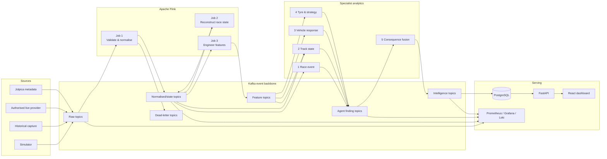

# System architecture

## Overview

PULSE has four execution layers:

1. **Ingestion** preserves source records in raw Kafka topics.
2. **Stream processing** validates, normalises, reconstructs state, and computes features using Flink.
3. **Specialist analysis** runs five independently deployable services communicating through Kafka topics.
4. **Serving** persists revisions and presents API, dashboard, and operational telemetry.

## Runtime boundaries

| Component | Responsibility | Owns durable state? | Reads | Writes |
| --- | --- | --- | --- | --- |
| Source adapter | Convert provider records to the shared envelope; preserve original provenance. | Adapter checkpoints only | Provider/API/capture | `pulse.raw.*` |
| Flink Job 1 | Validate, normalise, deduplicate, attach event-time/watermarks. | Flink state/checkpoints | `pulse.raw.*` | `pulse.norm.*`, `pulse.dlq.*` |
| Flink Job 2 | Reconstruct race, driver, segment, stint, pit-cycle state. | Flink keyed state | `pulse.norm.*` | compacted `pulse.norm.*`, context topics |
| Flink Job 3 | Compute context-conditioned features. | Flink windows/state | normalised state + events | `pulse.features.*` |
| Agent 1 | Maintain race-event lifecycle and event-context findings. | Event state/cache | race control, pit, status | event-agent findings |
| Agent 2 | Classify track state from supported observations. | Segment state/cache | weather, status, sectors, context | track-agent findings |
| Agent 3 | Detect contextual response deviations. | Driver baselines/cache | telemetry, timing, context | vehicle-agent findings |
| Agent 4 | Model stints and pit opportunities. | Driver/stint cache | tyres, laps, pits, context | strategy-agent findings |
| Agent 5 | Assemble evidence and emit revisioned impact assessments. | Correlation state/cache | all specialist findings, driver state | race-impact findings/intelligence |
| Persistence/API | Store immutable events and mutable latest views; provide controlled read/replay operations. | PostgreSQL | intelligence/operational topics | REST/SSE/WebSocket |

No source adapter calls an agent directly. No agent assumes it receives globally ordered events. No individual agent has authority to overwrite a source record.

## Kafka topic catalogue

### Raw ingestion

| Topic | Key | Retention intent | Producer | Purpose |
| --- | --- | --- | --- | --- |
| `pulse.raw.race_control.v1` | `session_id` | append/history | control adapter | Flags, messages, incidents, updates. |
| `pulse.raw.track_status.v1` | `session_id:segment_id` | append/history | track adapter | Track and sector status. |
| `pulse.raw.timing.laps.v1` | `session_id:driver_number` | append/history | timing adapter | Lap and sector records. |
| `pulse.raw.timing.positions.v1` | `session_id:driver_number` | append/history | timing adapter | Position, interval, and gap updates. |
| `pulse.raw.telemetry.car.v1` | `session_id:driver_number` | short/high-volume | telemetry adapter | Speed, throttle, brake, gear, RPM where authorised. |
| `pulse.raw.weather.v1` | `session_id` | append/history | weather adapter | Air/track temperature, wind, humidity, rain. |
| `pulse.raw.tyres.stints.v1` | `session_id:driver_number` | append/history | tyre adapter | Compound, stint age, tyres fitted. |
| `pulse.raw.pit.events.v1` | `session_id:driver_number` | append/history | timing adapter | Pit entry, stop, and exit. |
| `pulse.raw.session_status.v1` | `session_id` | append/history | control adapter | Session lifecycle. |

### Normalised, state, and feature topics

| Topic | Compacted? | Purpose |
| --- | --- | --- |
| `pulse.norm.race_events.v1` | no | Canonical lifecycle events. |
| `pulse.norm.driver_laps.v1` | no | Validated driver lap/sector records. |
| `pulse.norm.driver_state.v1` | yes | Latest known driver race state. |
| `pulse.norm.track_segments.v1` | yes | Latest known segment state. |
| `pulse.norm.tyre_stints.v1` | yes | Latest known driver stint state. |
| `pulse.features.vehicle_response.v1` | no | Rolling pace, telemetry, and baseline deviations. |
| `pulse.features.tyre_stints.v1` | no | Stint and degradation features. |
| `pulse.features.race_context.v1` | no | Event-aligned neutralisation, traffic, and segment context. |

### Agent, intelligence, and operational topics

| Topic | Producer | Consumer | Purpose |
| --- | --- | --- | --- |
| `pulse.agent.event_context.findings.v1` | Agent 1 | Agent 5, API | Race-event findings. |
| `pulse.agent.track_state.findings.v1` | Agent 2 | Agent 5, API | Track-state findings. |
| `pulse.agent.vehicle_response.findings.v1` | Agent 3 | Agent 5, API | Response-deviation findings. |
| `pulse.agent.tyre_strategy.findings.v1` | Agent 4 | Agent 5, API | Strategy findings. |
| `pulse.agent.race_impact.findings.v1` | Agent 5 | output services | Fused assessment findings. |
| `pulse.intelligence.driver_impact.v1` | Agent 5 | API/persistence | Driver-specific current/revisioned impacts. |
| `pulse.intelligence.track_alerts.v1` | Agents 2/5 | API/persistence | Significant track changes. |
| `pulse.intelligence.strategy_alerts.v1` | Agents 4/5 | API/persistence | Pit and tyre opportunities. |
| `pulse.intelligence.race_timeline.v1` | Agent 5 | API/persistence | Unified event/impact timeline. |
| `pulse.ops.agent_health.v1` | all services | operations | Heartbeats, errors, version, lag. |
| `pulse.ops.pipeline_metrics.v1` | all services | operations | Counts, latency, watermark, backpressure. |
| `pulse.dlq.<service>.v1` | any processor | remediation | Invalid or repeatedly failing records. |

### Topic policy

- Use idempotent producers, stable source-event IDs, and consumer group offsets.
- Partition by the key above. Ordering is guaranteed only for a key in a partition.
- Store latest materialised state in compacted topics; store event history/finding revisions as append-only topics.
- Treat Kafka delivery semantics and a database write as separate boundaries. The end-to-end system must demonstrate idempotence rather than claim universal exactly-once behaviour.

## Deployment model

### Local development

Docker Compose will run Kafka-compatible broker(s), schema registry if Avro/Protobuf is adopted, Flink JobManager/TaskManager, PostgreSQL, backend, frontend, Prometheus, Grafana, and Loki. The first code milestone may use a local in-memory event bus behind the same interface for fast unit tests.

### Production target

Use independently scalable containers or Kubernetes workloads only after local throughput and recovery evidence shows it is justified. Scale high-volume telemetry consumers separately from low-volume race-control services. Keep the authorised live adapter isolated from replay/simulator adapters.

## State and persistence

PostgreSQL stores source/capture inventory, run metadata, latest materialised state, finding revisions, assessment revisions, replay state, operational events, and test/evaluation results. Raw immutable captures belong in versioned object storage or an explicitly retained Kafka/source archive; PostgreSQL is not the sole historical-record system.

Suggested logical tables:

| Table | Primary key / uniqueness | Notes |
| --- | --- | --- |
| `captures` | `capture_id` | Provenance and licence evidence. |
| `runs` | `run_id` | Mode, speed, session instance, source/capture selection. |
| `source_events` | `event_id` | Immutable envelope receipt/outcome. |
| `driver_state_current` | `session_instance_id, driver_number` | Latest materialised state. |
| `findings` | `finding_id, finding_version` | Immutable specialist revision chain. |
| `impact_assessments` | `assessment_id, assessment_version` | Immutable fusion revision chain. |
| `replay_checkpoints` | `run_id, checkpoint_sequence` | Resume/reconciliation support. |
| `evaluation_runs` | `evaluation_run_id` | Dataset, config hash, metrics, artefacts. |

## Security and governance boundaries

- Credentials for licensed data providers must be stored in a secret manager or local `.env`, never in source control or emitted to topics.
- Persist source licences, access restrictions, capture hashes, acquisition time, and transformation chain alongside each approved capture.
- Set role-based access for replay control and live-provider configuration.
- Separate customer/user identity data from race data if user accounts are later added.
- Retain a data-deletion and source-withdrawal procedure before carrying licensed live data.

