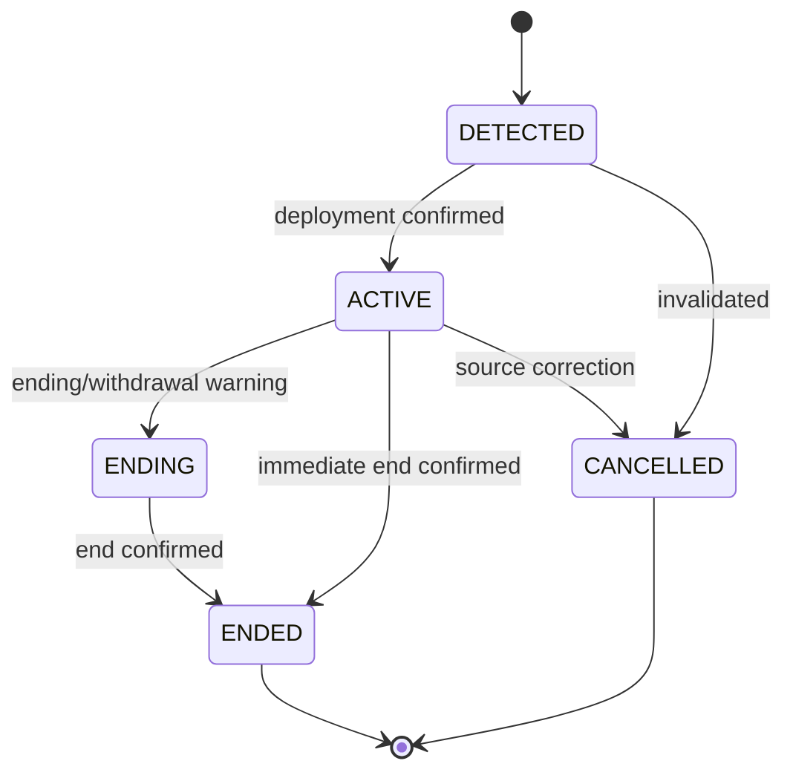
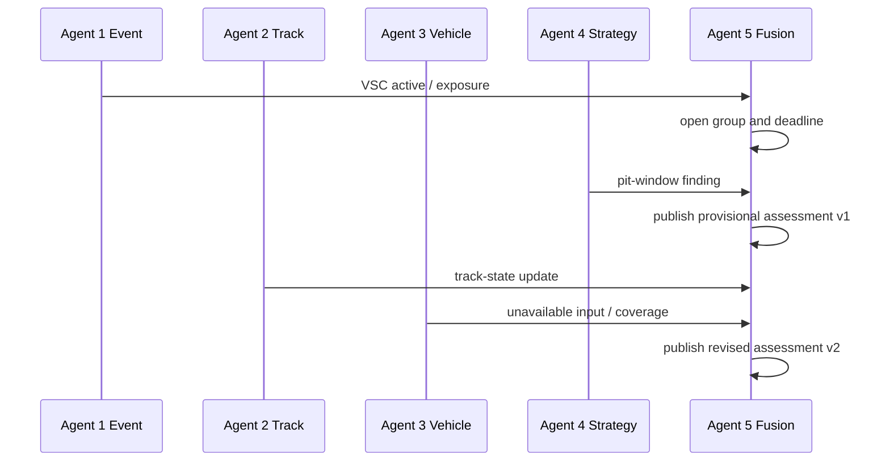

# Stream processing and agent design

## Processing responsibilities

Flink owns temporal correctness and state reconstruction. Specialist agents own bounded analytical interpretation. This keeps event-time logic out of ad hoc service code and prevents a Flink job from becoming five hidden agent implementations.

## Flink Job 1: ingestion normalisation and validation

**Input:** every `pulse.raw.*.v1` topic.

**Responsibilities:**

- validate envelope and payload fields against the current schema;
- map source-specific session, driver, segment, and event IDs to canonical IDs;
- normalise units while preserving original value/unit in transformation metadata when converted;
- deduplicate by stable event/source identity;
- assign event-time timestamps and source-specific bounded watermarks;
- identify invalid, incomplete, and unsupported records;
- route malformed/repeatedly failing input to the correct dead-letter topic;
- produce canonical events without modifying source event time.

**Outputs:** `pulse.norm.race_events.v1`, `pulse.norm.driver_laps.v1`, and canonicalised source-specific streams/state updates.

**State:** deduplication keys, provider mapping references, schema version metrics, and watermarks.

## Flink Job 2: race-state reconstruction

**Input:** canonical events from Job 1.

**Keyed state domains:**

| Domain | Key | Latest attributes |
| --- | --- | --- |
| Driver race state | `session_id:driver_number` | position, gap, interval, lap, sector, stint, tyre, race context, data freshness. |
| Track segment state | `session_id:segment_id` | status, weather-linked observations, latest update, coverage. |
| Tyre/stint state | `session_id:driver_number:stint` | compound, age, start/end, pace history summary. |
| Race event state | `session_id:event_id` | control type, lifecycle, scope, source refs, active/ending time. |
| Pit-cycle state | `session_id:driver_number:pit_visit` | entry/stop/exit and associated tyre/pit cost context. |

**Behaviour:** State records are materialised to compacted topics. Event histories remain append-only. A new position update never erases the historical evidence it supersedes.

## Flink Job 3: streaming feature engineering

**Input:** state and canonical events. **Output:** feature topics.

Feature families:

| Feature family | Inputs | Windowing | Caveat |
| --- | --- | --- | --- |
| Pace deviation | laps/sectors, driver baseline, traffic, neutralisation | lap-based/event-aligned | Do not compare green-flag and VSC pace as the same baseline. |
| Vehicle response | telemetry where present, sector/timing | event-time sliding | Output missing/unsupported when telemetry is absent. |
| Stint performance | compound, age, laps, pit cycle | lap/stint-based | Separate tyres, traffic, and neutralisation factors when possible. |
| Track change | weather/status/segment observations | event-time change detection | Do not assert direct grip measurement from lap times alone. |
| Event context | race control, driver location/state, pit window | event-aligned | Keep event lifecycle version and affected-scope evidence. |

The window duration is a source configuration, not a global constant. High-frequency telemetry, sector timing, weather, and lap data have different cadences.

## Agent interface

Every agent follows the same service interface:

```text
subscribe(topics, consumer_group)
  -> validate contract compatibility
  -> load bounded state / cache
  -> process event deterministically
  -> emit 0..n revisioned Finding records
  -> emit heartbeat, latency, errors, and input coverage metrics
```

Agent input subscriptions are independent. Agents 1–4 never wait for one another. Agent 5 maintains a correlation buffer with bounded deadlines.

## Agent 1: Race Event & Control Intelligence

**Purpose:** Establish what event happened, its lifecycle, scope, and association with nearby pit/incident activity.

| Element | Design |
| --- | --- |
| Inputs | race-control messages, session status, track status, pit events, event context. |
| State | canonical event ID, lifecycle, control type, scope, source refs, related pits/incidents, update time. |
| Method | Deterministic state machine plus message-to-event mapping configured per provider. |
| Outputs | `RACE_EVENT_LIFECYCLE`, `DRIVER_EVENT_EXPOSURE`, `PIT_EVENT_ASSOCIATION`. |
| Guardrails | Does not invent sporting categories or infer unreported flags. |

### Lifecycle state machine



An illegal transition does not overwrite the state. It emits a review/error finding with the competing source evidence.

## Agent 2: Track-State Intelligence

**Purpose:** Describe local track condition from observations and distinguish direct observation from inference.

| Element | Design |
| --- | --- |
| Inputs | weather, track status, circuit geometry, sector timing, vehicle-derived observations if authorised, race context. |
| State | segment condition label, observation freshness, measurement list, trend, coverage, source consistency. |
| Method | Rule-based initial classifier + change-point detection; temporal model only after labelled data exists. |
| Outputs | `TRACK_CONDITION_STATE`, `TRACK_TRANSITION`, `OBSERVATION_INCONSISTENCY`. |
| Guardrails | Labels direct observations as `OBSERVED`; any performance-derived hypothesis is `INFERRED` and never called measured grip. |

Initial labels: `DRY`, `DAMP`, `WET`, `DRYING`, `UNKNOWN`. Segment scope remains `UNKNOWN` when the source only has session-wide status.

## Agent 3: Vehicle-Response Intelligence

**Purpose:** Identify driver-specific deviation from a context-conditioned baseline.

| Element | Design |
| --- | --- |
| Inputs | telemetry, positions, lap/sectors, track finding/context, tyre/stint state, race event context. |
| State | driver baseline distributions by race context, recent anomalies, data freshness, confounders. |
| Method | Baseline regression/anomaly score with factors for tyre age, traffic, neutralisation, lap phase, and track condition. |
| Outputs | `PACE_DEVIATION`, `TELEMETRY_RESPONSE_DEVIATION`, `RESPONSE_REQUIRES_REVIEW`. |
| Guardrails | Never label an observed speed drop as a mechanical failure or driver error. |

Suggested initial calculation:

```text
deviation = observed_sector_or_telemetry_feature - expected(feature | driver, tyre_age, traffic, race_state, segment, track_state)
```

Publish only when the baseline has enough comparable evidence. If the model cannot isolate confounders, emit a lower-coverage review finding rather than a high-confidence anomaly.

## Agent 4: Tyre & Strategy Intelligence

**Purpose:** Estimate contextual stint change and compare pit alternatives under current race conditions.

| Element | Design |
| --- | --- |
| Inputs | tyres/stints, laps/sectors, pits, positions/intervals, weather/track context, race-event findings. |
| State | per-driver stint history, degradation estimate, pit cycle, candidate strategy alternatives. |
| Method | Deterministic cost model first; regression/forecasting after sufficient labelled replay data. |
| Outputs | `STINT_DEGRADATION_ESTIMATE`, `PIT_WINDOW_OPPORTUNITY`, `STRATEGY_SCENARIO`. |
| Guardrails | Describes a modelled opportunity/estimated cost, not an instruction to pit. |

### Initial deterministic strategy model

For each driver and candidate pit lap, calculate:

```text
scenario_cost = pit_lane_loss(race_state)
              + traffic_loss(estimated_gap, target_pack)
              + projected_stint_pace_loss(compound, age, condition)
              - neutralisation_saving(event_state)
```

All component estimates include `source_available` and `assumption` flags. A partial input results in a wider output range rather than a fabricated point estimate.

## Agent 5: Race Consequence & Forecast Intelligence

**Purpose:** Fuse evidence into a coherent, driver-specific assessment and update it as delayed specialists publish findings.

| Element | Design |
| --- | --- |
| Inputs | findings from Agents 1–4, driver state, race context, event-time history. |
| State | correlation group by trigger event/driver, required vs optional input flags, deadline, latest assessment revision. |
| Method | Deterministic rules and bounded aggregation, optionally calibrated forecasting model. |
| Outputs | `DRIVER_RACE_IMPACT`, `RACE_IMPACT_REVISION`, `UNRESOLVED_IMPACT`. |
| Guardrails | No unconstrained LLM race-outcome decisions. State evidence and unavailable inputs explicitly. |

### Asynchronous fusion algorithm

1. Agent 1 emits a lifecycle/exposure finding or a material state change creates a correlation group.
2. Agent 5 opens an event/driver group with a configurable deadline and minimum evidence policy.
3. It publishes a partial `PROVISIONAL` assessment when the minimum evidence is met or the first deadline expires.
4. Later compatible findings update coverage, forecast ranges, and explanation; Agent 5 emits a superseding revision.
5. At finalisation time it emits `CONFIRMED`, `UNRESOLVED`, or `WITHDRAWN` based on available evidence and lifecycle status.
6. A finding received beyond its correction window creates an explicit late-data/revision path, never a hidden state mutation.



## Event-time handling

- Use Flink event time and bounded out-of-orderness per source. Configure idleness to avoid an idle partition holding back global watermark progress.
- Preserve source `event_time_utc` through every transformation. Never replace it with wall-clock time.
- A replay has separate pacing controls: speed multiplier, pause/resume, seek/restart policy, and a `replay_clock_ms` field.
- Each source adapter declares expected lateness. This configuration is persisted with the run, so evaluation is reproducible.
- Concurrent sessions use distinct `session_instance_id` and consumer groups.

## Agent health contract

Each service emits a heartbeat to `pulse.ops.agent_health.v1` every configurable interval:

```json
{
  "agent_id": "tyre_strategy_agent",
  "instance_id": "strategy-7f8bb7",
  "run_id": "pulse-replay-001",
  "status": "HEALTHY",
  "last_processed_event_time_utc": "2026-06-07T14:30:10Z",
  "consumer_lag": 0,
  "finding_latency_ms_p95": 180,
  "model_version": "1.0.0",
  "emitted_at_utc": "2026-11-04T10:00:00Z"
}
```

Statuses: `STARTING`, `HEALTHY`, `DEGRADED`, `UNHEALTHY`, `STOPPING`. An agent crash affects input coverage, not the integrity of other agents' findings. Fusion can issue an `UNRESOLVED` assessment when an agent is unavailable past its deadline.

