# CALIBRE / PULSE — Current System Architecture

**Status:** Static implementation description, 22 November 2026.
**Source of truth:** Code referenced below. Proposed design is deliberately separated in [ROADMAP.md](ROADMAP.md).

## What currently executes

```text
Capture JSONL / simulator / external producer
        |
        v
  raw PULSE topic or local dispatch
        |
        v
StreamNormalizer (Pydantic validation + process-local event-id set)
        |
        +-- race_events ------> EventControl, TrackState, TyreStrategy, Integrity
        +-- driver_laps ------> VehicleResponse, Integrity
        +-- driver_state -----> VehicleResponse, TyreStrategy, Integrity
        +-- track_segments ---> TrackState, Integrity
        |
        v
PULSE finding topics -> ConsequenceFusion -> driver-impact topic -> in-memory StateStore -> REST/SSE
                                    |
                                    +-> SIA IntegrityAgent emits separate integrity findings
```

The local dispatch path is configured in [backend/pulse/main.py](../backend/pulse/main.py). In `KAFKA` mode, raw events are published and the backend consumes normalised topics; in `SIMULATOR`/`MEMORY` mode it invokes the same Python handlers in-process. This is operationally useful but is not equivalent to a durable distributed execution model.

## Components and actual responsibilities

| Component | Evidence | Current role | Important limitation |
|---|---|---|---|
| SIA evaluator | `sia_core_v3/sia_core/evaluator.py` | Deterministic calculation over an in-memory ledger, contract, decision instance and explicit evaluation instant. | The ledger and assessment index are process-local; no active backend path writes its admission log or SIA state durably. |
| SIA engine | `sia_core_v3/sia_core/engine.py` | Opens instances, admits atoms/facts/guards, creates revision chains and seals final decisions. | Post-finality material is logged after it has already been admitted to the ledger, rather than physically quarantined. |
| CALIBRE archetypes | `calibre_core/agents/` | A1–A5 emit atom-shaped observations and diagnostics. | They are not wired into `backend/pulse/main.py`; their default-input fallbacks and wall-clock diagnostic timestamps violate their advertised pure-agent boundary. |
| PULSE agents | `backend/pulse/agents/` | Rule/threshold based tactical findings and a fusion layer. | They contain fixed baselines, default values and narrative recommendations; none is an ML model or an LLM-driven specialist. |
| Integrity bridge | `backend/pulse/integrity/` | Maps selected normalised PULSE events into five SIA contracts. | Contracts do not match the C01–C13 catalogue; key reference facts and scope fields are never sourced in the live path. |
| Normalizer | `backend/pulse/stream/normalizer.py` | Schema validation, topic routing and event-ID deduplication. | Deduplication is an unbounded in-process set; no content validation, source-specific schema versioning, event-time watermark or durable dedup key. |
| Kafka client used by app | `backend/pulse/stream/kafka_client.py` | Produce/consume PULSE records. | Creates missing topics with one partition/RF=1 and consumes with auto commit; no idempotent producer, schema registry, DLQ, transaction or application-level EOS. |
| Kafka utilities not wired to app | `backend/pulse/stream/kafka_io.py` | Richer topic catalogue, idempotent producer, consumer and transactional processor. | Referenced by dedicated tests/benchmarks, not imported by the active application topology. |
| Replay | `backend/pulse/replay/` | Playback and seek by resetting in-memory components then replaying capture envelopes. | Run IDs are random, no persisted checkpoints/offsets/agent snapshots, and replay reconstruction differs from Kafka live processing. |
| Serving state | `backend/pulse/state/store.py` | Process-local cockpit projection and bounded SSE fan-out. | It is not a bitemporal ledger or durable state store; several projector defaults are synthetic. |

## SIA decision lifecycle as implemented

```mermaid
stateDiagram-v2
    [*] --> OPEN: open_decision / auto_open
    OPEN --> OPEN: admit evidence/fact/guard; evaluate or tick
    OPEN --> FINAL: every role reaches cutoff
    OPEN --> VOIDED_FINAL: void_decision
    FINAL --> FINAL: evaluate returns sealed assessment
    VOIDED_FINAL --> VOIDED_FINAL: evaluate returns sealed assessment
    FINAL --> POST_FINALITY_LOGGED: later matching item admitted
    POST_FINALITY_LOGGED --> FINAL
```



`OPEN`, `FINAL`, and the special voided final state are engine lifecycle states; `UNKNOWN`, `DEGRADED`, `SUSPECT`, and `HEALTHY` are integrity values on validity timelines, not lifecycle states. An open role becomes `DEGRADED` at its deadline if no usable evidence exists; a decision becomes final only after every role's deadline plus allowed lateness. Invalid transitions are only partly protected: evaluation time cannot regress per in-memory engine, but concurrent calls and restart recovery are not synchronised or persisted.

## Determinism boundary

The SIA evaluator itself is designed to be deterministic given its in-memory inputs and explicit `K`. The full PULSE pipeline is not reproducible as a whole: ingestion time defaults to wall clock, replay and findings use UUIDs, PULSE agents use mutable in-memory state and defaults, and Kafka/live replay do not share a persisted admission log. Any claim stronger than “kernel-level deterministic under identical admitted inputs” requires runtime validation and redesign.

## Proposed architecture boundary

Do not treat the following as current implementation: a sequenced durable admission log, a single Kafka topology with transactional stages, checkpointed state reconstruction, or LLM/ML-assisted specialists. Those are proposals in [ROADMAP.md](ROADMAP.md).
