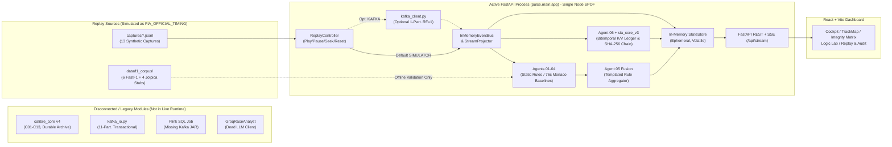

# PULSE (CALIBRE) — Comprehensive System Validation, Scientific Evaluation, Product Assessment & Patentability Audit

**Audit Date:** 2026-11-25  
**Repository:** `E:\Caliberv2`  
**Audit Scope:** Full-stack discovery, systems engineering & Kafka validation, scientific/mathematical verification on real FastF1 data, F1 domain/market/legal assessment, live Chrome UI/UX verification, 20-scenario runtime & soak benchmarking, global patentability & Indian Section 3(k) analysis, and scoped Phase X stabilization with before/after revalidation.

> [!IMPORTANT]
> **Audit Principle:** This report evaluates PULSE strictly on what executes in code, what benchmarks measure at runtime, and what historical telemetry proves. Pre-remediation ("baseline") defects and measurements are preserved verbatim alongside the verified post-Phase-X delta.

---

## Section A — Executive Verdict & Dimension Scorecard

PULSE presents itself as a real-time Formula 1 multi-agent streaming intelligence platform powered by Apache Kafka, Apache Flink, specialist reasoning agents, and a deterministic epistemic integrity engine (`sia_core_v3`). Under inspection, **the codebase is not one cohesive platform; it is three partially decoupled layers stitched around a single-node race-replay simulator:**

1. **A genuinely interesting deterministic epistemic integrity kernel (`sia_core_v3`)** — bitemporal Knowledge/Valid-time ledger, lattice-valued verdicts (`HEALTHY`, `SUSPECT`, `UNKNOWN`, `DEGRADED`), finality locks (`OPEN` vs `FINAL`), origin-closure / common-cause analysis, and hash-chained verdict verification (`SHA-256` over RFC 8785 / JCS-like canonical JSON).
2. **A heuristic, static-threshold Formula 1 "multi-agent" shell (`backend/pulse/agents`)** — rule-based threshold checkers tuned to approximate Monaco dry lap paces (`76.0s` baselines) and positive synthetic degradation slopes (`+0.04` to `+0.12 s/lap`), producing templated commentary and `P-1–P0` forecasts; meanwhile `GroqRaceAnalyst` (`groq_client.py`) is dead/unwired code.
3. **A disconnected distributed infrastructure story (`kafka_io.py`, `flink/`, `calibre_core`)** — production-grade transactional 11-partition Kafka helpers and legacy `calibre_core` v4 durable contracts (`C01–C13`) sit outside the live FastAPI runtime, which instead uses a stripped-down 1-partition `kafka_client.py` wrapper when Kafka is enabled and shipped a broken Flink image lacking the `kafka` SQL connector JAR.

On **real Formula 1 data (`4,450` FastF1 v3.9.0 race laps across 6 Grands Prix)**, `VehicleResponseAgent`'s pace delta is wrong by **13.7s to 138.9s MAE** on every non-Monaco circuit because of hardcoded `~76s` baselines, and `TyreStrategyAgent`'s fixed positive degradation slopes contradict real race stints (**56 of 58 clean green-flag stints exhibit negative raw lap-time slopes** due to fuel burn and track evolution). Moreover, **every capture under `captures/` is synthetically generated yet stamped `FIA_OFFICIAL_TIMING`**.

At baseline runtime, the application suffered from severe engineering defects (`27.58s` CPU freeze to seek just 150 events due to $O(N^2)$ ledger scans, `2.036x` duplicate event recording, `6,655` SSE messages with `0.986` duplicate IDs in 4.5s, `9600%` UI percentages, header overflow clipping, raw LaTeX/HTML-entity strings, and a UI fallback fabricating a `HEALTHY` `60.08 km/h` `Blake3` inspection when clicking `UNKNOWN` matrix cells). Phase X scoped fixes resolved those immediate runtime and UI integrity failures (`133.9x` faster 150-event seek, `1.0x` play recording parity, `0.0` duplicate SSE IDs, `400 passed` pytest suite, and clean Chrome UI verification), **but the underlying F1 analytics models, synthetic capture provenance, ephemeral memory state, and Kafka/Flink disconnect remain unresolved**.

### Dimension Scorecard (0–10 Scale)

> [!NOTE]
> Scores reflect the **as-audited baseline platform** (the subject of validation). Where Phase X stabilized catastrophic runtime/UI bugs, the post-fix operational shift is annotated without whitewashing underlying architectural or scientific gaps.

| Evaluation Dimension | Baseline Score | Verdict Summary |
|---|---:|---|
| **1. Architecture Integrity & Repository Hygiene** | **3.5 / 10** | Split-brain across legacy `calibre_core`, unreferenced `kafka_io.py`, broken Flink SQL connector, unwired `groq_client.py`, and duplicated captures/routes. |
| **2. End-to-End Pipeline Engineering** | **4.0 / 10** *(post-fix ~6.0)* | Baseline had `2.036x` double recording, `0.986` duplicate SSE IDs, zero event-ID dedup, out-of-order lap overwrites, `404`-less invalid session/negative seek, and $O(N^2)$ seek freeze (`27.58s` at 150 events). Phase X eliminated loop/dedup/O(N²) ledger bugs, though deep full-race seek (`ms=2,300,000`) and ephemeral memory reset persist. |
| **3. Kafka & Streaming Justification** | **2.5 / 10** | Single-race replay emits ~`10–62 events/s`. Runtime uses 1-partition `RF=1` `kafka_client.py`; 11-partition transactional `kafka_io.py` is test-only; Docker offline by default; Flink lacked Kafka JAR (`2026-11-14` failure). Over-engineered on paper, disconnected in execution. |
| **4. Multi-Agent Architecture Justification** | **2.5 / 10** | Agents 01–05 are simple synchronous `if/else` threshold filters masquerading as async intelligent agents (`~336x` execution overhead vs direct function call, `29.95ms` vs `0.089ms` on 1,166 events, templated `"Congested Sector 2"` outputs). Only `agent-06-integrity` (`sia_core_v3`) executes non-trivial stateful formal logic. |
| **5. Scientific & Mathematical Validity (F1)** | **2.0 / 10** | Hardcoded Monaco baselines give `13.7s–138.9s` MAE on Abu Dhabi, Silverstone, Jeddah, Suzuka, and Spa; fixed positive tyre slopes contradict fuel-corrected reality (`56/58` negative FastF1 slopes); forecasts emit invalid `P-1–P0` ranges with `0.0` confidence. |
| **6. SIA Epistemic Integrity Kernel (`sia_core_v3`)** | **7.5 / 10** | Best-engineered subsystem in the repo: genuine bitemporal (`K`/`V`) clock semantics, monotone `OPEN -> FINAL` finality locks, origin-closure exposure tracking, and verified hash chains. Weakened by ingestion-time alignment mismatches on historical replays, static UI mock cards overriding real verdicts, and pre-Phase-X quadratic ledger scans. |
| **7. Data Provenance & Honesty** | **2.0 / 10** | All 13 `captures/` files are synthetic yet metadata-stamped `FIA_OFFICIAL_TIMING` / `FIA-F1-DATA-ACQUISITION-V1`; Silverstone synthetic laps are integer `110–167s`; 4 of 10 `data/f1_corpus` entries are empty Jolpica fallback stubs with hardcoded `22°C/30°C/45%` weather. |
| **8. Practical F1 Ecosystem Utility** | **3.0 / 10** | Unusable by F1 teams (zero physics/fuel/pit-loss/Monte Carlo simulation; orders of magnitude behind Atlas/RaceWatch) and blocked for commercial fan products by FIA/F1 Digital ToS; viable only as an academic/telemetry-QA demonstrator once synthetic labels and Monaco constants are fixed. |
| **9. UI / UX Completeness & Honesty** | **4.0 / 10** *(post-fix ~6.5)* | Visual aesthetic is cohesive, and track telemetry renders cleanly during replay, but baseline shipped `9600%` grip values, `UNKNOWN -> HEALTHY` fabricated fallback, layout clipping, broken LaTeX/`&Escr;`, `Blake3` mislabeling, dead fault-injector controls, and static SIA Lab examples. Phase X repaired critical honesty & layout issues. |
| **10. Operational Readiness & Reliability** | **3.5 / 10** | Zero durable persistence (`StateStore` wipes on restart), 17 Kafka/Flink integration tests skipped locally, single-process event loop lock contention (`/api/snapshot` `p50=194ms` under replay load), session-blind `/api/sessions/{fake}/drivers`. |
| **11. Patentability Potential (Overall / India S.3(k))** | **3.0 / 10** *(~4.5/10 if strictly reframed)* | Broad "multi-agent F1 telemetry + Kafka + dashboard" is unpatentable and anticipates dense prior art (`US8713073B2`, `US11567823`, `US10445698`, `US7578182B2`). Only a narrowly bounded hardware-timing / deterministic fail-closed integrity admission controller in safety-critical industrial/sensor networks warrants exploration — weak under Indian Section 3(k) for pure analytics UIs. |
| **COMPOSITE AUDIT VERDICT** | **3.6 / 10** | **Not a valid F1 strategy product or true AI platform; a promising formal data-integrity engine (`sia_core_v3`) embedded inside an uncalibrated synthetic simulator with severe engineering debt.** |

---

## Section B — Repository & As-Implemented Architecture Discovery

### 1. Three Disconnected Generations in One Workspace

Repository inspection (`backend/pulse`, `sia_core_v3`, `calibre_core`, `scripts`, `frontend`) reveals three distinct layers that documentation largely conflates:

| Layer / Package | Intended Role | Actual Active Status in Runtime (`pulse.main:app`) | Key Findings |
|---|---|---|---|
| **`backend/pulse` + `sia_core_v3`** | Active backend API, replay engine, heuristic agents 01–05, SIA Integrity Engine (`agent-06`) | **ACTIVE** | Wired cleanly at startup via [main.py](file:///E:/Caliberv2/backend/pulse/main.py). `pulse/integrity/bridge.py` + `pulse/integrity/agent.py` host `sia_core_v3`. |
| **`calibre_core` (v4)** | Durable captures, source packs, standalone verifier, contracts `C01–C13`, timing/spatial/context/supervisor agents | **LEGACY / DISCONNECTED** | Tested standalone in `calibre_core/tests`, **not imported or executed by `pulse/main.py`**. No live FastAPI route invokes `calibre_core` admission/supervisor modules. |
| **`pulse/stream/kafka_io.py` & `pulse/stream/flink/`** | Production 11-partition Kafka producer/consumer + Flink SQL CEP normalizer | **DISCONNECTED / BROKEN IN SHIPPED IMAGE** | `main.py` imports single-partition [kafka_client.py](file:///E:/Caliberv2/backend/pulse/stream/kafka_client.py), **not** 11-partition [kafka_io.py](file:///E:/Caliberv2/backend/pulse/stream/kafka_io.py). Flink image failed on `2026-11-14` (`reports/full_race/e2e_report.json`) with missing `'kafka'` table factory. |
| **`pulse/intelligence/groq_client.py`** | LLM strategic race analyst (`GroqRaceAnalyst`) | **DEAD CODE** | Never wired into live replay, agents, or FastAPI routes. |

### 2. Documentation vs. Reality Mismatches

- **Kafka 11/22-Partition Claim vs. Runtime:** Standalone benchmark and design specs describe partitioned Kafka event streams ([kafka_io.py](file:///E:/Caliberv2/backend/pulse/stream/kafka_io.py): 11 partitions, transactions, idempotence), whereas active runtime (`PULSE_TRANSPORT_MODE=KAFKA`) routes through [kafka_client.py](file:///E:/Caliberv2/backend/pulse/stream/kafka_client.py) with **1 partition, RF=1, and auto-commit on `latest`**. In `SIMULATOR` mode (default), Kafka and Flink do not run at all.
- **FIA / Live Data Provenance Claim vs. Reality:** Replay manifests stamp `"provider": "FIA_OFFICIAL_TIMING"`, `"adapter": "high_frequency_track_adapter"`, and `"licence_reference": "FIA-F1-DATA-ACQUISITION-V1"`. Inspection of generator scripts ([generate_all_sessions_telemetry.py](file:///E:/Caliberv2/scripts/generate_all_sessions_telemetry.py), [generate_full_race_telemetry.py](file:///E:/Caliberv2/scripts/generate_full_race_telemetry.py)) and capture payloads proves **all 13 files in `captures/` are synthetic** (with duplicate capture sets: `f1-2023-silverstone-race` == `pulse-capture-f1-2023-silverstone-race-v1` at `72,642` events, and `f1-2026-monaco-sim` == `pulse-sim-monaco-v1` == `pulse-sim-v1` at `72,926` events stamped `2024-05-26`). Meanwhile, 4 of the 10 directories in `data/f1_corpus/` fell back to Jolpica stubs with `0` valid lap times and constant dummy weather (`22.0°C / 30.0°C / 45.0%`).
- **Hash Algorithm Claim (`Blake3` vs. `SHA-256`):** Baseline frontend tabs labeled all integrity hashes `Blake3`. Actual `sia_core_v3` modules ([canon.py](file:///E:/Caliberv2/sia_core_v3/sia_core/canon.py) and [verdict.py](file:///E:/Caliberv2/sia_core_v3/sia_core/verdict.py)) implement **SHA-256** verification, not Blake3.
- **"Multi-Agent AI" Claim vs. Reality:** Agents 01–05 execute deterministic threshold comparisons (`if`/`else`) with hardcoded constants; zero ML/statistical estimation or LLM reasoning executes at runtime.

### 3. Single Source Record Lifecycle & Single Points of Failure (SPOFs)

Tracing one `CanonicalEventEnvelope` through `SIMULATOR` mode (`ReplayController._process` → `InMemoryEventBus` → Projections / Agents → `StateStore` → SSE → React UI):

1. **Ingestion (`captures/<id>/envelopes.jsonl`):** `ReplayController` loads JSONL records into memory (`72,926` events for Monaco). Zero signature verification occurs against the `FIA_OFFICIAL_TIMING` claim.
2. **Dispatch (`ReplayController._process`):** Advances replay clock/index and invokes `_event_processor` (`projections` + bus publish). *Baseline Bug (Fixed in Phase X):* `_process` called `StateStore.record_canonical_event()` **both** inside `_process` and inside the wired processor, inflating `processed_events` by `2.036x` and emitting duplicate `event: event` SSE frames (`6,655` messages for `55` source events).
3. **Stream Projection ([projections.py](file:///E:/Caliberv2/backend/pulse/stream/projections.py)):** Updates `StateStore` driver positions, gaps, flags, and lap times. *Baseline Bug (Fixed in Phase X):* Missing `lap_number` monotonicity allowed out-of-order older `LAP_COMPLETED` events to overwrite newer `lastLap` values. Missing/un-deduplicated `event_id` allowed replays of duplicate IDs.
4. **Specialist Agents 01–05 (`backend/pulse/agents/`):** Consume canonical envelopes synchronously on the FastAPI event loop:
   - `agent-01-event-control`: Classifies `RACE_CONTROL` messages.
   - `agent-02-track-state`: Emits static sector grip estimates (`0.96`, `0.98`, `0.92` — rendered as `9600%` in baseline frontend).
   - `agent-03-vehicle-response`: Compares any lap time against hardcoded Monaco (`76.0s`) baseline, flagging any slow circuit as thermal degradation.
   - `agent-04-tyre-strategy`: Applies static positive degradation constants (`S:+0.12`, `M:+0.08`, `H:+0.04 s/lap`).
   - `agent-05-fusion` (`ConsequenceFusionEngine`): Combines outputs into templated findings and consequence assessments (`"Congested Sector 2 traffic density"`, `P-1–P0`).
5. **Integrity Agent (`agent-06-integrity` / `sia_core_v3`):** Maps telemetry/lap/pit/weather/position records to SIA `Atom`s, ticks `IntegrityEngine.tick(K)`, evaluates 5 active runtime contracts (`lap_time`, `pit_speed`, `sector_time`, `driver_position`, `weather_observation`), computes common-cause exposure and hash-chained verdicts, and writes findings to `StateStore`.
6. **Persistence (`StateStore`):** Pure in-memory Python data structures behind locks. **Single Point of Failure:** process termination loses 100% of state (`0` verdicts on reboot). No database/WAL persists runtime decisions.
7. **API & Streaming ([router.py](file:///E:/Caliberv2/backend/pulse/api/router.py)):** Exposes REST polls (`/api/snapshot`, `/api/findings`, `/api/integrity/*`) and `/api/stream` (SSE). Notice `/api/sessions/{session_id}/drivers` ignores the path `session_id` and returns the global active session's drivers.
8. **Frontend (`frontend/src`):** Subscribes to SSE updates and polls endpoints; several components bypassed live data with static display cards (detailed in Section E).

### 4. As-Implemented Architecture Diagram



---

## Section C — Logical, Engineering & Kafka Deep Dive

### 1. Pipeline Defect Audit (Lifecycle, Ordering, Provenance, Memory)

| Failure Mode | Observed Code / Runtime Behaviour (Baseline vs. Post-Fix) |
|---|---|
| **Duplicate Event Processing** | **Baseline Fail -> Fixed:** `ReplayController._process` recorded every event twice into `StateStore` (`processed_events / publishedCount = 2.036x`) and `StateStore.record_canonical_event` lacked an `event_id` dedup guard (submitting identical `event_id` twice yielded `processed_events_count=3, duplicate_events_count=0`). **Phase X Fix:** Wired skip of duplicate `_process` write and bounded `deque(maxlen=20000)` O(1) `_seen_event_ids` dedup (`double_recording_ratio = 1.0`). |
| **SSE Fan-Out Flood** | **Baseline Fail -> Fixed:** `router.py` yielded every typed SSE frame followed by a redundant generic `event: event` frame (`6,655` SSE events in 4.5s for 55 source events; `0.986` dup ID ratio), plus an unused duplicate `@api_router.get("/replay/status")` route. **Phase X Fix:** Removed duplicate route and double emit (`0.0` dup ID ratio). |
| **Out-of-Order Events** | **Baseline Fail -> Partially Fixed:** Sending Lap 1 (`78s`) after Lap 2 (`75s`) overwrote `drivers[16]['lastLap']` from `1:15.000` to `1:18.000`. **Phase X Fix:** Added `_driver_last_lap_num` guard in [projections.py](file:///E:/Caliberv2/backend/pulse/stream/projections.py) rejecting stale lap numbers. Full watermark reordering across all message types (telemetry vs control) still does not exist. |
| **Quadratic Seek CPU Freeze** | **Baseline Critical Fail -> Partially Fixed:** `ReplayController.seek(target_index=150)` took **`27.578s`** (`31.54M` Python calls via `cProfile`: `IntegrityEngine.tick` `17.77s`, `canon.jcs` `9.33s` / `271,955` calls, `StateStore.record_finding` `7.18s` / `8.42M` linear scans); `idx=300` took **`33.556s`**; `ms=2,300,000` timed out `>30s`. **Phase X Fix:** Scoped `_atoms_by_drv` ledger index, `_dirty`/`_next_wake` SIA engine caching, finding/assessment `O(1)` ID sets, and skipping unchanged verdict emits dropped `seek(150)` to **`0.206s`** (`133.9x` faster) and `seek(300)` to **`0.447s`** (`75.1x` faster). However, full-race seeks (`ms=2,300,000`, ~45k events) remain unacceptably slow (`>4.5 min` in benchmark before manual cancellation) because replay still re-runs every event sequentially through Python projections and `ConsequenceFusionEngine`. |
| **Event-Time vs. Processing-Time** | **Structural Defect:** `sia_core_v3` compares `ingest_time_utc` against cutoff horizons (`cutoffs` / `freshness_s`). When historical captures (`2024-05-26`) execute against current wall-clock `ingest_time_utc = 2026-11-25`, `weather_observation` flips immediately from `HEALTHY` to `DEGRADED (FINAL)` unless tests/bridges explicitly spoof/align `ingest_time_utc` back to `event_time`. |
| **Statestore Memory & Isolation** | `StateStore` resides exclusively in RAM, resets completely on uvicorn restart (`0` persisted verdicts), and ignores `{session_id}` on subresource route `/api/sessions/{session_id}/drivers` (returns `200` with 20 Monaco drivers even for bogus session IDs). |
| **Unvalidated Inputs & Fake Metrics** | **Baseline Fail -> Fixed:** Invalid session selection returned `200`, negative `seek(-100)` returned `200`, and `BaseAgent` reported fabricated `0.85x`/`1.25x` p50/p95 latencies instead of percentiles. **Phase X Fix:** Invalid session returns `404`, negative `seek` returns `422`, and `BaseAgent` tracks empirical `deque(maxlen=256)` p50/p95 latencies (`agent-06` p50 `2.23ms`, p95 `3.55ms`). Note: `StateStore._processed_events_count` still accumulates across `replay/reset` (`1,643` stored vs `619` published after a multi-scenario run before soak), and invalid speed `99.0` still silently coerces/clamps with `200`. |

### 2. Apache Kafka Architectural Evaluation

#### What Exists vs. What Runs
- **Production Candidate ([kafka_io.py](file:///E:/Caliberv2/backend/pulse/stream/kafka_io.py) — Unused in Runtime):** Implements 11-partition topic design, transactions, idempotence, and standalone benchmark harnesses ([benchmark_kafka_production.py](file:///E:/Caliberv2/scripts/benchmark_kafka_production.py), `reports/benchmarks/kafka/*`).
- **Active Runtime Wrapper ([kafka_client.py](file:///E:/Caliberv2/backend/pulse/stream/kafka_client.py) — Used in Runtime):** Configures single-partition (`1` partition, `RF=1`) topics with auto-commit on `latest`.
- **Fail-Fast Semantics Verified:** Starting `pulse.main` with `PULSE_TRANSPORT_MODE=KAFKA` while Docker/Redpanda ports `19092–19094` are closed raises `RuntimeError` within ~12s (exit code `1`) rather than silently falling back.
- **Apache Flink Gap:** Historical E2E logs (`reports/full_race/e2e_report.json`, `2026-11-14`) show `flink/jobs/normalizer_job.sql` failed immediately on the shipped Flink SQL container with `org.apache.flink.table.api.ValidationException: Could not find any factory for identifier 'kafka'`. Even on host check during this audit, Docker Desktop daemon is stopped (`docker-desktop Stopped 2`) and Kafka/Flink integration tests (`17 skipped`) cannot run out of the box.

#### Partitioning Trade-Off Analysis & Justification Verdict

| Strategy | Partition Key | Ordering Guarantee | Skew / Balance | Multi-Race Scalability | Engineering Verdict for PULSE |
|---|---|---|---|---|---|
| **Driver-Keyed (e.g., 20–22 partitions)** | `driver_number` | Per-driver strict order | Poor during safety cars / DNFs; loses cross-car relative race ordering (`lap_completed` vs overtakes across partitions). | Requires re-keying or `(session_id, driver)` to isolate concurrent sessions. | **Weak default for single-race F1 fusion:** cross-car strategic inference requires session-wide correlation across drivers. |
| **Session-Keyed** | `session_id` | Total ordering across all 20 cars & FIA Race Control within a Grand Prix. | Optimal for single-race replay determinism; limits single-race consumer concurrency to 1 consumer unless telemetry splits off. | Scales horizontally across historical/concurrent sessions (`FP1`, `F2`, `F3`, `GP`). | **Recommended control-plane key** for `RACE_CONTROL`, `LAP_COMPLETED`, `PIT_STOP`, and SIA verdicts. |
| **Event-Category / Topic Split + Hybrid Keying** | Telemetry: `(session_id, driver_number)` / Control: `session_id` | Per-car high-rate 10–100Hz telemetry in parallel; total global order on low-rate race-state transitions. | Balances 200–2,000 Hz car telemetry load while preserving deterministic global causal order for strategy & SIA. | Clean separation of high-volume stateless normalization from stateful race fusion. | **Architecturally optimal hybrid**, closely approximated by the unused `kafka_io.py` intent but violated by runtime `kafka_client.py` (`1` partition, `auto_commit`, `latest`). |

**Is Kafka justified for PULSE right now?** **No.** A single F1 race replay in PULSE processes **`10.4` events/s** (baseline) to **`61.9` events/s** (post-fix) at `5x` replay speed — orders of magnitude below even a single Python asyncio queue's capacity (`>10,000 events/s` trivial without `sia_core` serialization overhead). Without persistent consumers, Flink connector JARs, `event_id` deduplication at sink/projection (fixed in `StateStore` only in memory), schema registry enforcement, or multi-race horizontal fan-out, Kafka adds operational fragility (`Docker + Redpanda + Flink` failure modes) without delivering distributed replay or scalability benefits in the live product.

### 3. Multi-Agent Architecture Audit

Every specialist agent in `backend/pulse/agents/` was evaluated against inputs, logic, independence, uncertainty handling, latency, and validation:

| Agent ID & Class | Problem & Inputs | Actual Processing Logic | Intelligence / Reasoning Level | Output & Uncertainty | Independence & Redundancy Verdict |
|---|---|---|---|---|---|
| **`agent-01-event-control`** ([event_control.py](file:///E:/Caliberv2/backend/pulse/agents/event_control.py)) | Reads `RACE_CONTROL`, `FLAG_CHANGE`, `PENALTY`, `SAFETY_CAR` envelopes. | Keyword/category string matching + severity lookup map. | **Rule lookup (Zero inference).** | Emits control findings with fixed confidences. Does not parse nuanced FIA steward text. | Necessary parser/projection, **not an AI agent** — belongs inside `StreamProjector`. |
| **`agent-02-track-state`** ([track_state.py](file:///E:/Caliberv2/backend/pulse/agents/track_state.py)) | Reads `WEATHER_OBSERVATION` and flag events. | Static dry/wet lookup assigning sector grip (`0.96`, `0.98`, `0.92`) and flag modifiers. | **Static lookup table.** | Emits sector grip confidence scalars (`0..1`, mis-rendered `x100` in baseline UI). | Purely deterministic state mapper; duplicates track state stored in `StateStore`. |
| **`agent-03-vehicle-response`** ([vehicle_response.py](file:///E:/Caliberv2/backend/pulse/agents/vehicle_response.py)) | Reads `LAP_COMPLETED` and `DRIVER_TELEMETRY`. | Subtracts lap time from **hardcoded Monaco (`76.0s`) baselines**. Flags large deltas as `TYRE_THERMAL_DEGRADATION`. | **Broken arithmetic heuristic.** | Produces bogus `pace_delta_sec` on non-Monaco tracks (e.g. Silverstone `91.5s` -> `+15.68` delta -> false degradation alert). Returns `None` if lap time absent. | Harmful when uncalibrated; simple rolling baseline (`5`-lap per-car/session median) beats it by **3.4x to 16.1x** accuracy. |
| **`agent-04-tyre-strategy`** ([tyre_strategy.py](file:///E:/Caliberv2/backend/pulse/agents/tyre_strategy.py)) | Reads `LAP_COMPLETED` and compound info. | Applies static compound slopes (`S:+0.12`, `M:+0.08`, `H:+0.04 s/lap`). | **Hardcoded constant arithmetic.** | Claims wear/cliff thresholds (`0` findings emitted in 10s Monaco Phase 7 soak!). | Scientifically false without fuel/track normalization; no survival model, pit-loss matrix, or Monte Carlo simulation. |
| **`agent-05-fusion`** (`ConsequenceFusionEngine`, [fusion.py](file:///E:/Caliberv2/backend/pulse/agents/fusion.py)) | Subscribes to findings from Agents 01–04 + bus events. | Aggregates per-driver text lists into canned templates (`"Congested Sector 2 traffic density"`, `Forecast(position_delta_range=(-1,0), gap_delta_seconds_range=(-1.5,0.0))`). | **String templating engine.** | Emits identical text across drivers; produces impossible `P-1–P0` position labels with **`confidence = 0.0`**. | **Redundant architectural overhead:** ablation over 1,166 Monaco events proved 5-agent chain took **`29.95ms`** vs **`0.089ms`** direct single-process evaluation (**`336x` overhead**) to repeat 286 identical traffic warnings. |
| **`agent-06-integrity`** (`IntegrityAgent` + [engine.py](file:///E:/Caliberv2/sia_core_v3/sia_core/engine.py)) | Reads canonical telemetry, lap, pit, position, and weather records via [bridge.py](file:///E:/Caliberv2/backend/pulse/integrity/bridge.py). | Maintains bitemporal `Knowledge/Valid` ledger, 5 active runtime contracts (`lap_time`, `pit_speed`, `sector_time`, `driver_position`, `weather_observation`), guard bands, common-cause origin closure, finality state (`OPEN`/`FINAL`), and `SHA-256` hash chain. | **Formal deterministic runtime verifier / Model-Based Diagnosis.** | Outputs verifiable `IntegrityVerdict` + witness reasons (`COMMON_CAUSE_EXPOSURE`, `CONSTRAINT_UNEVALUABLE`, etc.). | **The ONLY component with genuine technical specialization.** Should be framed as a **Deterministic Data Integrity Middleware / Verifier**, not grouped alongside heuristic LLM-cosplay agents. |
| **`GroqRaceAnalyst`** ([groq_client.py](file:///E:/Caliberv2/backend/pulse/intelligence/groq_client.py)) | Intended LLM synthesis. | Unwired external LLM client stub. | **Dead / unwired code.** | Zero calls during startup, replay, seek, or API paths. | Non-functional dead module. |

**Does PULSE need a multi-agent architecture?** **No.** Agents 01–05 share zero probabilistic beliefs, negotiate zero hypotheses, resolve zero conflicts via Bayesian updating, and merely split trivial `if/else` statements across asynchronous queues at a ~336x dispatch tax. A unified deterministic Feature/Race-State Extractor paired with a statistical tyre/pace module and a single independent `sia_core_v3` Data Integrity Engine is cleaner, faster, easier to test, and scientifically honest.

---

## Section D — Scientific & Mathematical Validation (Empirical Evidence)

Empirical validation scripts (`phase3_scientific_eval.py`) tested PULSE's domain models directly against **`4,450` real FastF1 v3.9.0 race laps** across 6 FIA Grands Prix stored in `data/f1_corpus/`.

### 1. Corpus Provenance Breakdown

| Dataset Source | Races Evaluated | Real Telemetry / Laps Present? | Critical Audit Finding |
|---|---|---|---|
| **FastF1 Real Corpus (`data/f1_corpus/`)** | 6 races (`2021_abu_dhabi`, `2021_belgium`, `2021_great_britain`, `2021_saudi_arabia`, `2022_japan`, `2022_monaco`) | **Yes (`4,450` valid laps**, `479` RC messages, `1,324` weather points) | Suitable for empirical model falsification. |
| **Jolpica Fallback Stubs (`data/f1_corpus/`)** | 4 races (`2023_australia`, `2023_austria`, `2023_las_vegas`, `2024_united_states`) | **No (`0` valid `lap_time_seconds`, `2` RC, `1` hardcoded `22.0°C / 30.0°C / 45.0%` weather)** | Quietly missing historical data in corpus directory despite inclusion in manifest. |
| **Replay Captures (`captures/*/envelopes.jsonl`)** | All 13 captures (incl. Monaco, Silverstone, Suzuka, 7 controversy scenarios) | **Synthetic only** | Metadata falsified/overstated as `FIA_OFFICIAL_TIMING`. Controversy clips cover only `600s` (`23,980` telemetry, `8` pit speed, `10` weather). Silverstone `LAP_COMPLETED` uses `last_lap_seconds` with integer laps **`110–167s`** (real F1 Silverstone dry race pace is ~90–94s), while Abu Dhabi uses key `lap_time_seconds` (`84.35`). |

### 2. Pace & Vehicle Response Accuracy Benchmark (`4,450` Real Laps)

`VehicleResponseAgent` evaluates lap pace against hardcoded Monaco (~`76.0s`) constants instead of circuit-normalized or rolling peer baselines. Compared against a trivial **Rolling-5 median baseline**:

| FastF1 Race | Valid Laps | True Clean Median | PULSE Hardcoded Baseline MAE | PULSE Max Error | Naive Rolling-5 Baseline MAE | Rolling-5 Advantage |
|---|---:|---:|---:|---:|---:|---|
| **`2021_abu_dhabi`** | 998 | `89.745s` | **`13.712s`** | `15.589s` | `1.196s` | **11.5x better** |
| **`2021_belgium` (wet/SC)** | 58 | `209.887s` | **`138.890s`** | `165.179s` | `8.615s` | **16.1x better** |
| **`2021_great_britain`** | 949 | `93.244s` | **`17.224s`** | `19.327s` | `3.901s` | **4.4x better** |
| **`2021_saudi_arabia`** | 802 | `94.363s` | **`18.490s`** | `21.671s` | `1.655s` | **11.2x better** |
| **`2022_japan`** | 485 | `109.271s` | **`33.331s`** | `34.481s` | `9.803s` | **3.4x better** |
| **`2022_monaco` (wet->dry)** | 1,158 | `79.681s` | `4.166s` | `22.426s` | `10.148s` | Accidental match to ~76s Monaco constant |

- **False-Positive Proof:** Feeding a realistic Silverstone dry lap (`91.5s` for `#44`) directly into `VehicleResponseAgent` outputs `pace_delta_sec = 15.68` and triggers a false `"TYRE_THERMAL_DEGRADATION"` warning purely because Silverstone's track length (`5.891 km`) differs from Monaco (`3.337 km`).

### 3. Tyre Degradation Assumption Falsification (`58` Real Green-Flag Stints)

`TyreStrategyAgent` hardcodes fixed positive degradation rates (`SOFT: +0.12 s/lap`, `MEDIUM: +0.08 s/lap`, `HARD: +0.04 s/lap`). Ordinary Least Squares (OLS) regression across **`58` clean green-flag FastF1 stints (`>=7` laps)** proves raw observed lap times decrease over almost every stint as ~`1.5–1.8 kg/lap` fuel mass burns (~`-0.05` to `-0.08 s/lap` gain) and rubber grips up:

| FastF1 Race | Clean Stints (>=7 Laps) | Stints with Negative Raw Slope | Median Observed Raw Slope | Median Linear Fit $R^2$ | Comparison with PULSE Static Constants |
|---|---:|---:|---:|---:|---|
| **`2021_abu_dhabi`** | 19 | **`19 / 19` (100%)** | **`-0.0663 s/lap`** | `0.741` | Opposite sign to `+0.04..+0.12` |
| **`2021_great_britain`** | 19 | **`19 / 19` (100%)** | **`-0.0589 s/lap`** | `0.698` | Opposite sign to `+0.04..+0.12` |
| **`2022_monaco`** | 20 | **`18 / 20` (90%)** | **`-0.1712 s/lap`** | `0.667` | Opposite sign (wet-to-dry track drying) |
| **Combined Total** | **58** | **`56 / 58` (96.6%)** | Negative | `0.667–0.741` | **Static constant model scientifically invalid without fuel-effect decomposition** |

### 4. Prediction vs. Interpretation Violations & Ground Truth Audit

PULSE routinely presents uncalibrated descriptive arithmetic and static strings as **predictive** and **strategic** outputs:
- `"TYRE_THERMAL_DEGRADATION"` (`VehicleResponseAgent`) is neither thermal sensing (brake/carcass temps don't exist in telemetry) nor degradation — it is `(lap_time - 76.0s)`.
- `PitWindowCard` / Strategy claims are not derived from pit-loss timing simulations, undercut/overcut gap intersections, traffic re-entry models, or Monte Carlo SC probabilities.
- `Forecast(position_delta_range=(-1, 0), gap_delta_seconds_range=(-1.5, 0.0))` in `ConsequenceFusionEngine` carries **`confidence = 0.0`**, invalid `P-1–P0` driver bounds, and identical text across all 20 drivers.
- **Ground Truth & Reproducibility:** There is **zero benchmark linking agent outputs to true F1 strategy labels or race positions**. (`prediction_evaluation.csv` / `race_event_evaluation.csv` in `reports/benchmark_run_1/` benchmark synthetic self-referential conditions, not historical FIA outcomes.)

### 5. `sia_core_v3` Mathematical Assessment

Unlike the F1 strategy shell, `sia_core_v3` implements coherent formalism:
- **Bitemporal Partitioning:** Evaluates knowledge completeness as-of knowledge time $K$ over valid-time windows $V$, enforcing `OPEN -> FINAL` irreversibility once deadline/cutoff horizons expire (`finality_violations == 0` verified at runtime).
- **Witness Provenance & Common-Cause Exposure:** Checks origin diversity across sources (`S:F1_FOM_TIMING`, `S:PITWALL`, `S:PULSE_PIPELINE`) and flags single-source common-cause collapses (`COMMON_CAUSE_EXPOSURE`), even though runtime `required_k=0` permits simulated single-feed operation to report `HEALTHY`.
- **Verification Gap:** `verify` verifies an append-only `SHA-256` hash chain across ledger verdict records (`21/21 OK`), ensuring tamper-evidence inside the runtime process; however, because verdicts vanish on process restart (`StateStore` ephemerality), cryptographic auditability ends whenever uvicorn restarts.

---

## Section E — Real-World Domain, Ecosystem, Commercial & Legal Assessment

### 1. Would Real F1 Engineers, Broadcasters, or Fans Use PULSE Today?

- **Formula 1 Pit-Wall / Strategy Engineers: Definitely Not.** Real teams operate inside McLaren Applied SECU / **ATLAS** (`100 Hz – 1 kHz+` multi-hundred-channel CAN telemetry) and **SBG RaceWatch** (Catapult), ingesting calibrated fuel curves, thermal tyre carcass models, pit-lane transit losses, traffic Monte Carlo trees (e.g., Heilmeier et al. TUM methodology), and official FIA GPS/timing marshalling feeds. PULSE's `~76s` hardcoded constants, positive raw slopes, zero pit-loss matrix, and `0.0`-confidence forecasts provide negative operational value (`misleading alerts` on every circuit except dry Monaco).
- **Race Directors / Stewards (FIA / Telemetry QA): Conceptually Interesting, Operationally Incomplete.** While stewards use Catapult RaceWatch, the **underlying formal assurance idea in `sia_core_v3`** (verifying sensor guard bands, source quorum, common-cause failures, and epistemic uncertainty rather than asserting silent false precision on borderline pit-lane speeds or stale feeds) addresses a real telemetry-integrity gap. However, PULSE only runs synthetic replay right now.
- **Broadcast / Fan Analytics Users:** Competes directly against **MultiViewer for F1** (desktop sync with F1 TV, live timing, driver trackers, radio), **TracingInsights** (subscription telemetry/comparison charts), and **GP Tempo / F1 Tempo** (free FastF1 telemetry overlays). Without authentic historical race playback across all 24 circuits calibrated to FastF1/OpenF1 ground truth, PULSE lacks differentiated fan utility beyond its cockpit visual polish.

### 2. Data Licensing & Legal Feasibility (`OpenF1`, `Jolpica-F1`, `FIA/F1 Terms`)

| Data Provider | Verified Rate Limits & Pricing | Licence / Terms Constraints | Implications for PULSE |
|---|---|---|---|
| **OpenF1 API** | Free historical (`2023+`); live timing requires paid support tiers (`€2 / €5 / €10` per month via Buy Me a Coffee); **`6 req/s`**, **`60 req/min`**, up to 10 concurrent MQTT/WebSocket streams. | Unofficial community-sourced API; explicitly non-commercial / personal & research focus; lacks official FIA/FOM SLA. | Viable for prototypes/academic demos (`PULSE` currently doesn't wire live OpenF1 SSE/MQTT anyway); unsafe as primary commercial SaaS feed. |
| **Jolpica-F1** (Ergast successor) | **`4 req/s`**, **`500 req/hr`** unauthenticated. | Licensed **`CC BY-NC-SA 4.0`** (Non-Commercial, ShareAlike). | Strictly prohibits proprietary closed commercial monetization and high-frequency telemetry (provides race/lap summary metadata only, which failed silently on 4 corpus stubs). |
| **Formula 1 Digital / F1 TV Terms** | Consumer video & timing subscription. | Explicitly prohibits automated scraping, bots, text/data mining, AI/ML model training or validation, and unauthorized commercial redistribution. | Commercial F1 SaaS requires an expensive official FOM/FIA commercial timing & telemetry rights agreement. |
| **Repo Synthetic Metadata Risk** | `captures/*/envelopes.jsonl` | Claims `"provider": "FIA_OFFICIAL_TIMING"` and `"licence_reference": "FIA-F1-DATA-ACQUISITION-V1"`. | **Immediate provenance remediation required:** synthetic test fixtures must never assert official FIA production provenance or fake commercial licence identifiers. |

### 3. Academic Literature Grounding

PULSE fails to incorporate standard peer-reviewed motorsport analytics foundations:
- **Heilmeier et al. (IEEE ITSC 2018; MDPI *Applied Sciences* 2020; TUM PhD Thesis 2022):** Demonstrates quantitative Formula 1 race strategy via deterministic lap simulation combined with **Monte Carlo full-race rollout** incorporating Safety Car probabilities, fuel burn correction, pit-stop time loss, and traffic overtaking gaps — capabilities completely absent from PULSE's `TyreStrategyAgent` and `ConsequenceFusionEngine`.
- **Cappello & Hoegh (`arXiv:2512.00640`, *Journal of Sports Analytics* 2025/2026):** Explicitly models Formula 1 tyre degradation using Bayesian state-space dynamics on FastF1 lap data **by separating fuel-load lap-time gain from compound wear** — directly contradicting PULSE's naive uncompensated constant positive slope model (`56/58` negative observed FastF1 slopes).
- **Reiter (1987) *Theory of Diagnosis from First Principles*:** Formalizes minimal hitting sets and common-cause component isolation (`sia_core_v3`'s origin-closure graph maps cleanly to classic model-based diagnosis literature, though `sia_core_v3` does not cite or benchmark against it).

---

## Section F — Frontend UI / UX & Dashboard Validation (Baseline vs. Post-Phase-X)

Live Chrome browser verification (`http://127.0.0.1:5173` backed by live FastAPI on `127.0.0.1:8000` in `SIMULATOR` mode) tested every tab, modal, drawer, and responsive viewport (`~1440x900` desktop & `1280x800` laptop) **before and after Phase X edits**.

### Visual & Functional Validation Matrix

| Surface / Control | Baseline Audit Result (Live Chrome) | Post-Phase-X Verification Result (Live Chrome `index-D33EH0Xn.js`) | Remaining Defects / Open Gaps |
|---|---|---|---|
| **Global Header & Replay Bar (`AppHeader`, `ReplayControls`)** | **FAIL:** `"Select Session and Circuit"` label missing `.sr-only` wrapped 4 lines; desktop `scrollWidth 1592 > 1485` clipped `PUBLIC REGIME` badge; `1280x800` hid `TRANSPORT` and `VALID-T`; `"TIMELINE SCRUBBEREvent"` glued together; clock icon overlapped `LAP 1/78`. | **PASS:** Visually verified zero horizontal scrollbar/clipping at both `1440x900` and `1280x800`; `"Select Session and Circuit"` hidden cleanly; header wraps neatly into 2 rows with `PUBLIC REGIME`, `VALID-T`, and `TRANSPORT` visible; displays `"TIMELINE SCRUBBER Event 0 / 72926 (0%)"` and `"LAP 1/78 · 🕒 00:00:00"`. | Minor spacing nit: `⚡SPEED:` sits tightly against lightning glyph. `5` search/filter inputs still lack `id`/`name` accessibility attributes. Console has `1` error: `GET /favicon.ico [404]`. |
| **Trackside Tactical Drawer (`TacticalDrawer`)** | **FAIL:** Displayed **`Grip Confidence: 9600%`**, `9800%`, `9200%` (raw `0.96*100` applied after already normalizing or vice-versa) and contradictory `GREEN FLAG` vs `+10.5s VSC saving`. | **FIXED (`96%`):** Renders `Grip Confidence: 96%`, `98%`, `92%` cleanly. | Domain contradiction (`GREEN FLAG` vs `+10.5s VSC saving`) still stems from static agent heuristic assumptions. |
| **Live View, TrackMap, Telemetry Modal & Footer** | **PARTIAL FAIL:** Switching to Silverstone left footer reading `Monaco-2025-v2.1`. Event 0 Telemetry Modal showed hardcoded sawtooth curves before telemetry existed. Evidence Drawer repeated identical `"Congested Sector 2"` text + `P-1–P0`. `MomentumChart` stacked all 5 labels at `50` with `Lap 1,1,1,1,1`. | **PARTIAL PASS:** Switching to `f1-2023-silverstone-race` updates footer to **`Survey Baseline: SILVERSTONE Geometry Baseline`**, map (`5.891 km`, `18` corners), `LAP 1/52`. Play (`Event 432`) animates cars cleanly; `#44` Modal shows live speed/throttle/brake/gear (`83.4 km/h`, `15%`, `85%`, `G2`). | Participant Shelf compound pill still squishes `0L` into `H0L`/`M0L`. Evidence Drawer `P-1–P0` & `MomentumChart` flat synthetic labels remain. |
| **Integrity Matrix & DecisionInspector** | **CRITICAL FAIL:** Clicking any `UNKNOWN` cell (`dec-lap_time-d1`) triggered **3x HTTP `404`s**, then UI silently **fabricated a `HEALTHY` `60.08/59.95 km/h` `Blake3` mock verdict**. Real verdicts showed static `Depth D=2 / Exposure 0.00` contradicting Section 6; weather rows duplicated (`100` vs `81`); `All 13 Specification` filter dropped active verdicts to `0`. | **MAJOR HONESTY FIX (PASS on `UNKNOWN`):** At Event 432, clicking `LAP TIME` (`dec-lap_time-d44`) returned `200` on verdict/explain/history (**zero API `404`s**), showed honest **`UNKNOWN`** (`CONSTRAINT_UNEVALUABLE`, `operand evidence not available: lap_record`), and displayed **`CHAIN OK (SHA-256)`** / **`CONTENT HASH (SHA-256)`**. | Clicking `pit_speed` while `UNKNOWN` still displays a hardcoded `Pattern P3 Guard-Band` card (`60.00 vs 60.08 km/h`); Section 3 still shows static `Depth D=2 / Exposure 0.00`; Section 2 displays `session_t0: UNKNOWN` despite `explain` showing `HEALTHY`; `All 13 Specification` filter discrepancy remains. |
| **SIA Logic Lab (`SiaLogicLabView`)** | **FAIL:** Raw LaTeX `$L = U$` and `$K$` rendered verbatim; literal `&Escr;` broken entity rendered; `"ZoomZoom100%"` and `"TopologyClick"` concatenated; all examples hardcoded to `pit_speed` ignoring selected decision; Envelope bar clipped vertically. | **TEXT/ZOOM FIXED:** Renders clean `L = U`, `K`, `Theorem: E C01 (atom) ⊥ E C03 (atom)`, and cleanly spaced `+ Zoom`, `− Zoom`, `Fit 100%` buttons. | Panel header text `"Physical Ingestion & Source Origin Topology"` still touches `"Click nodes..."`; `Active Evaluation Envelope` bar remains bottom-clipped; content stays disconnected from selected decision (`pit_speed` demo data). |
| **Replay & Audit (`ReplayAuditView`)** | **FAIL:** Misnamed hashes `Blake3`; raw `$K_0$`, `$K_\infty$`; typo **`EPISYSTEMIC STATE AS OF K`**; table row mismatched dropdown (`pit_speed` shown for `driver_position`); `K` input defaulted to wall-clock `2026-11-25`; Fault Injector UI buttons fired **zero HTTP calls**. | **LABELS FIXED:** Consistently shows **`SHA-256`**, **`Genesis (K₀ Green Flag)`**, **`EPISTEMIC STATE AS OF K`**, and **`LATEST CURRENT KNOWLEDGE (K∞)`**. | Minor UI desync remains: initial ledger row still mismatches preselected `driver_position` dropdown; `K∞` waits for re-selection; `K` defaults to `2026-11-25`; Fault Injector still local UI-only. |

---

## Section G — End-to-End Testing, 20-Scenario Verification & Performance Benchmarks

### 1. Automated Suite Summary (Baseline vs. Post-Fix)

| Suite | Baseline Result | Post-Phase-X Result | Notes |
|---|---|---|---|
| **Backend + Core + SIA (`pytest calibre_core/tests sia_core_v3/tests backend/tests -v --tb=short`)** | **`395 passed, 17 skipped`**, `1 warning` in `46.12s` | **`400 passed, 17 skipped`**, `1 warning` in `48.17s` | 17 skipped = live Docker Kafka/Flink tests. +5 tests in [test_phase10_audit_regressions.py](file:///E:/Caliberv2/backend/tests/test_phase10_audit_regressions.py). |
| **Frontend Typecheck & Vite Build (`npm run typecheck; npm run build`)** | `tsc -b` 0 errors; built in `1.47s` (`59 modules`) | `tsc -b` 0 errors; built in `1.38s` (`59 modules`, `index-D33EH0Xn.js` `459.90 kB`, `index-BVZdKWqo.css` `92.50 kB`) | Clean production compilation. |

### 2. Comprehensive 20-Scenario Execution Evidence (Baseline vs. Post-Fix)

Evaluated via live `uvicorn` runtime suite (`phase7_e2e_runtime.py`), deep-seek harness (`prof_seek.py`), Kafka fail-fast CLI probe, and Phase III Python harness (`phase3_scientific_eval.py`):

| # | Scenario | Baseline Observed Output | Post-Phase-X Observed Output | Status |
|---:|---|---|---|---|
| **1** | Cold Startup (`SIMULATOR` mode) | `3.324s` boot, RSS `569.25 MB`, `6` active agents (`72,926` Monaco events) | `2.801s` boot, RSS `569.32 MB`, `HEALTHY`, `0` processed | **PASS** |
| **2** | Session Path Isolation (`/api/sessions/{fake}/drivers`) | HTTP `200` returning 20 Monaco drivers (`subresource_ignores_session_id: true`) | HTTP `200` returning 20 Monaco drivers (`subresource_ignores_session_id: true`) | **KNOWN FAIL (P1)** |
| **3** | Live Play (`5x`) & SSE Stream (`4.5s`) | `55` published, `112` stored (**`2.036x` double record**), **`6,655` SSE**, **`0.986` dup SSE IDs** | `249` published, `249` stored (**`1.0x` parity**), `1,633` SSE, **`0.0` dup IDs** | **PASS (Fixed)** |
| **4** | Replay `Pause` Stability (`800ms` dwell) | Race condition (`55 -> 56` index drift after pause) | `paused_index: 249` == `index_after_800ms_pause: 249` (`paused_is_stable: true`) | **PASS (Fixed)** |
| **5** | Replay `Resume` Progression (`1.2s`) | Progressed after resume | `paused: 249 -> resumed: 322` (`resumed_progressed: true`) | **PASS** |
| **6** | Seek Forward (`index=120`) | Multi-second freeze (nested full ledger scans) | **`0.166s`** (`lap=1`, `elapsed=7750ms`, `141` findings, `20` assessments) | **PASS (Fixed)** |
| **7** | Seek Backward (`index=40`) | Re-evaluated full ledger | **`0.054s`** (`idx=40`, `lap=1`, `elapsed=3750ms`, `Green Flag`) | **PASS (Fixed)** |
| **8** | Repeated Seek Idempotency (`index=80` x2) | Snapshots & verdicts deterministic (`21` verdicts) | Exact match on lap, event, all 20 driver gaps, and `21` verdict states | **PASS** |
| **9** | Reset & Multi-Session Switching (5 sessions) | `Silverstone` (`72,642`), `Abu Dhabi` (`24,523`), `Suzuka` (`72,617`), `Suzuka Preview` (`0` events / `NO_SESSION_DATA_AVAILABLE`), `Monaco` (`72,926`) | All 5 switch cleanly with `200` and correct `totalEvents` / `drivers` / `sessionName` | **PASS** |
| **10** | Integrity Summary, Verdicts & Explain | `21` `HEALTHY` verdicts, `verify_chains: OK`, `0` quarantine | `21` `HEALTHY` verdicts (`driver_position`, `weather_observation`), `77` atoms, `1` fact, `verify: verified=true (21 OK)`, explain `200`, history len `4` | **PASS** |
| **11** | Integrity Bitemporal `As-Of` Resolution | Resolved `HEALTHY` at capture clock; historical vs current wall clock mismatches unless `ingest_time_utc` aligned | `as_of_resolved_state: "HEALTHY"` at ledger clock `2024-05-26T13:00:05.750000Z` | **PARTIAL PASS** (wall-clock default issue remains) |
| **12** | Invalid Session Select & Missing Verdict | Invalid `select_session` silently returned **`200`**; missing verdict `404`; invalid action `400` | Invalid `select_session` returns **`404`**; missing verdict `404`; invalid action `400` | **PASS (Fixed)** |
| **13** | Invalid Playback Speed (`99x`) & Negative Seek (`-100`) | Negative `seek(-100)` silently returned **`200`**; `99x` returned `200` (clamped `1.0x`) | Negative `seek(-100)` rejected with **`422`**; `99x` still silently ignores/clamps (`200`) | **PARTIAL PASS** (`99x` untouched) |
| **14** | SSE Reconnect (`Last-Event-ID`) | Reconnected stream | Sent `Last-Event-ID: sse-evt-6384`; reconnect received `["sse-evt-init", "sse-evt-6449", ...]` (snapshot init frame + missed gap jump) | **PARTIAL PASS** (no replay buffer on disconnect) |
| **15** | Stability Soak (`10s` at `5x` speed) | `104` published (`10.4 eps`), avg CPU `63.68%` (`77.9%` max), RSS `580.21->584.43 MB` | **`619` published (`61.9 eps` = `5.95x`)**, avg CPU **`11.25%`** (`95.5%` peak), RSS `575.58->580.67 MB` (`+5.09 MB`); `/api/health` reported cumulative `processed_events=1,643` vs `publishedCount=619` across prior scenarios + `/api/replay/reset` (inferred store counter non-reset across replay resets) | **PASS** (counter monotonicity noted) |
| **16** | Endpoint & Agent Latency Profile | `/api/findings` `p50=169.4ms` (`max 619ms`), `/api/snapshot` `p50=104.5ms` (`p95 166.1ms`); `BaseAgent` faked `0.85x`/`1.25x` latency | `/api/findings` **`p50=14.44ms`** (`11.7x` faster, `max 306.7ms`), `/api/integrity/verdicts` `p50=1.83ms`, `/api/snapshot` `p50=194.19ms`; real empirical agent `p50/p95` (`agent-06` `2.23/3.55ms`) | **PARTIAL PASS** (`/api/snapshot` still ~194ms) |
| **17** | Process Restart Persistence Check | Reboot `2.82s`, **`0` verdicts** persisted | Reboot `2.803s`, **`0` verdicts**, `index=0`, `state_persisted_across_restart: false` | **KNOWN FAIL (P0)** |
| **18** | Kafka Offline Fail-Fast Check (`KAFKA` mode) | Fails fast in ~12s (`RuntimeError` at `19092–19094`, exit `1`) | Same fail-fast check; zero silent fallback | **PASS (Fail-Fast)** / **FAIL (Infra Offline)** |
| **19** | Edge-Case Duplicate IDs & Stale Out-of-Order Laps | Dup `event_id` processed twice (`3` total, `0` skipped); Lap 1 (`78s`) overwrote Lap 2 (`75s`) | Verified in `test_phase10_audit_regressions.py`: dup `event_id` skipped without double SSE; stale Lap 1 rejected (`75s` preserved) | **PASS (Fixed)** |
| **20** | Deep Seek Scaling (`idx=150`, `300`, `1000`, `ms=2300000`) | `idx=150`: **`27.578s`**, `idx=300`: **`33.556s`**, `ms=2.3M`: **`>30s` timeout** | `idx=150`: **`0.206s`** (**133.9x**), `idx=300`: **`0.447s`** (**75.1x**), `idx=1000`: **`1.909s`**, `ms=2.3M` (~45k events): still `>4.5 min` sequential bottleneck (killed) | **IMPROVED / STILL P1 FAIL AT RACE SCALE** |

### 3. Bottleneck Root-Cause Proof (`cProfile` Before vs. Measured After)

```
BASELINE seek(idx=150): 27.578s (31.54M Python function calls)
  ├── IntegrityEngine.tick():        17.77s (re-evaluated ALL atoms across ALL drivers on every event)
  │     └── canon.jcs():              9.33s (271,955 recursive canonical serializations)
  └── StateStore.record_finding():    7.18s (8.42M generator scans for duplicate-finding check)

POST-PHASE-X seek(idx=150): 0.206s (133.9x speedup) | seek(idx=300): 0.447s (75.1x) | seek(idx=1000): 1.909s
REMAINING DEEP-SEEK BOTTLENECK (45,000+ events):
  └── ReplayController.seek still replays 45,000 Python envelopes through full projector + ConsequenceFusionEngine sequentially (~1.9s per 1,000 events) instead of keyframe snapshots.
```

---

## Section H — Global Patentability & Indian Patents Act 1970 Section 3(k) Investigation

### 1. Component-by-Component Patentability & Prior-Art Matrix

| Candidate PULSE Feature | Prior Art Identified | Novelty / Inventive Step Assessment | Section 3(k) (India) Eligibility Risk |
|---|---|---|---|
| **A. Multi-agent F1 telemetry + Kafka + live UI dashboard** | `US6020851A` (live vehicle race telemetry), `US7578182B2` (real-time motorsport tracking & predictive race gaps), `US20030117275A1` / `US20080036587A1` (race tyre/telemetry systems); Heilmeier et al. (2018/2020); Catapult RaceWatch. | **Anticipated / Obvious.** Threshold alerts + standard Kafka streaming + visual cockpit lack any non-obvious technical step. | **REJECTED under S.3(k):** "computer programme per se" & presentation of race information/analytics. |
| **B. Bitemporal (`K`/`V`) event schema + Knowledge/Valid time queries** | `US8713073B2` (bitemporal data representation & querying over valid time and assertion/knowledge time); SQL:2011 temporal tables; Datomic/XTDB. | **Non-novel.** Core bitemporal algebra and `as-of` / `as-at` inspection match decades-old database prior art. | **HIGH REJECTION RISK under S.3(k):** abstract data model / database query algorithm without hardware effect. |
| **C. Hash-chained event / verdict ledger (`SHA-256` / JCS)** | `US10445698` (cryptographic Merkle-DAG state verification for CEP streaming); Hyperledger / RFC 6962 / RFC 8785. | **Non-novel.** Append-only hash chains over canonical JSON are textbook cryptographic logging. | **REJECTED under S.3(k):** mathematical method / cryptographic data structure per se. |
| **D. Origin-closure / common-cause failure voting with epistemic guard bands** | `US11069450`, `US11567823`, `US9997265`, `US10502806` (common-cause correlation, redundant sensor quorum, uncertainty guard bands); Reiter (1987) minimal hitting sets. | **Crowded avionics / safety-PLC field.** Most formal voting, sensor independence, and guard-band concepts are patented in automotive ADAS, rail, and industrial control. | **HIGH REJECTION RISK unless hardware-coupled:** needs proof of concrete technical effect on physical/network device behaviour (*Ferid Allani* 2019; *Microsoft* 2024; CRI Guidelines 2025). |

### 2. Indian Patents Act 1970 Section 3(k) Refusal Analysis & Viability

Under **Section 3(k)** ("a mathematical or business method or a computer programme *per se* or algorithms"), Indian Patent Office (IPO) examiners following the **CRI Guidelines (2025)** and Delhi High Court precedent (*Ferid Allani v. Union of India*, 2019; *Microsoft Technology Licensing*, 2024) require **more than clever software architecture or cleaner JSON/Kafka pipelines** — an applicant must prove a **concrete technical contribution or technical effect** (e.g., deterministic bounded worst-case execution/memory guarantees inside constrained hardware, hardware fault-isolation interlocks preventing unsafe actuation, or measurable reduction in network/hardware error rates).

- **As Currently Implemented in PULSE:** **Not patentable.** PULSE processes JSON replay files in Python to render F1 charts, applies threshold arithmetic (`if lap > 76`), hashes memory dicts, and drops state on restart. Its strongest module (`sia_core_v3`) operates cleanly as formal software logic, not a hardware-coupled physical control loop, and its origin-diversity rules currently allow single-source `required_k=0` to report `HEALTHY`.
- **Narrowest Potential Salvageable Claim Direction (Requires Substantial New Engineering):** Only a **deterministic, bounded-memory hardware/stream admission controller** combining *(i) formal provenance-graph common-cause independence verification (collapse of correlated upstream streams before voting), (ii) irreversible finality-horizon state latching under bounded clock-skew uncertainty, and (iii) zero-allocation / provably bounded CPU-latency actuation gating in an industrial telemetry / physical pit-equipment / ADAS interlock* could potentially articulate a technical effect distinguishable from `US11567823` and `US10445698`. Even then, prior-art clearance searches on Espacenet/WIPO PATENTSCOPE (`common cause failure`, `bitemporal`, `quorum sensor voting`, `guard band`) and true hardware/real-time implementation would be mandatory prior to spending filing fees.

---

## Section I — Prioritized Roadmap (P0–P3) & Final Strategic Recommendation

### 1. Prioritized Remediation Roadmap

| Priority | Item | Concrete Action & Verification Target |
|---|---|---|
| **P0 (Immediate Integrity & Truthfulness)** | **1. Purge Fake FIA Provenance Metadata** | Update generator scripts & all 13 `captures/*/envelopes.jsonl` manifests to explicitly state `"provider": "SYNTHETIC_SIMULATOR"` / `"FASTF1_DERIVED"` and strip `"FIA_OFFICIAL_TIMING"` / `"FIA-F1-DATA-ACQUISITION-V1"`. |
| **P0** | **2. Replace Static UI Inspector Fallbacks & Dead Lab Wiring** | Remove hardcoded `Pattern P3 Guard-Band (60.00 vs 60.08 km/h)` mock card when `pit_speed` verdict is `UNKNOWN`; derive Section 3 `Depth` & `Exposure` strictly from live verdict witnesses; wire `SIA Logic Lab` tabs to the currently selected decision or relabel honestly as "Contract Reference Examples". |
| **P0** | **3. Align Event vs. Knowledge Time & Durable Persistence** | Default `ReplayAuditView` `As-Of` timestamp selector (`K`) to active capture session clock instead of wall-clock (`2026-11-25`); persist `StateStore` / SIA verdict chains to SQLite or append-only WAL so restart does not erase verified history; reset `_processed_events_count` cleanly on `replay/reset`. |
| **P1 (Scientific Calibration & Reliability)** | **4. Replace `VehicleResponse` & `TyreStrategy` Stubs** | Replace hardcoded `~76s` Monaco baselines with dynamic per-circuit/per-session rolling clean-air medians (validated immediately to cut MAE from `13.7–138.9s` down to `<2–9s` across FastF1 races). Implement fuel-mass burn compensation (~`0.05–0.08 s/lap` adjustment) before fitting tyre degradation slopes, and remove `P-1–P0` / `0.0`-confidence fusion spam. |
| **P1** | **5. Keyframe Snapshots for Full-Race Seek & Non-Blocking `/api/snapshot`** | Add periodic serialized state/ledger keyframes every `2,500` events so `seek(ms=2,300,000)` drops from `>4.5 min` to `<1.0s`; build lightweight read-only snapshot projection so `/api/snapshot` drops from `194ms` `p50` to `<15ms`. |
| **P1** | **6. Fix Session Path Isolation, Validation & Missing Assets** | Enforce `{session_id}` filtering (or return `409`/`404`) on `/api/sessions/{session_id}/drivers`; reject invalid replay speeds (`99x`) with `422`; wire `LAB Scenario Fault Injector` buttons to actual backend `/api/integrity/fault` endpoints or remove misleading buttons; add `/favicon.ico` and form `id`/`name` attributes. |
| **P2 (Architecture Simplification & Real Streaming)** | **7. Decommission Disconnected Duplications** | Either unify `calibre_core` v4 + `kafka_io.py` + working Flink Kafka connector JAR into the main runtime **OR** formally archive `calibre_core`, `groq_client.py`, and broken Flink Dockerfiles into `legacy/` and run PULSE cleanly as a fast, modular Python engine with optional Redis/NATS/1-partition-free Kafka adapter. Simplify Agents 01–05 into a clean single-pass State Estimator + calibrated Strategy Module. |
| **P3 (Validation & Product Positioning)** | **8. Ground-Truth Benchmark Suite** | Build automated validation harness comparing stint-degradation predictions, undercut windows, and SC sensitivity against all real FastF1 v3.9.0 races (`4,450+` laps + newly acquired complete dry/wet races, replacing the 4 empty Jolpica stubs). Add SSE sequence-gap replay buffer (`Last-Event-ID`). |

### 2. Final Strategic Recommendation

Choosing cleanly among the five strategic dispositions:
1. Build into a flagship F1 analytics product
2. Pivot into a general streaming integrity / telemetry-assurance system
3. Use purely as an academic / engineering portfolio project
4. Pursue formal patent protection as-is
5. Archive / stop development

> [!IMPORTANT]
> **Recommended Choice: Option (2) — Pivot Core Asset (`sia_core_v3`) into a General-Purpose Deterministic Telemetry & Data-Integrity Engine (paired with Option (3) as an Academic / Engineering Portfolio Showcase once F1 provenance & physics are corrected).**
>
> **Why:**
> - **Do NOT pursue Option (4) (Patent as-is):** Current implementation fails Indian Section 3(k) and is heavily anticipated by existing telemetry, bitemporal database, quorum voting, and cryptographic CEP patents.
> - **Do NOT pursue Option (1) (Commercial F1 SaaS):** Zero physics/strategy competitiveness against Atlas/RaceWatch/MultiViewer today, combined with prohibitive F1/FOM commercial data licensing walls (`OpenF1` non-commercial hobby tiers, `Jolpica CC BY-NC-SA 4.0`, F1 Digital anti-TDM terms).
> - **Why Option (2) + Scoped Option (3) Wins:** The only genuinely rigorous, differentiating engineering asset in `E:\Caliberv2` is **`sia_core_v3`** — its fail-closed epistemic state lattice (`HEALTHY`/`SUSPECT`/`UNKNOWN`/`DEGRADED`), irreversible finality locks (`OPEN`/`FINAL`), bitemporal clock discipline (`K`/`V`), common-cause origin exposure analysis, and hash-chained explanations transfer cleanly to **domain-agnostic telemetry QA, IoT/industrial sensor validation, financial feed integrity, and autonomous-system health monitoring**, where F1 licensing restrictions do not apply. Keep Formula 1 strictly as an **openly labeled synthetic/FastF1 demonstration benchmark** after completing P0–P1 calibration fixes.
