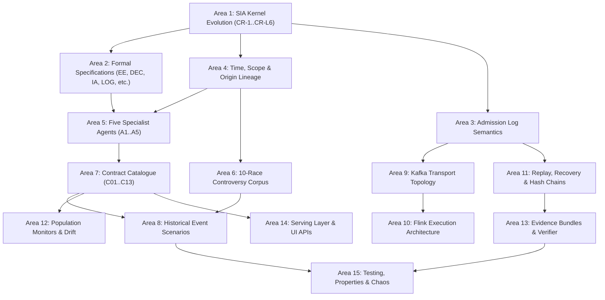

# CALIBRE — Implementation Roadmap & Architectural Evolution

**Date:** 13 November 2026  
**Horizon:** 5 to 10 Years  
**Status:** Active Implementation Blueprint  
**Guiding Principle:** The specification outlives the code. Zero dependencies in the reasoning kernel.

---

## 1. Architectural Principles & Invariants

1. **Deterministic Reasoning Kernel:** SIA Core evaluates decisions as a pure function of `(contract, evidence visible at K, K)`. It never reads wall-clock time, generates random numbers, or executes I/O.
2. **Standard-Library Only Core:** No external dependencies may ever be introduced into `sia_core_v3` or the formal verifier.
3. **Evidence Producers, Not Adjudicators:** Specialist agents emit factual observations with stated uncertainties; they never output integrity grades, penalty recommendations, or fault verdicts.
4. **Honest Origin Lineage:** Two feeds sharing an upstream platform carry a single source-origin token. Independent corroboration requires disjoint source and processing token closures.
5. **Absence is a Verdict:** Decisions open by schedule, not by the arrival of evidence. Silence progresses from `UNKNOWN` to `DEGRADED` unless legitimately voided (`VOIDED` witness for retirements or red flags).
6. **Immutable Bitemporal History:** Content hash commits to what was concluded; record hash links revisions chronologically. Knowledge time is strictly monotonic and non-regressive.
7. **Transport vs Evaluation Mechanics:** Kafka and Flink provide execution scale and replay durability; they never define evaluation semantics or timestamps.

---

## 2. Area-by-Area Implementation Plan

### Area 1: SIA Specification & Kernel Evolution (CR-1, CR-2, CR-6, CR-10, CR-L2, CR-L6)
- **What needs to change:**
  1. *CR-1 (Decision Voiding):* Implement `void_decision(instance_id, reason, witness_code="VOIDED")` in `IntegrityEngine` and `evaluator.py`. Voided decisions transition directly to `UNKNOWN` with finality `FINAL` and emit a named `VOIDED` witness, preventing false alarms during retirements, session suspensions, or red flags.
  2. *CR-2 (Lateness Witness):* When reference facts arrive after a contract's soft deadline, record a `LATE_REFERENCE_FACT` witness.
  3. *CR-6 (Witness Code Registry):* Establish a standardized registry mapping witness codes to severity (`INFO`, `WARNING`, `DEFECT`), human-readable descriptions, and remedial hints.
  4. *CR-10 (Zone Sub-Scope Key):* Add `ZONE` sub-scope under `SECTOR` in `ScopeClass` to support micro-sectors and pit-lane loop zones.
  5. *CR-L2 (Algorithm-Tagged Digests):* Update `canon.py` so that all content and record digests carry the `sha256:` algorithm prefix, guaranteeing cryptographic agility.
  6. *CR-L6 (Margin Report Witness):* Integrate policy-neutral threshold witnesses (Pattern P3) directly into the evaluator's assembly stage.
- **Affected Files:** `sia_core_v3/sia_core/engine.py`, `sia_core_v3/sia_core/evaluator.py`, `sia_core_v3/sia_core/model.py`, `sia_core_v3/sia_core/canon.py`, `sia_core_v3/sia_core/verdict.py`.
- **New Files:** `sia_core_v3/sia_core/witnesses.py` (registry of witness definitions).
- **Dependencies:** None.
- **Acceptance Criteria:** All existing 259 tests pass; new property tests verify that voiding stops further evaluation, tagged digests parse cleanly, and margin witnesses appear when measurements approach thresholds.

### Area 2: Formal Specification Suite (EE, DEC, IA, LOG, SEM, BUN, PACK)
- **What needs to change:** Extract formal, language-neutral JSON/Markdown specifications defining:
  - `EE v1.0` (Evidence Event Envelope): content-addressed atom structure, typed time, origin tokens, uncertainty, raw span references.
  - `DEC v1.0` (Decision Evidence Contract): schema for roles, scopes, formulas, constraints, tolerances, fault models, deadlines.
  - `IA v1.0` (Integrity Assessment): verdict schema, 4-state validity timelines, witnesses, derived limitations, maturity, hash chain.
  - `LOG v1.0` (Admission Log): immutable sequence of log entries, knowledge-time assignment rules, configuration epochs.
  - `SEM v1.0` (Evaluation Semantics): normative reference prose and mathematical vector rules for the state algebra, diagnosis, resilience, and envelope collapse.
  - `BUN v1.0` (Evidence Bundle): portable `.tar.zst` layout, manifests, root checksums, and offline verification protocol.
  - `PACK v1.0` (Domain Pack Specification): requirements for source adapters, reference registries, and contracts.
- **New Files:** `calibre_core/specs/EE_v1.0.json`, `calibre_core/specs/DEC_v1.0.json`, `calibre_core/specs/IA_v1.0.json`, `calibre_core/specs/LOG_v1.0.json`, `calibre_core/specs/BUN_v1.0.json`, `calibre_core/specs/conformance_vectors.json`.
- **Dependencies:** Area 1.
- **Acceptance Criteria:** Specification files validated against JSON Schema Draft-07; conformance runner tests vector equality against reference implementation.

### Area 3: Integrity Assessment & Admission-Log Semantics
- **What needs to change:** Formalize the Sequencer's admission log as the single source of truth. The evaluator must operate as a pure function of an ordered slice of this log.
- **Affected Files:** `calibre_core/capture_archive.py`, `sia_core_v3/sia_core/ledger.py`.
- **New Files:** `calibre_core/admission.py` (canonical admission log writer, reader, and iterator).
- **Dependencies:** Area 1, Area 2.
- **Acceptance Criteria:** Replaying an identical admission log yields identical `record_hash` chains across 100% of runs.

### Area 4: Time Handling, Scope Management & Origin Lineage
- **What needs to change:** Guarantee strict typed-time conversion (LAP_RELATIVE, SESSION_ELAPSED, ABSOLUTE_UTC) with reference-gated paths; enforce scope hierarchy (`SESSION` > `DRIVER_SESSION` > `DRIVER_LAP` > `SECTOR` > `ZONE`); ensure origin closures prevent fake corroboration when public feeds share upstreams.
- **Affected Files:** `sia_core_v3/sia_core/timeclass.py`, `sia_core_v3/sia_core/model.py`, `calibre_core/source_pack.py`.
- **Dependencies:** Area 1.
- **Acceptance Criteria:** Conversions without in-scope references fail closed; shared platform upstreams yield `COMMON_CAUSE_EXPOSURE` on every assessment.

### Area 5: Five Specialist Agent Archetypes (A1–A5)
- **What needs to change:** Implement the five specialist agents as pure, deterministic evidence producers following rules AR-1 through AR-10:
  - **A1 Timing Agent:** Parses raw timing streams, produces lap and sector records, derives lap-start and lap-end reference facts with cumulative uncertainty, and flags missing transponder gaps.
  - **A2 Vehicle Telemetry Agent:** Processes car sensor streams (speed, RPM, gear, throttle, brake, DRS), computes windowed speeds with sample counts and resolution, integrates distance with uncertainty, and emits kinematic plausibility flags.
  - **A3 Spatial & Geometry Agent:** Ingests GPS/position coordinates and surveyed circuit registry, detects gate crossings (finish line, sector lines, pit entry/exit), computes path lengths, and emits geometry reference facts with layout validity windows.
  - **A4 Session Context Agent:** Ingests race control messages, track status, weather, and entry lists; maintains session intervals (green, yellow, VSC, SC, red, finish), and declares rule-regime facts (e.g. event-specific pit speed limits).
  - **A5 Feed Supervisor Agent:** Runs in an isolated failure domain; monitors raw topic taps, consumer lag, and cadence baselines; emits monotonic clock ticks, `STALLED` / `RESUMED` guard facts, and feed-health metrics.
- **New Files:**
  - `calibre_core/agents/base.py` (AR-1..AR-10 archetype foundation)
  - `calibre_core/agents/timing.py` (A1)
  - `calibre_core/agents/telemetry.py` (A2)
  - `calibre_core/agents/spatial.py` (A3)
  - `calibre_core/agents/context.py` (A4)
  - `calibre_core/agents/supervisor.py` (A5)
- **Dependencies:** Area 1, Area 4.
- **Acceptance Criteria:** Reprocessing the same raw inputs produces identical atom IDs (AR-2); agents never output integrity grades (AR-1); unit tests cover declared failure catalogues.

### Area 6: 10-Race Controversy Corpus & Data Acquisition Pipeline
- **What needs to change:** Curate the 10 most controversial F1 races from 2021 onwards (Abu Dhabi 2021 mandatory); implement a unified, repeatable data acquisition pipeline leveraging FastF1, Jolpica-F1, and official FIA documents.
- **New Files:**
  - `docs/F1_CONTROVERSY_CORPUS.md` (comprehensive research, facts vs disputes, FIA documents)
  - `scripts/acquire_f1_corpus.py` (repeatable multi-session acquisition tool)
  - `data/corpus_manifest.json` (canonical checksums and metadata for all 10 races)
  - `calibre_core/circuits/geometry.py` (programmatic track geometry, gate positions, layout versions)
- **Dependencies:** Area 4, Area 5.
- **Acceptance Criteria:** Acquisition script successfully acquires and normalizes all 10 races with verified content checksums; data coverage matrix explicitly documents availability per category.

### Area 7: F1 Contract Catalogue (C01–C13) & Failure Patterns (P1–P9)
- **What needs to change:** Implement all 13 contracts with complete contract cards, detectability figures, and calibration records:
  - C01: Lap-time consistency (P1, P6)
  - C02: Sector-sum consistency (P1)
  - C03: Pit-lane speed integrity (flagship: P1, P2, P3, P4, P8)
  - C04: Vehicle kinematic plausibility (P1)
  - C05: Telemetry time alignment (P6)
  - C06: Position and track consistency (P1, P2, P6)
  - C07: Session-status integrity (P1, P5)
  - C08: Incident timing (P6)
  - C09: Weather reporting (P5)
  - C10: Weather-dependent advisory (P5)
  - C11: Feed-source integrity (P5, P9)
  - C12: Monitor health (P4, P9)
  - C13: Rule-regime consistency (P8)
- **New Files:** `calibre_core/contracts/catalogue.py`, `calibre_core/contracts/cards.py`.
- **Dependencies:** Area 1, Area 2, Area 5.
- **Acceptance Criteria:** Every contract validates against SIA rules V-01..V-12; each constraint has a defined detectability figure.

### Area 8: Historical Event Scenarios & Benchmark Suite
- **What needs to change:** Map the 10 controversial races to specific CALIBRE contracts and failure patterns. Build automated scenario tests that replay historical evidence through the pipeline and evaluate SIA's integrity assessments.
- **New Files:** `calibre_core/tests/test_historical_scenarios.py`.
- **Dependencies:** Area 5, Area 6, Area 7.
- **Acceptance Criteria:** Abu Dhabi 2021 scenario evaluates safety car unlapping and restart status; Monaco geometry scenario evaluates expired reference and margin against uncertainty; all scenarios execute deterministically.

### Area 9: Kafka & Stream Pipeline Topology
- **What needs to change:** Standardize topic naming (`calibre.<pack>.<layer>.<name>`), partition keys, and serialization formats across local in-memory bus and clustered Kafka.
- **Affected Files:** `calibre_core/kafka_io.py`, `backend/pulse/stream/bus.py`.
- **Dependencies:** Area 2, Area 3.
- **Acceptance Criteria:** Identical execution semantics across `SIMULATOR` and `KAFKA` transport modes.

### Area 10: Flink Execution Architecture (J1–J4)
- **What needs to change:** Formalize the 4 Flink jobs:
  - J1 Sequencer: Envelope admission, deduplication, knowledge-time assignment.
  - J2 Evaluator: Hosts SIA kernel, deterministic scheduling, and amendments.
  - J3 Population Monitors: Calibration bias and drift sentinel.
  - J4 Verifier: Batch replay equivalence and hash chain verification.
- **Affected Files:** `backend/pulse/stream/flink/client.py`, `calibre_core/batch.py`.
- **New Files:** `calibre_core/flink_pipeline.py` (Python stream-job wrappers and test harness).
- **Dependencies:** Area 3, Area 7, Area 9.
- **Acceptance Criteria:** Simulated stream engine executes J1..J4 with transactionally consistent state.

### Area 11: Replay, Recovery & Hash-Chain Verification
- **What needs to change:** Guarantee that replaying an admitted log produces 100% identical hash chains. Provide state reconstruction from log checkpoints without publishing duplicate downstream messages.
- **Affected Files:** `calibre_core/standalone_verifier.py`, `pulse/replay/controller.py`.
- **Dependencies:** Area 1, Area 3.
- **Acceptance Criteria:** Verification CLI validates bundles offline without external dependencies.

### Area 12: Population-Level Monitoring & Drift Sentinel
- **What needs to change:** Surface systemic biases (e.g. 2.9% loop distance discrepancy) across populations; monitor schema and cadence drift without allowing monitor outputs to fabricate source independence.
- **Affected Files:** `sia_core_v3/sia_core/calibration.py`, `calibre_core/contracts/catalogue.py`.
- **Dependencies:** Area 1, Area 7.
- **Acceptance Criteria:** Population bias fact expires when monitor stalls; dependent contracts degrade gracefully.

### Area 13: Evidence Bundles & Standalone Verification
- **What needs to change:** Implement `.tar.zst` portable bundles containing manifest, contract versions, reference facts, admission log slice, raw spans, and hash chain segments.
- **Affected Files:** `calibre_core/archive.py`, `calibre_core/standalone_verifier.py`.
- **Dependencies:** Area 2, Area 11.
- **Acceptance Criteria:** `calibre_core.standalone_verifier` passes strict verification on all generated race bundles on a clean machine using standard library only.

### Area 14: Serving Layer & Investigation Interface
- **What needs to change:** Expose REST/SSE APIs for session boards, bitemporal decision history, lineage graphs, and evidence audit drawers; integrate with the tactical cockpit.
- **Affected Files:** `backend/pulse/integrity/router.py`, `backend/pulse/main.py`.
- **Dependencies:** Area 1, Area 7.
- **Acceptance Criteria:** Any verdict is traceable to its raw supporting evidence in at most three UI steps.

### Area 15: Testing, Property Verification & Chaos Validation
- **What needs to change:** Add property tests for admission order invariance, duplicate idempotence, knowledge-time monotonicity, and envelope bounds; execute chaos drills (simulated broker disconnects, corrupt records, clock steps).
- **New Files:** `calibre_core/tests/test_invariants.py`.
- **Dependencies:** Areas 1 through 14.
- **Acceptance Criteria:** 100% of invariants pass; zero regressions across the 380 existing tests.

---

## 3. Dependency & Execution Graph

