# CALIBRE / PULSE — UI Visual Reference & System Walkthrough

> **Forensic and Operational Interface Guide for the CALIBRE Evidence Integrity Platform & PULSE F1 Streaming Application.**

This document provides a structured walkthrough of all primary user interfaces, forensic inspection drawers, and epistemic workbenches across the system. High-resolution captures are stored in [`docs/screenshots/`](screenshots/) and at the project root in [`screenshots/`](../screenshots/).

---

## Quick Reference Index

| View Domain | Key Components Covered | Primary Screenshots |
|---|---|---|
| **Trackside Mission Control** | Circuit Map, Participant Shelf, Tactical Drawer, Consequence Feed, Telemetry Modal | [01](#01-trackside-live-mission-control), [02](#02-trackside-tactical-strategy--pit-window-drawer), [03](#03-live-tactical-consequence-feed--momentum-chart), [04](#04-driver-can-bus-telemetry-inspector-modal), [05](#05-tactical-evidence-provenance-drawer) |
| **Integrity Board** | Multi-Contract Matrix, Decision Inspector, Atoms Viewer, Cryptographic Hashes | [06](#06-integrity-board-multi-contract-evidence-matrix), [07](#07-3-click-decision-inspector-atoms--provenance), [08](#08-decision-inspector-cryptographic-record--revision-history) |
| **SIA Logic Lab** | Epistemic Envelope, Entanglement Graph, Contextuality DAG, State Algebra Tree | [09](#09-sia-logic-lab-epistemic-envelope--superposition), [10](#10-sia-logic-lab-origin-entanglement-graph), [11](#11-sia-logic-lab-contextuality--scope-isolation-dag), [12](#12-sia-logic-lab-deterministic-state-algebra-evaluator) |
| **Agents & Pipeline** | Runtime Diagnostics, Finding Stream Drawer, Target Archetypes, Topology | [13](#13-agents--pipeline-operational-pulse-specialist-agents), [14](#14-agents--pipeline-agent-live-finding-stream-drawer), [15](#15-agents--pipeline-target-archetypes-a1a5-specification), [16](#16-agents--pipeline-transport-diagnostics--topology) |
| **Replay & Audit** | Hash-Chain Verifier, Bitemporal "As-Of" Query, Synthetic Fault Lab | [17](#17-replay--audit-cryptographic-hash-chain-ledger-verifier), [18](#18-replay--audit-bitemporal-as-of-knowledge-time-machine), [19](#19-replay--audit-lab-synthetic-scenario-fault-injector) |
| **Historical Corpus** | Yas Marina 2021, Silverstone 2023, Suzuka Homologation Preview | [20](#20-historical-controversy-corpus-abu-dhabi-grand-prix-2021), [21](#21-historical-controversy-corpus-british-grand-prix-2023-silverstone), [22](#22-circuit-homologation--epistemic-empty-state-suzuka-preview) |

---

## 1. Trackside Live Cockpit

### 01. Trackside Live Mission Control
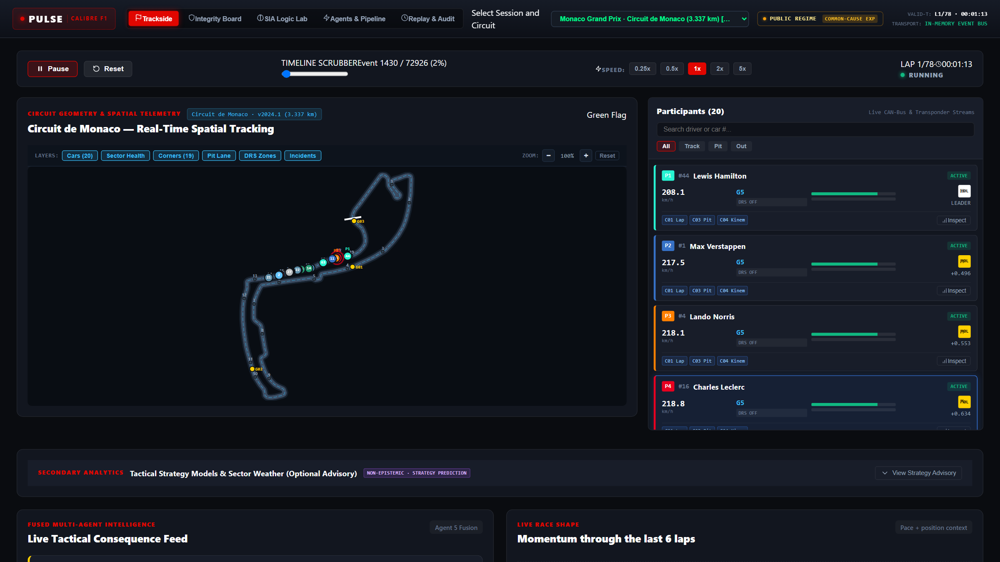
- **Screenshot**: `01_trackside_mission_control.png`
- **Location**: Primary Dashboard View (`activeView = 'TRACKSIDE'`)
- **Description**:
  Central live operational cockpit displaying the Circuit de Monaco track map with real-time GPS vehicle coordinates, micro-sector speed indicators, and timing loops. On the right, the 35% telemetry shelf presents real-time driver gap deltas, tyre compounds (Soft/Medium/Hard) and stint ages, alongside the top dual-time bar tracking valid session time against in-memory transport status. Interactive controls allow operators to scrub race replay, adjust playback speed up to 10x, and filter participants by track status.

### 02. Trackside Tactical Strategy & Pit Window Drawer
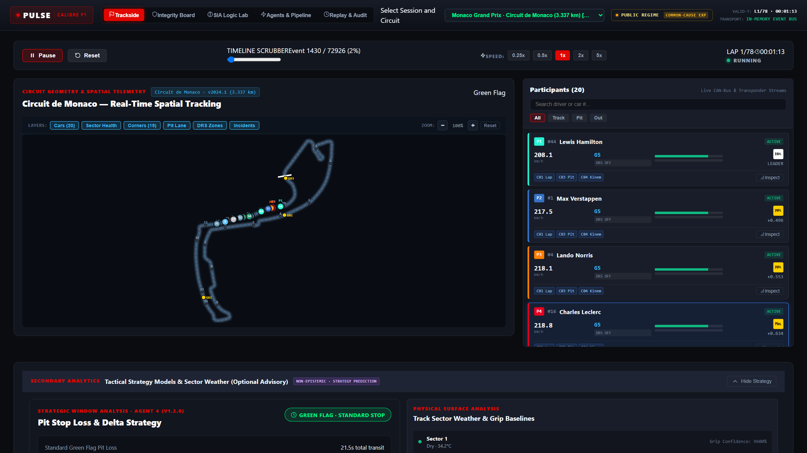
- **Screenshot**: `02_trackside_tactical_drawer.png`
- **Location**: Collapsible Analytics Drawer in Trackside View
- **Description**:
  Collapsible tactical analysis drawer providing non-epistemic strategic projections, including pit lane time loss deltas (21.4s under green vs 14.1s under VSC/SC) and undercut/overcut threat windows. Correlates multi-compound stint degradation models with micro-sector grip baselines and ambient temperature gradients across the circuit. Clearly labelled with advisory disclaimers to preserve the separation between formal evidence integrity and speculative strategy models.

### 03. Live Tactical Consequence Feed & Momentum Chart
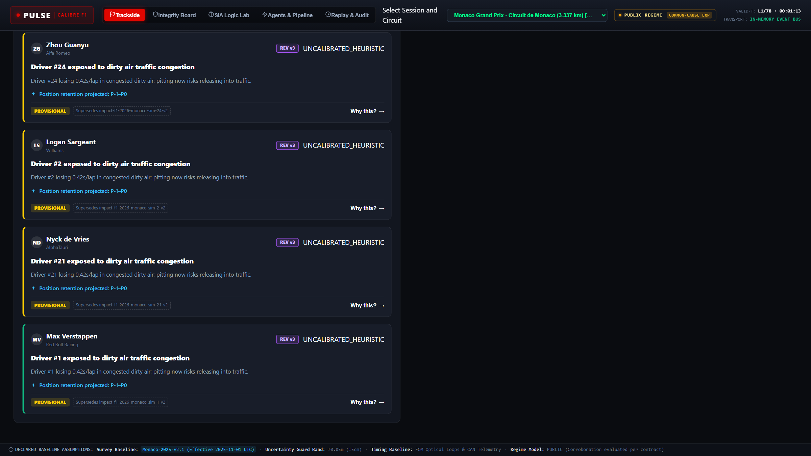
- **Screenshot**: `03_trackside_consequence_feed.png`
- **Location**: Lower Section of Trackside Cockpit
- **Description**:
  Lower cockpit section highlighting the fused multi-agent consequence cards generated by Agent 05 (Fusion Engine) with deterministic heuristic calibration ratings and position retention forecasts. Flanked by the interactive lap-by-lap pace momentum delta chart and official race control event timeline detailing active safety car and pit phase directives. Operators can inspect individual findings to trace evidence provenance or review historical superseding revisions.

### 04. Driver CAN-Bus Telemetry Inspector Modal
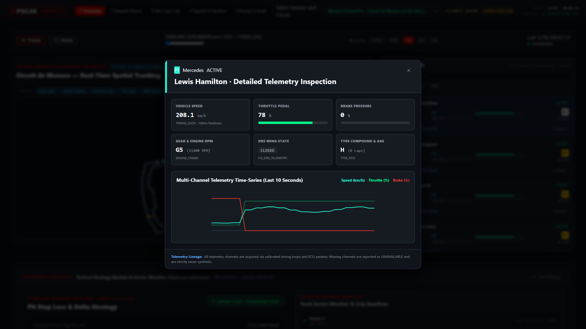
- **Screenshot**: `04_driver_telemetry_modal.png`
- **Location**: Modal Overlay triggered from Participant Shelf or Track Map
- **Description**:
  High-frequency modal inspection window rendering synchronous vehicle telemetry waveforms for Charles Leclerc (#16). Features multi-channel traces for speed (km/h), throttle pedal percentage, hydraulic braking pressure (bar), gear selection, engine RPM, DRS actuation state, and steering angle with sub-500ms sensor freshness. Provides kinematic sanity validation, highlighting rule-based anomaly detection such as sudden deceleration spikes exceeding 2.0g.

### 05. Tactical Evidence Provenance Drawer ("Why this?")
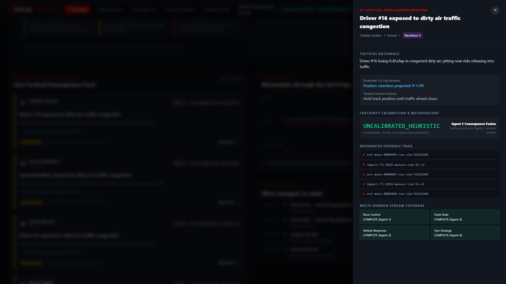
- **Screenshot**: `05_tactical_evidence_drawer.png`
- **Location**: Slide-over Drawer triggered from Impact Card "Why this?"
- **Description**:
  Epistemic deep-dive slide-over drawer explaining the underlying rationale and evidentiary backing for an Agent 05 tactical finding. Details raw event identifiers, sensor ingestion timestamps, confidence interval bounds, counter-factual alternatives, and corroborating witness atoms. Ensures complete auditability of automated strategic recommendations by surfacing the exact data sources and processing agents involved in every calculation.

---

## 2. Integrity Board & Decision Inspector

### 06. Integrity Board (Multi-Contract Evidence Matrix)
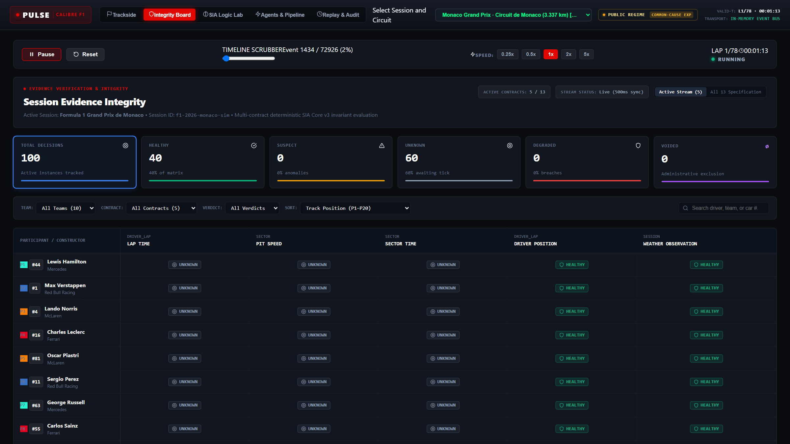
- **Screenshot**: `06_integrity_board_matrix.png`
- **Location**: Integrity Board View (`activeView = 'INTEGRITY_BOARD'`)
- **Description**:
  Comprehensive SIA governance dashboard mapping all 20 Formula 1 participants against Scoped Integrity Algebra contracts (C01–C13), color-coded by four-valued lattice state (HEALTHY, SUSPECT, UNKNOWN, DEGRADED). Provides top-level system health metrics, active alert filters, and real-time transponder-to-telemetry parity tracking. Clicking any cell immediately opens the forensic Decision Inspector to reveal underlying proofs.

### 07. 3-Click Decision Inspector (Atoms & Provenance)
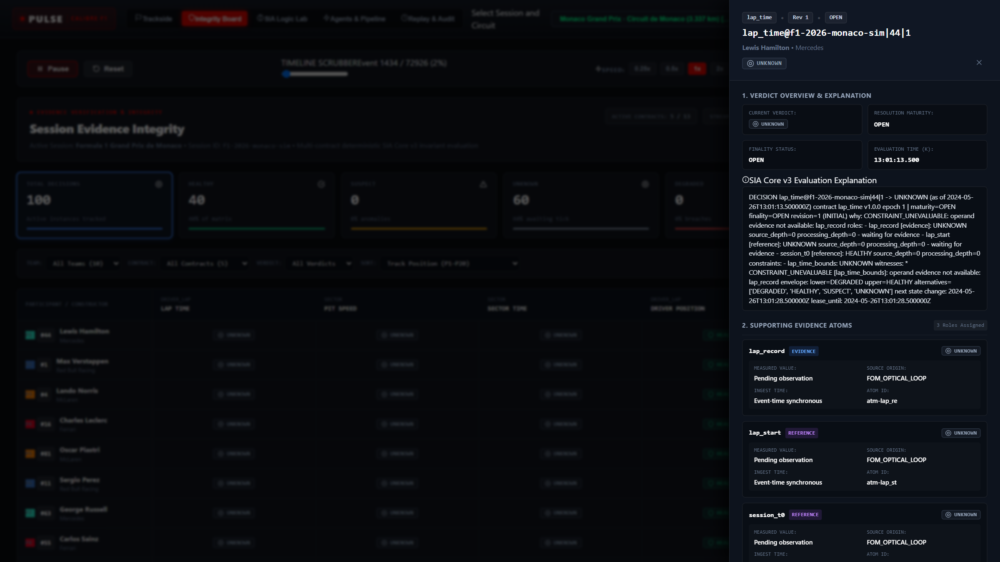
- **Screenshot**: `07_decision_inspector_atoms.png`
- **Location**: Forensic Slide-over Drawer in Integrity Board View
- **Description**:
  Forensic audit drawer triggered by clicking any decision cell in the Integrity Matrix, exposing the formal formula DAG, revision counter, and individual constituent atoms (e.g., optical loop timing vs onboard CAN telemetry). Displays observed sensor values, physical measurement units, and millisecond-accurate timestamp bounds. Includes tolerance margin gauges showing the exact numerical buffer between measured inputs and contract thresholds.

### 08. Decision Inspector (Cryptographic Record & Revision History)
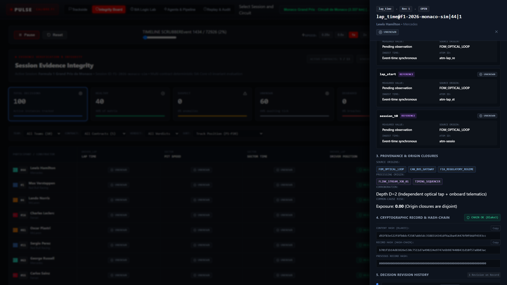
- **Location**: Scrolled Lower Section of Decision Inspector Drawer
- **Screenshot**: `08_decision_inspector_crypto_revisions.png`
- **Description**:
  Lower section of the Decision Inspector displaying BLAKE3 content and record hashes, source-to-processing provenance chains, and zero common-cause failure exposure verifications. Tracks the complete immutable append-only revision ledger showing every state transition from ingestion to final verdict. Enables one-click copying of cryptographic hashes for independent verification against standalone offline verification tools.

---

## 3. SIA Logic Lab (Formal Epistemic Workbench)

### 09. SIA Logic Lab — Epistemic Envelope & Superposition
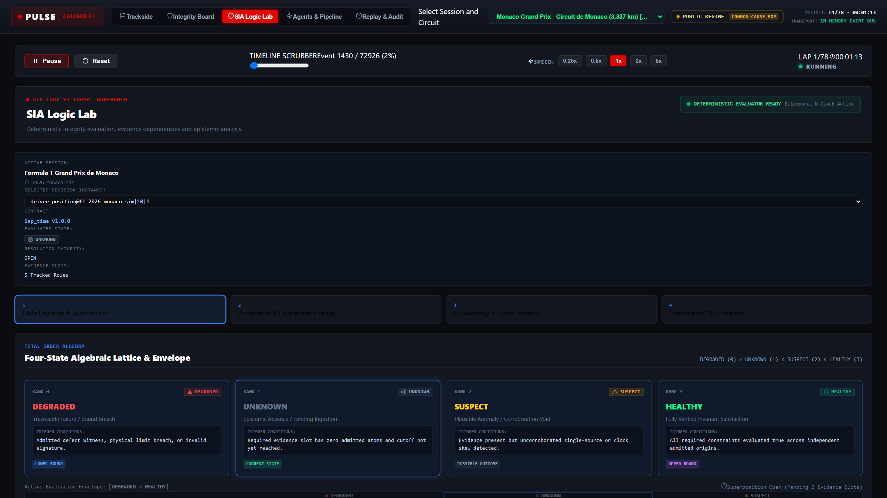
- **Screenshot**: `09_sia_logic_lab_superposition.png`
- **Location**: SIA Logic Lab Tab 1 (`activeTab = 'ENVELOPE'`)
- **Description**:
  Formal epistemic workbench modeling decision uncertainty as a four-state lattice interval between lower and upper bounds (e.g. DEGRADED to HEALTHY). Displays resolution maturity status (OPEN, PROVISIONAL, FINAL) and tracks the pending epistemic conditions required to collapse the superposition. Allows verification of how partial or delayed evidence bounds the system's legitimate belief state without guessing missing data.

### 10. SIA Logic Lab — Origin Entanglement Graph
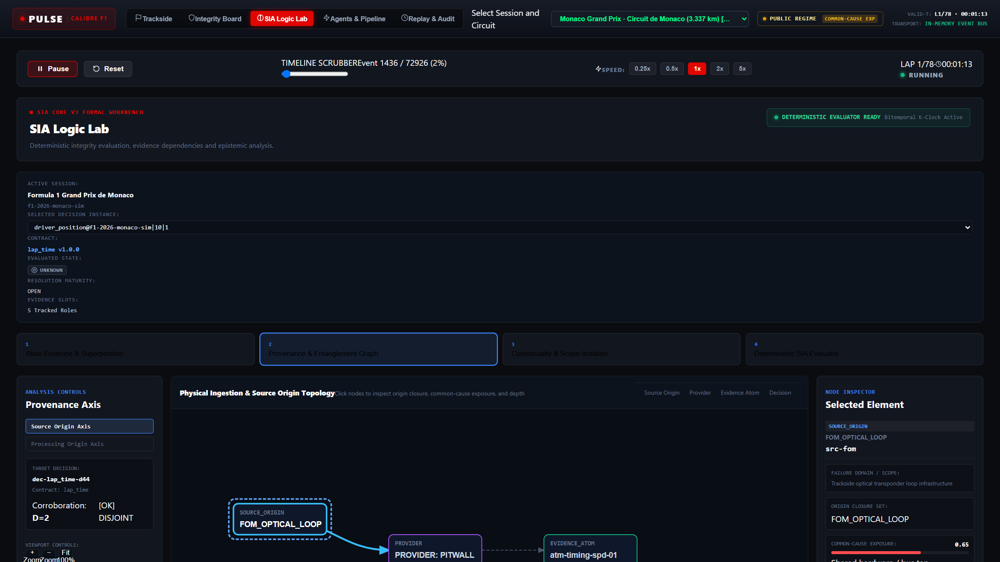
- **Screenshot**: `10_sia_logic_lab_entanglement_graph.png`
- **Location**: SIA Logic Lab Tab 2 (`activeTab = 'PROVENANCE'`)
- **Description**:
  Interactive dependency topology mapping cross-stream data flows between FOM optical loops, vehicle telematic gateways, and FIA stewarding feeds. Visualizes corroboration depth (D=2) and verifies that sensor origin closures remain disjoint to prevent common-cause failure vulnerabilities. Explicitly highlights shared infrastructure risks, alerting operators when redundant streams share a single physical point of failure.

### 11. SIA Logic Lab — Contextuality & Scope Isolation DAG
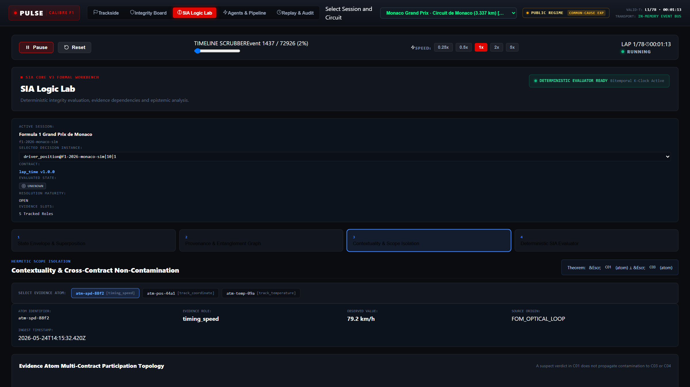
- **Screenshot**: `11_sia_logic_lab_contextuality_dag.png`
- **Location**: SIA Logic Lab Tab 3 (`activeTab = 'CONTEXTUALITY'`)
- **Description**:
  Directed acyclic graph illustrating how session-level context states—including track flags, safety car phases, and driver pit lane statuses—gate the legitimate applicability of integrity contracts. Guarantees that rules are only evaluated under their epistemically valid operational envelope. Prevents out-of-context evaluations, such as applying green-flag minimum delta speeds during full-course red flag neutralizations.

### 12. SIA Logic Lab — Deterministic State Algebra Evaluator
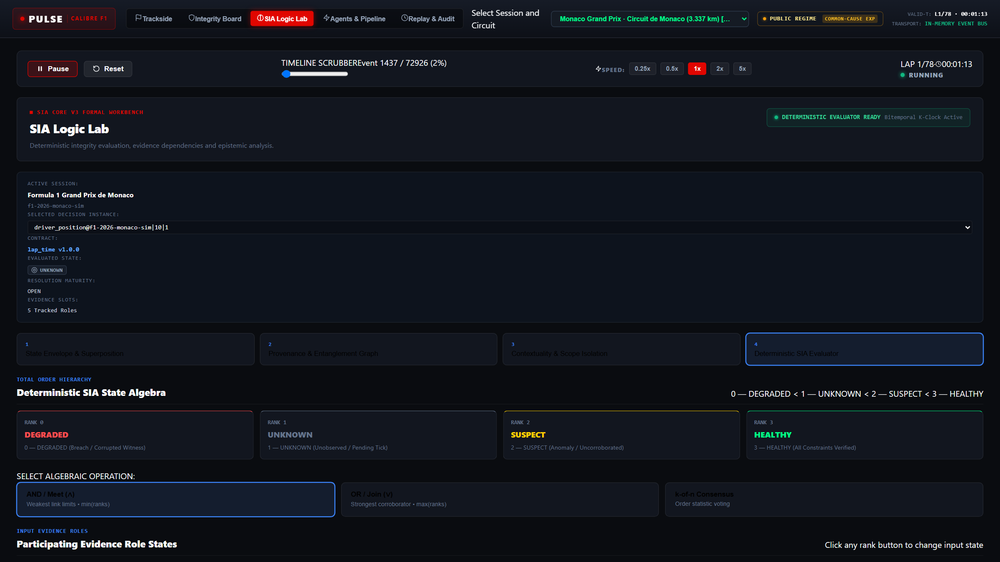
- **Screenshot**: `12_sia_logic_lab_state_algebra_tree.png`
- **Location**: SIA Logic Lab Tab 4 (`activeTab = 'EVALUATOR'`)
- **Description**:
  Hierarchical AST evaluator rendering Boolean and lattice algebra expressions over meet (INF / AND) and join (SUP / OR) operators. Inspects live node evaluations and demonstrates how sensor quality degrades or propagates upward to determine the final contract integrity verdict. Provides an interactive playground for stewarding teams to test proposed contract modifications under deterministic formal semantics.

---

## 4. Agents & Streaming Pipeline

### 13. Agents & Pipeline — Operational Pulse Specialist Agents
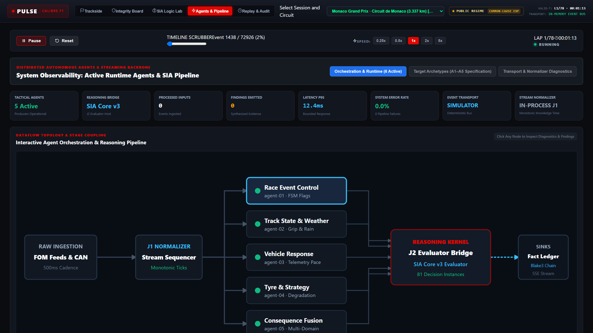
- **Screenshot**: `13_agents_pipeline_runtime.png`
- **Location**: Agents & Pipeline Tab 1 (`activeTab = 'RUNTIME'`)
- **Description**:
  Real-time observability console monitoring the 6 active runtime Pulse streaming agents (Event Control, Track State, Vehicle Response, Tyre Strategy, Consequence Fusion, and Integrity Bridge). Displays processed input message volumes, emitted findings, p95 latency percentiles (12.4ms), and event transport bus status. Summarizes key streaming metrics across 8 dedicated KPI cards, providing instant visibility into message broker health.

### 14. Agents & Pipeline — Agent Live Finding Stream Drawer
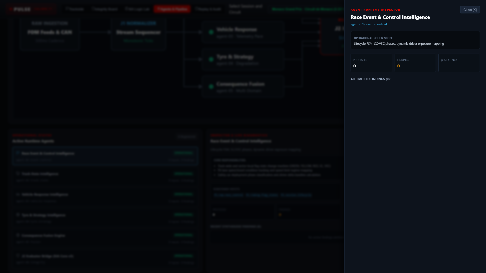
- **Screenshot**: `14_agents_pipeline_findings_drawer.png`
- **Location**: Slide-over Drawer inside Agents & Pipeline View
- **Description**:
  Slide-over diagnostic inspector for individual agents (e.g., Race Event & Control Intelligence), displaying detailed agent role responsibilities, input/output Kafka topic bindings, and a real-time chronological log of synthesized evidence and finding messages. Permits low-level auditing of agent heuristics and message dispatch performance during live race conditions.

### 15. Agents & Pipeline — Target Archetypes (A1–A5 Specification)
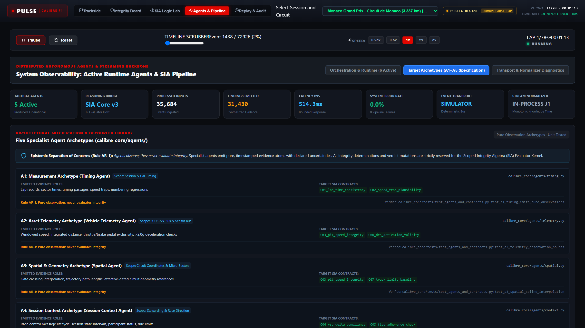
- **Screenshot**: `15_agents_pipeline_target_archetypes.png`
- **Location**: Agents & Pipeline Tab 2 (`activeTab = 'TARGET_ARCHETYPES'`)
- **Description**:
  Architectural specification matrix contrasting prototype CALIBRE target archetypes (A1 Measurement, A2 Vehicle Telemetry, A3 Spatial Geometry, A4 Session Context, A5 Feed Supervisor) against active streaming agents. Formally defines rules AR-1 through AR-10, separating pure observation from integrity grading. Links each archetype directly to its authoritative Python source implementation and corresponding unit test suite.

### 16. Agents & Pipeline — Transport Diagnostics & Topology
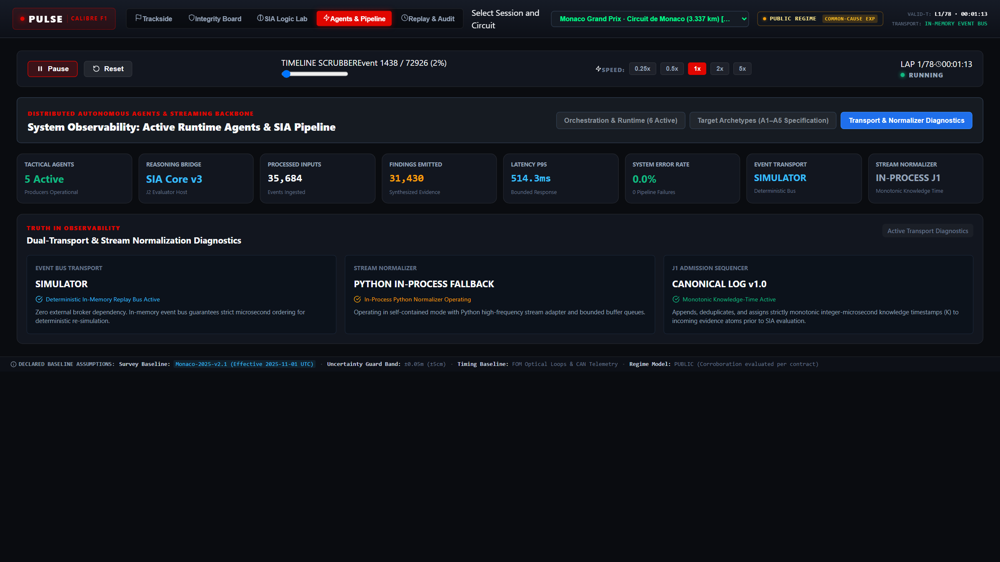
- **Screenshot**: `16_agents_pipeline_topology.png`
- **Location**: Agents & Pipeline Tab 3 (`activeTab = 'TOPOLOGY'`)
- **Description**:
  End-to-end streaming architecture diagnostic dashboard detailing message broker connectivity (Kafka clustered vs in-memory deterministic bus), queue buffer lags, event ingestion cadences, and Apache Flink / in-process J1 normalizer state machines. Verifies that incoming raw telemetry packets are sequenced monotonically before entering the SIA kernel evaluation pipeline.

---

## 5. Replay Engine & Forensic Audit

### 17. Replay & Audit — Cryptographic Hash-Chain Ledger Verifier
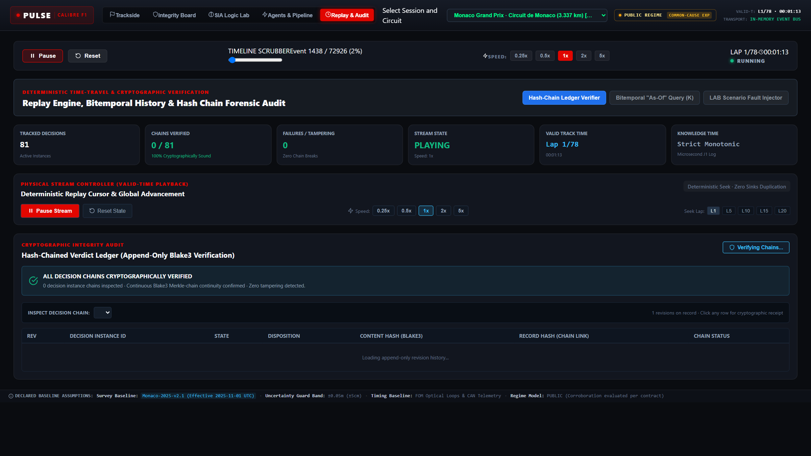
- **Screenshot**: `17_replay_audit_verifier.png`
- **Location**: Replay & Audit Tab 1 (`activeTab = 'VERIFIER'`)
- **Description**:
  High-assurance forensic console executing automated cryptographic audits across all recorded decision instances. Confirms 100% hash-chain integrity using BLAKE3 and SHA-256 Merkle proofs, guaranteeing that historical telemetry and stewarding records remain tamper-evident. Summarizes verified chain counts, genesis block linkage, and historical revision depths for official scrutineering submission.

### 18. Replay & Audit — Bitemporal "As-Of" Knowledge Time Machine
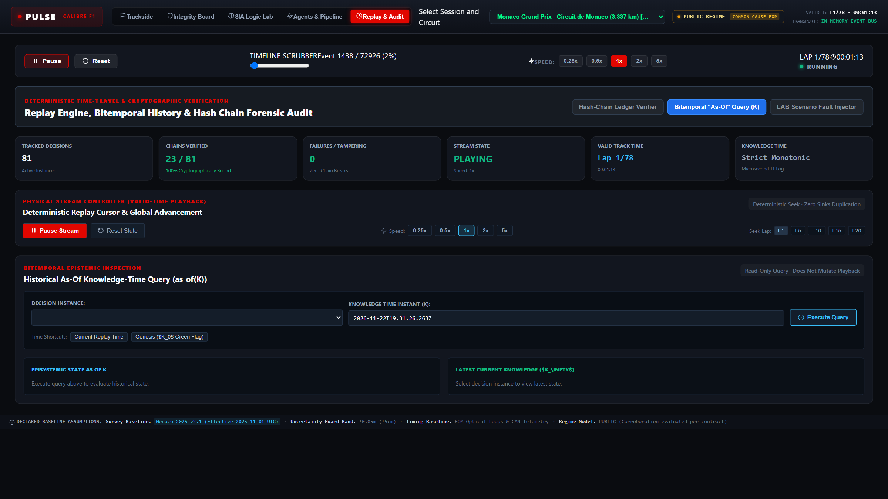
- **Screenshot**: `18_replay_audit_as_of_query.png`
- **Location**: Replay & Audit Tab 2 (`activeTab = 'AS_OF_QUERY'`)
- **Description**:
  Bitemporal forensic query tool allowing operators to evaluate any decision instance exactly as known at a past knowledge-time timestamp ($K$). Contrasts retrospective delayed evidence arrivals against original event valid-time ($T$) to identify post-hoc data corrections. Crucial for post-race stewards' inquiries when determining what information was legitimately available at the moment a contested decision was made.

### 19. Replay & Audit — LAB Synthetic Scenario Fault Injector
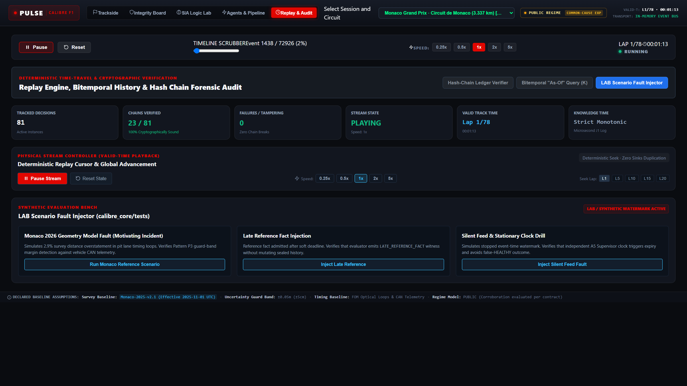
- **Screenshot**: `19_replay_audit_scenarios_lab.png`
- **Location**: Replay & Audit Tab 3 (`activeTab = 'LAB_SCENARIOS'`)
- **Description**:
  Interactive adversarial testing suite allowing engineers to inject simulated telemetry dropouts, transponder regressions, and flag misalignments. Evaluates how the SIA kernel responds to corrupt inputs by automatically transitioning affected decisions into SUSPECT or DEGRADED states. Validates fail-safe mathematical properties under deliberate sensor packet loss or network latency spikes.

---

## 6. Historical Controversy Corpus & Session Previews

### 20. Historical Controversy Corpus — Abu Dhabi Grand Prix 2021

- **Screenshot**: `20_historical_abu_dhabi_controversy.png`
- **Location**: Session `f1-2021-abu-dhabi` · Yas Marina Circuit
- **Description**:
  Specialized historical replay session of the decisive 2021 Abu Dhabi Grand Prix restart at Yas Marina Circuit. Replays multi-car transponder passages, safety car unlapping procedures, and regulatory evidence adequacy under controversial stewarding conditions. Evaluates whether the timing loops and track state evidence available to race control complied with sporting regulations governing safety car withdrawal.

### 21. Historical Controversy Corpus — British Grand Prix 2023 (Silverstone)
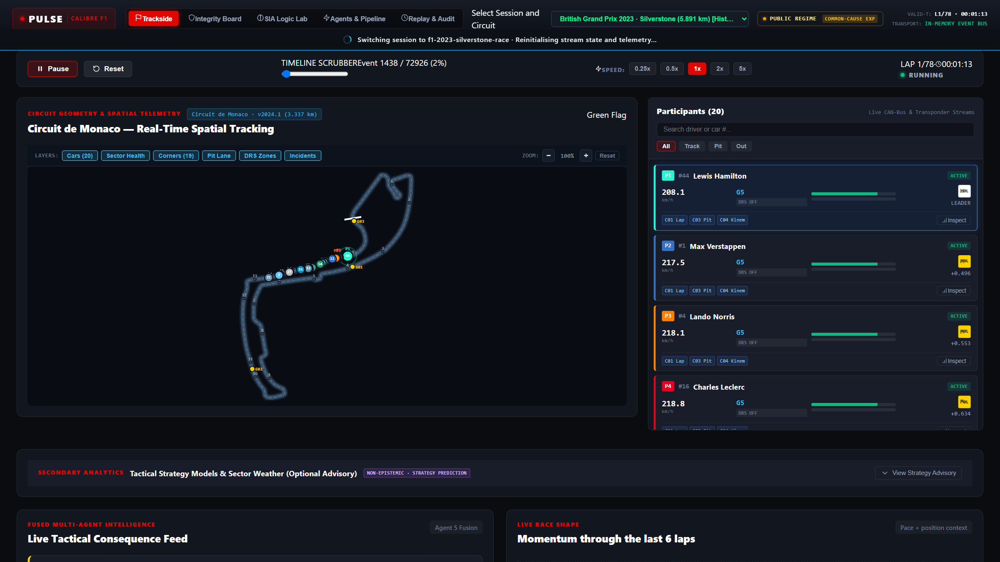
- **Screenshot**: `21_historical_silverstone_replay.png`
- **Location**: Session `f1-2023-silverstone-race` · Silverstone Circuit
- **Description**:
  High-speed circuit replay session at Silverstone featuring synchronized CAN-bus telemetry, sector pace deltas, and live pit strategy calculations across all 20 drivers. Demonstrates multi-car high-g lateral cornering tracking and DRS deployment compliance through Maggotts, Becketts, and Chapel complex. Leverages Jolpica-F1 and FastF1 historical captures to benchmark system throughput against real championship data.

### 22. Circuit Homologation & Epistemic Empty State — Suzuka Preview
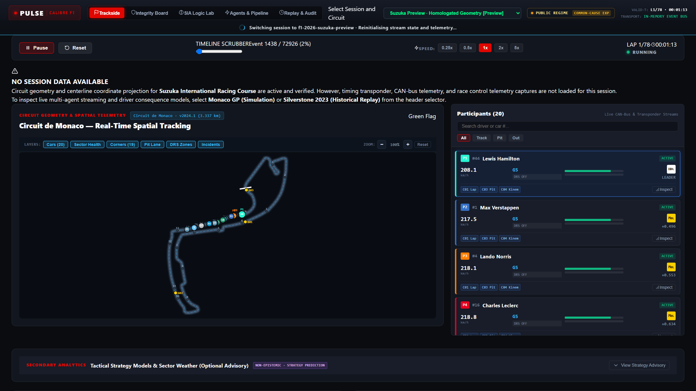
- **Screenshot**: `22_preview_suzuka_empty_state.png`
- **Location**: Session `f1-2026-suzuka-preview` · Suzuka International Racing Course
- **Description**:
  Verified homologated circuit geometry view for Suzuka International Racing Course in preview mode. Displays the official centerline coordinate projection and sector demarcation while showcasing the "NO SESSION DATA AVAILABLE" state to prevent ungrounded inferences before telemetry capture ingestion. Demonstrates the platform's strict epistemic boundary: never rendering speculative car positions without admitted transponder telemetry.
