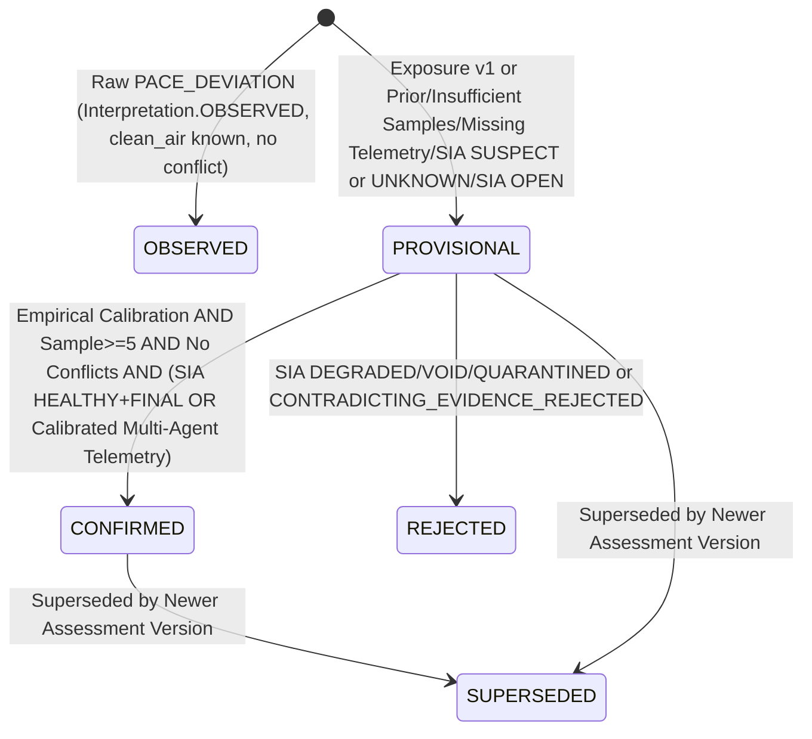

# PULSE Specialist Agent & Integrity Synthesis Architecture

---

## 1. Specialist Pipeline Overview (Agents 01-06)

PULSE executes six asynchronous event-driven agents communicating over either Kafka topics (`KAFKA` mode) or `PulseEventBus` (`MEMORY`/`SIMULATOR` modes), all inheriting `BaseAgent` empirical percentile telemetry (`deque(maxlen=256)` p50/p95 tracking).

```mermaid
sequenceDiagram
    participant Norm as Normalizer / Bus
    participant A12 as Agent 01 & 02 (Flags/Track)
    participant A3 as Agent 03 (Vehicle Pace)
    participant A4 as Agent 04 (Tyre/Pit)
    participant A6 as Agent 06 (SIA Core v3)
    participant A5 as Agent 05 (Consequence Fusion)
    participant DB as StateStore & SSE

    Norm->>A12: VSC_DEPLOYED / WEATHER_UPDATE
    A12->>A5: RACE_EVENT_LIFECYCLE / TRACK_CONDITION_STATE (PROVISIONAL)
    A5->>DB: Emit v1 Assessment (PROVISIONAL)
    Norm->>A3: LAP_COMPLETED / CAR_TELEMETRY
    A3->>A5: PACE_DEVIATION (clean_air_status, baseline, sample_count)
    Norm->>A6: EventEnvelope -> EvidenceAtom / ReferenceFact
    A6->>A5: INTEGRITY_ASSESSMENT (integrity_state, finality_status)
    Norm->>A4: PIT_IN / LAP_COMPLETED / VSC
    A4->>A5: PIT_WINDOW_OPPORTUNITY (calibration_status, limitations)
    A5->>DB: Emit v2 (v1 -> SUPERSEDED; CONFIRMED only if calibrated + positive evidence)
```

---

## 2. Agent Contracts, Inputs, Outputs & Bounds

| Agent ID | Class / Module | Subscribed Inputs | Emitted Topic & Finding Types | Key Constraints & Phase I Hardening |
| :--- | :--- | :--- | :--- | :--- |
| **`agent-01-event-control`** | `EventControlAgent` ([event_control.py](../../backend/pulse/agents/event_control.py)) | `SESSION_STARTED`, `RACE_CONTROL_*`, `VSC_*`, `SAFETY_CAR_*`, `RED_FLAG`, `YELLOW_FLAG`, `GREEN_FLAG*`, `DRIVER_RETIRED`, `STEWARD_DECISION` | `pulse.agent.event_context.findings.v1` (`RACE_EVENT_LIFECYCLE`, `DRIVER_EVENT_EXPOSURE`, `DRIVER_RETIREMENT`, `STEWARD_ACTION`) | Never invents artificial stewarding rulings; preserves `PROVISIONAL` vs FIA `CONFIRMED` notices |
| **`agent-02-track-state`** | `TrackStateAgent` ([track_state.py](../../backend/pulse/agents/track_state.py)) | `WEATHER_UPDATE`, sector & track status events | `pulse.agent.track_state.findings.v1` (`TRACK_CONDITION_STATE`, `WEATHER_TRANSITION`) | Tracks air/track temp, wet/drying grip regime, neutralised flags |
| **`agent-03-vehicle-response`** | `VehicleResponseAgent` ([vehicle_response.py](../../backend/pulse/agents/vehicle_response.py)) | `LAP_COMPLETED`, `CAR_TELEMETRY`, flag/session start | `pulse.agent.vehicle_response.findings.v1` (`PACE_DEVIATION`) | Strictly causal `predict_baseline()` BEFORE `observe_lap()`; emits tri-state `clean_air_status` (`CLEAN_AIR_UNKNOWN` blocks `CONFIRMED` & never trains baselines) |
| **`agent-04-tyre-strategy`** | `TyreStrategyAgent` ([tyre_strategy.py](../../backend/pulse/agents/tyre_strategy.py)) | `PIT_ENTRY`, `PIT_EXIT`, `TYRE_FITTED`, `LAP_COMPLETED`, `VSC`/`SC` | `pulse.agent.tyre_strategy.findings.v1` (`DEGRADATION_ANALYSIS`, `PIT_WINDOW_OPPORTUNITY`) | Requires `>= 5` clean inliers & lap span `>= 3`; marks `INSUFFICIENT_SAMPLES`; attaches explicit `strategy_scope="ADVISORY_LOCAL_PIT_WINDOW_ONLY"` & `is_globally_optimal=False` |
| **`agent-05-fusion`** | `ConsequenceFusionEngine` ([fusion.py](../../backend/pulse/agents/fusion.py)) | All finding topics + SIA integrity topic (`deque(maxlen=25)` per `(session, driver)`) | `pulse.intelligence.driver_impact.v1` (`Assessment` v1 -> v2 -> ...) | Enforces 5-status epistemic policy (`OBSERVED`, `PROVISIONAL`, `CONFIRMED`, `REJECTED`, `SUPERSEDED`); missing SIA alert never grants `CONFIRMED` |
| **`agent-06-integrity`** | `IntegrityAgent` ([agent.py](../../backend/pulse/integrity/agent.py)) | Normalized driver laps, pit events, track status, weather, session t0 | `pulse.agent.integrity.findings.v1` (`INTEGRITY_ASSESSMENT`) & `StateStore` | Evaluates 5 Python contract specs in [contracts.py](../../backend/pulse/integrity/contracts.py) (`lap_time`, `pit_speed`, `sector_time`, `driver_position`, `weather_observation`) over `sia_core_v3` SQLite WAL *(no YAML contract files exist at runtime)* |

---

## 3. Agent 05 Epistemic Confirmation Policy (Phase I)

Under Phase I commit `a130ef7`, [ConsequenceFusionEngine](../../backend/pulse/agents/fusion.py) resolves every assessment status transparently via `_detect_conflicts()` + `_has_positive_corroboration()` + `_classify_v2_status()`:



**Guaranteed Invariants (`backend/tests/test_fusion.py`, 9 tests including all 10 mandated cases):**
1. `PRIOR_UNMEASURED` stays `PROVISIONAL` even when zero SIA alert exists.
2. SIA `INTEGRITY_ASSESSMENT` alerts are matched on BOTH legacy `verdict`/`status` and SIA's canonical `integrity_state` + `finality_status` (`OPEN` vs `FINAL`).
3. Missing telemetry (`missing_telemetry=True` / `CLEAN_AIR_UNKNOWN`), insufficient samples (`< 5`), SIA `UNKNOWN`, SIA `SUSPECT`, and non-finalized `HEALTHY (OPEN)` block `CONFIRMED` (`PROVISIONAL`).
4. SIA `DEGRADED`/`VOID`/`QUARANTINED` or hard contradicting evidence transition assessments cleanly to `REJECTED`.
5. `v2` / `v3` emission and `StateStore.record_assessment()` transition the superseded revision cleanly to `SUPERSEDED`.

---

## 4. Agent 03 & Agent 04 Scientific Calibration Boundaries

- **Baseline Model (`RollingCleanAirPaceEstimator`):** Causal 5-lap median over `CLEAN_AIR_CONFIRMED` green laps in current stint, adjusted by fuel-burn approximation (`100 kg * 0.035 s/kg / total_laps`) and guarded field-wide track evolution (`0.20 < |med| <= 5.0s`), with fast green recovery replacing single slow restart laps (`-6.0s`) instead of averaging slow restarts with racing pace.
- **Tyre Degradation (`FuelCompensatedDegradationModel`):** Precision-weighted empirical-Bayes hierarchical shrinkage combining driver stint OLS (`>= 5` inliers, lap span `>= 3`, `|y - med| <= 3.5s`) with session compound pool (`SESSION_POOL_CALIBRATED`) and weak Pirelli prior (`PRIOR_DEG_SLOPE_SE=0.060`).
- **Pit-Window Simulator (`PitWindowStrategySimulator`):** Learns green & neutralised pit transit loss from observed `PitIn`/`PitOut` pairs (`[10s, 45s]`), projects rank via live field gaps, and explicitly surfaces `model_limitations` (static opponent response, unknown neutralisation end lap, uniform fuel load, `END_OF_RACE_HORIZON_TOO_SHORT` when `remaining_laps <= 2`).
