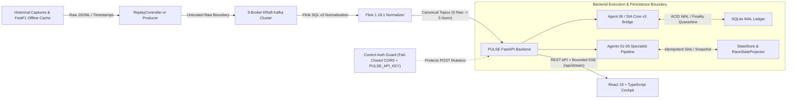
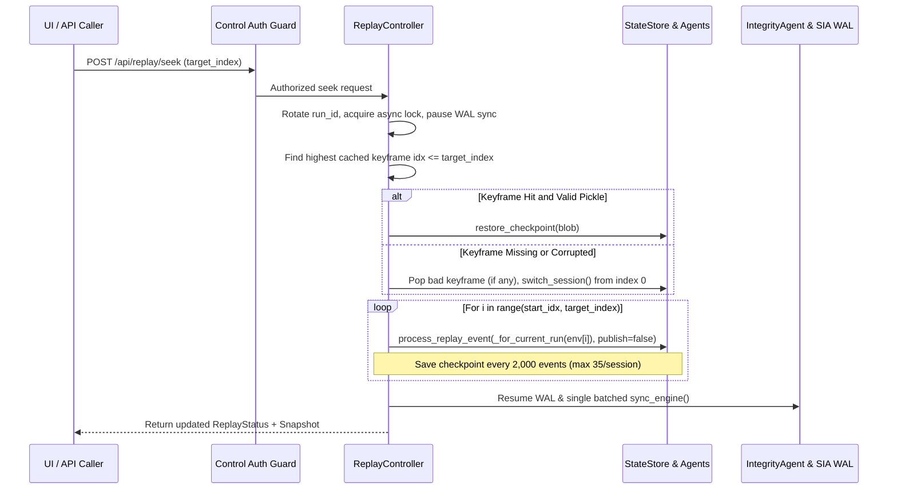
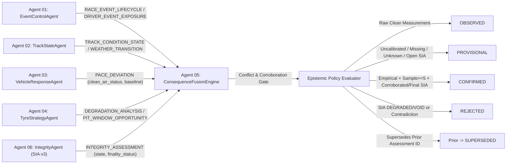
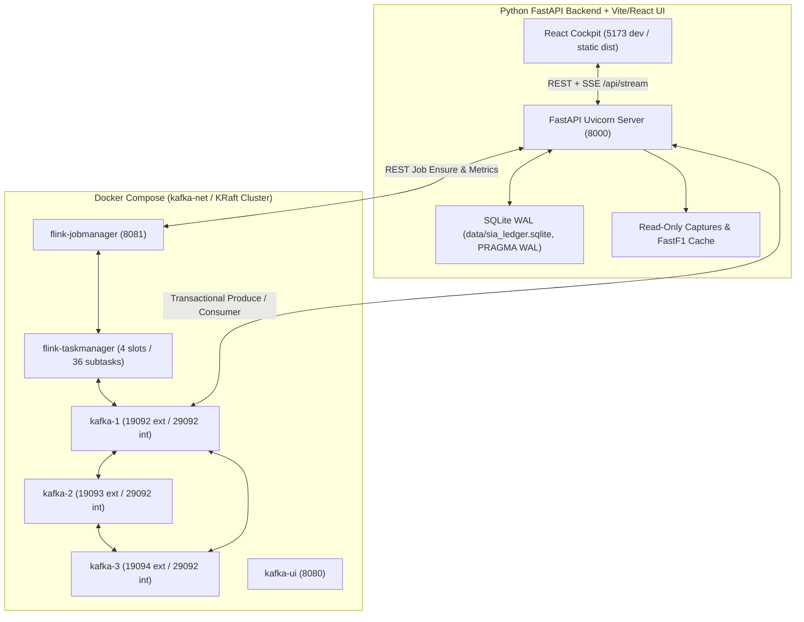

# PULSE Current System Architecture

**System:** PULSE — Predictive Unified Live Stream & Integrity Engine (formerly CALIBRE)  
**Branch / Baseline:** `pulse-phase-j-rc` *(branched from preserved Phase I checkpoint `f5fbc6a` on `pulse-reconstruction`)*  
**Primary Domain:** Formula 1 race telemetry, neutralisation events, pace estimation, tyre degradation, strategy advisory, and causal evidence integrity.

---

## 1. High-Level Overview & Execution Modes

PULSE separates **domain-independent cryptographic evidence verification** (`sia_core_v3`), **canonical event ingestion & stream normalization** (Apache Kafka KRaft + Apache Flink SQL v3), **asynchronous specialist race-intelligence synthesis** (`backend/pulse/agents/`), **deterministic replay & keyframe checkpoints** (`backend/pulse/replay/`, `backend/pulse/state/`), and a **real-time React 19 broadcast cockpit** (`frontend/`).

| Runtime Mode (`PULSE_TRANSPORT_MODE`) | Ingestion & Transport | Flink Normalizer | Primary Purpose |
| :--- | :--- | :--- | :--- |
| **`KAFKA`** (Production / Distributed) | 3-broker KRaft Kafka (`localhost:19092-19094` host, `kafka-1..3:29092` internal) | Active Flink 1.18.1 SQL v3 (`pulse-canonical-normalizer-v3`) | Multi-broker fault tolerance, EOS transactions, partitioned fan-out |
| **`MEMORY`** (Local Research / Test) | In-process `PulseEventBus` + `StreamNormalizer` | Bypassed via deterministic Python normalizer | Reproducible offline FastAPI runs, pytest integration & replay benchmarks |
| **`SIMULATOR`** | `ScenarioRunner` -> `PulseEventBus` | Bypassed | Synthetic stress scenarios and UI interactive exploration without live Kafka |

> [!IMPORTANT]
> Historical F1 captures (`f1-2023-silverstone-race`, `2021/2022` FastF1 datasets) and synthetic simulation captures (`f1-2026-monaco-sim`, `f1-2026-suzuka-race`) are strictly labeled by provenance in session metadata and are never presented as live official FIA timing feeds.

---

## 2. Six Canonical Architecture Diagrams

### 2.1 System Context & Trust Boundaries

### 2.2 End-to-End Streaming Dataflow

```mermaid
flowchart LR
    ENV["captures/*/envelopes.jsonl"] -->|"Driver-Affine Key"| RAW["9 Raw Topics (pulse.raw.*)"]
    RAW -->|"Watermark + Unit Validation"| FLK["Flink SQL normalizer-v3 (18 vertices, 36 subtasks / 4 slots)"]
    FLK -->|"Valid Records (WHERE event_id & event_type NOT NULL)"| NORM["5 Normalized Topics (pulse.norm.*)"]
    NORM -->|"Consumer Group (enable_auto_commit=False)"| DISP["Backend Consumer & Stream Dispatcher"]
    DISP -->|"Poison Consumer Record"| DLQ["Consumer DLQ (calibre.dlq / pulse.dlq)"]
    DISP -->|"Telemetry, Laps, Weather, Flags"| SPEC["Agents 01-04"]
    DISP -->|"Reference & Evidence Atoms"| SIAAG["Agent 06 IntegrityEngine"]
    SPEC -->|"Domain Findings"| FUS["Agent 05 ConsequenceFusionEngine"]
    SIAAG -->|"INTEGRITY_ASSESSMENT Findings"| FUS
    FUS -->|"Epistemic Assessment Chain"| SINK["IdempotentVerdictSink + StateStore"]
    SINK -->|"SSE Frame (max 64 listeners)"| DASH["Frontend UI"]
```

### 2.3 Replay & Keyframe Seek Control Flow

### 2.4 Multi-Agent Consequence Fusion Pipeline

### 2.5 SIA Integrity & Finality Quarantine Lifecycle

```mermaid
stateDiagram-v2
    [*] --> OPEN_UNKNOWN: Open Decision Instance
    OPEN_UNKNOWN --> EVALUATION_LOOP: Admit Atom / ReferenceFact / GuardFact
    EVALUATION_LOOP --> SUSPECT: Conflict, Low Quality Grade, or Pending Corroboration
    EVALUATION_LOOP --> HEALTHY: All Constraints Satisfied + Independent Sources
    EVALUATION_LOOP --> DEGRADED: Constraint Breach, Hash Tamper, or Missing Past Deadline
    SUSPECT --> FINAL_SEALED: K >= slot.deadline_s + allowed_lateness_s
    HEALTHY --> FINAL_SEALED: K >= slot.deadline_s + allowed_lateness_s
    DEGRADED --> FINAL_SEALED: K >= slot.deadline_s + allowed_lateness_s
    FINAL_SEALED --> PRE_ADMISSION_QUARANTINE: Post-Finality Late / Conflicting Event Arrives
    PRE_ADMISSION_QUARANTINE --> FINAL_SEALED: Logged to sia_quarantine; Ledger Unchanged
```

### 2.6 Deployment & Storage Topology

---

## 3. Repository Component Inventory

| Component | Path | Responsibility |
| :--- | :--- | :--- |
| SIA Core Engine | [sia_core_v3/](../../sia_core_v3/sia_core/__init__.py) | Pure domain-configurable integrity algebra, bitemporal timelines, SHA-256 JCS hash chains, SQLite WAL & quarantine |
| Legacy Kernel Tests | [calibre_core/](../../calibre_core/__init__.py) | Historical provenance bundles, durable manifest tests, controversy replay regressions |
| Analytics Models | [pace_and_tyre.py](../../backend/pulse/analytics/pace_and_tyre.py), [baseline_comparison.py](../../backend/pulse/analytics/baseline_comparison.py) | Causal rolling clean-air pace, fuel-compensated tyre degradation, advisory pit simulator, 6-baseline LORO evaluator |
| Specialist Agents 01-05 | [backend/pulse/agents/](../../backend/pulse/agents/fusion.py) | Event control, track state, vehicle response, tyre strategy, strict epistemic consequence fusion |
| SIA Bridge & Agent 06 | [backend/pulse/integrity/](../../backend/pulse/integrity/agent.py) | Maps canonical events into SIA contracts/decisions and publishes `INTEGRITY_ASSESSMENT` findings |
| Kafka & Flink Layer | [backend/pulse/stream/](../../backend/pulse/stream/kafka_io.py) | 70-topic cluster topology manager, `DriverSlots` partitioner, Flink SQL v3 lifecycle manager, EOS consumer |
| State & Replay | [store.py](../../backend/pulse/state/store.py), [controller.py](../../backend/pulse/replay/controller.py) | Deterministic checkpointed seek (`120s` client timeout), atomic SSE fan-out (`max_sse_listeners=64`), session isolation |
| REST API & Security | [router.py](../../backend/pulse/api/router.py), [security.py](../../backend/pulse/api/security.py), [config.py](../../backend/pulse/config.py) | Fail-closed startup/runtime posture guard, CORS allowlist, mandatory non-dev/shared-demo `PULSE_API_KEY`, regex session validation |
| Frontend Cockpit | [frontend/src/](../../frontend/src/App.tsx) | React 19 + TypeScript UI for Trackside Mission Control, Integrity Matrix, SIA Logic Lab, Agents & Replay Audit |

---

## 4. Security & Deployment Boundaries

| Tier | CORS Policy | Mutator Auth (`PULSE_API_KEY`) | Transport / Exposure | Appropriate Use |
|---|---|---|---|---|
| **Local Workstation** (default `PULSE_ENV=development`) | Restricted via `Settings.cors_origin_list` (`localhost:5173`, `127.0.0.1:5173`, `localhost:3000`); wildcard `*` raises startup error | Optional when bound strictly to loopback (`127.0.0.1`/`localhost`) and `PULSE_REQUIRE_CONTROL_AUTH=false`; runtime guard still fails closed (`HTTP 503`) if `requires_control_auth` is `True` with empty key | Defaults `host="127.0.0.1"`, plaintext HTTP/Kafka | Local single-user development, profiling, research runs |
| **Controlled Shared Demo** (`PULSE_ENV=shared-demo` or `PULSE_REQUIRE_CONTROL_AUTH=true` or non-loopback `host`) | Explicit non-wildcard allowlist via `PULSE_CORS_ORIGINS` (must not stay default `localhost` origins when non-loopback/external) | **Fails closed at startup** (`validate_security_posture()`) unless non-placeholder `>=16`-char `PULSE_API_KEY` is configured; enforced on all `10` `POST` mutators via `X-PULSE-API-Key` or `Authorization: Bearer` | Reverse proxy TLS termination required externally; atomic `store.try_add_listener(64)` active (`HTTP 429`) | Controlled academic/lab demonstrations behind trusted LAN/VPN |
| **Multi-Tenant / Public Production** *(Not Claimed / Not Implemented)* | Explicit tenant-scoped origins | Single shared symmetric key only — no per-user OIDC/JWT, RBAC, or multi-tenant audit trail | Unencrypted local Kafka/Flink containers & unencrypted local SQLite WAL | Explicitly **NOT production multi-tenant ready**; requires external KMS, SASL-SSL/mTLS Kafka, OIDC/RBAC, and distributed persistence |
