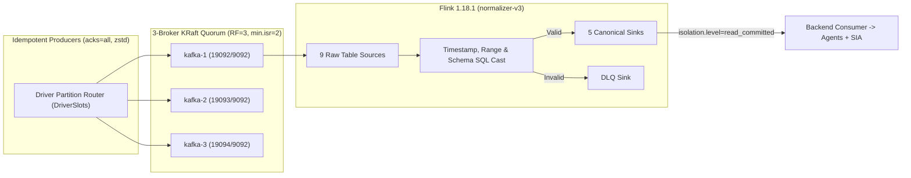

# PULSE Kafka KRaft & Apache Flink Streaming Architecture

---

## 1. Distributed Topology & Cluster Guarantees

PULSE runs a 3-node Apache Kafka KRaft cluster (`docker-compose.kafka.yml`, zero ZooKeeper dependency) paired with Apache Flink 1.18.1 SQL normalization:

- **Brokers:** `kafka-1`, `kafka-2`, `kafka-3` (combined `controller,broker` KRaft quorum).
  - External host bootstrap listeners: `localhost:19092,localhost:19093,localhost:19094`
  - Internal Docker container listeners: `kafka-1:9092,kafka-2:9092,kafka-3:9092` (explicitly NOT host-exposed; prevents Docker bridge `UnknownHostException` failures)
- **Replication & Durability:** Default `replication.factor = 3`, `min.insync.replicas = 2`, `unclean.leader.election.enable = false`, survival across any single-broker outage (`test_t2_single_broker_failure_zero_data_loss`) and fail-safe write stall under 2-broker loss (`test_t3_two_broker_failure_not_enough_replicas_safety`).
- **Apache Flink 1.18.1:** `calibre-flink-jobmanager` (`localhost:8081` REST) + `calibre-flink-taskmanager` running `pulse-canonical-normalizer-v3` (`18` operators/vertices, `36` running task slots, Kafka SQL connector + JSON format + checkpointing).

---

## 2. Partitioning Strategy (`DriverSlots`)

Driver-scoped telemetry preserves strict causal lap/segment ordering per car without requiring global total ordering across all 20 cars:

- `DriverSlots` deterministically hashes/maps each driver number `(1..99)` modulo topic partition count `P` (default production `P = 11`, benchmarked across `P in {1, 3, 6, 11, 22}`).
- **Observed Multi-Session Skew (`P = 11`, 20 drivers, `3 x 6,000 = 18,000` msgs):** 9 partitions receive 2 drivers (`~1,800` events each) and 2 partitions receive 1 driver (`900` events each), yielding `max / mean = 1.102` (verified in [phase_i_kafka_sustained.json](../../reports/benchmarks/phase_i_kafka_sustained.json)).
- Session-wide events (`driver_number = None`: flags, VSC/SC, weather, `SESSION_ENTRY_LIST`) route deterministically to partition `0` or session hash key.

---

## 3. Complete Topic Catalogue (70 Broker Topics vs 29 Core App Channels)

Why do broker topic counts show `70` while [topics.py](../../backend/pulse/topics.py) lists `29`?
- [topics.py](../../backend/pulse/topics.py) (`ALL_TOPICS`) exports the **29 primary backend subscription/publication constants** (`RAW_TOPICS` 9, `NORMALISED_TOPICS` 5, `FEATURE_TOPICS` 3, `AGENT_TOPICS` 6, `INTELLIGENCE_TOPICS` 4, `OPS_TOPICS` 2).
- [kafka_io.py](../../backend/pulse/stream/kafka_io.py) (`build_topic_catalogue()`, verified `70/70` against live cluster via `python -m pulse.stream.kafka_io --verify`) provisions the complete **70-topic distributed topology**, adding Flink DLQ namespaces, CALIBRE legacy/compat verification topics, SIA audit/ledger streams, and replay control channels:

| Domain Tier | Count in `build_topic_catalogue()` | Key Topic Names / Patterns | Partitions |
| :--- | :--- | :--- | :--- |
| **Raw Telemetry & Control** (`RAW_TOPICS`) | 9 + compat aliases | `pulse.raw.timing`, `telemetry`, `position`, `weather`, `race_control`, `pit_stops`, `entry_list`, `session_lifecycle`, `capture_manifest` | 11 (driver-affine) / 1–3 (session) |
| **Flink Canonical Normalized** (`NORMALISED_TOPICS`) | 5 | `pulse.normalised.driver_laps.v1`, `driver_state.v1`, `race_control.v1`, `weather.v1`, `session_status.v1` | 11 / 3 |
| **Derived Features & Agent Findings** | 9 (`FEATURE` + `AGENT`) | `pulse.feature.*` (3), `pulse.agent.{event_context,track_state,vehicle_response,tyre_strategy,integrity}.findings.v1` + `.v1` channels | 11 |
| **Fusion & SIA Intelligence** | 4 + SIA streams | `pulse.intelligence.{driver_impact,strategy,integrity_verdicts,telemetry}.v1`, `pulse.integrity.*` | 11 / 3 |
| **Ops, DLQ & Benchmark Channels** | Remainder to `70` | `pulse.ops.*`, `pulse.dlq.*`, `calibre.*` verification & partition-test specs | 1–11 |

---

## 4. Apache Flink SQL v3 Normalizer (`normalizer_job.sql`)

[normalizer_job.sql](../../backend/pulse/stream/flink/jobs/normalizer_job.sql) replaces v2 (which missed `POSITION_UPDATE` / `CAR_TELEMETRY` mappings to `driver_state`) with full 9-to-5 canonical normalization:
- Validates mandatory ISO timestamps, finite numerical ranges, unit bounds, and JSON paths inside Flink SQL table DDLs before downstream Python agents consume events.
- [manager.py](../../backend/pulse/stream/flink/manager.py) automatically inspects `http://localhost:8081/jobs/overview` on startup in `KAFKA` mode and ensures `pulse-canonical-normalizer-v3` is running.

---

## 5. End-to-End Semantics & Fault Recovery Guarantees

1. **Producer Idempotency:** `acks="all"`, `enable.idempotence=True`, `max.in.flight.requests.per.connection=5`, `compression.type="zstd"`.
2. **Read-Committed Consumer & Manual Commit:** Consumer uses `isolation.level="read_committed"`, `enable.auto.commit=False`, explicit synchronous `commit(asynchronous=False)` only after batch processing completes.
3. **Consumer Idempotent Sink:** [IdempotentVerdictSink](../../backend/pulse/stream/kafka_io.py) backs SQLite WAL primary key `(topic, partition, offset)` (`INSERT OR IGNORE`) — duplicate delivery on cooperative rebalance (`test_t4`, `test_t6`, and `phase_i_kafka_sustained.json`) yields `0` duplicate verdicts.
4. **Dead-Letter Queue:** Non-transient poison JSON/schema records publish asynchronously to `pulse.dlq.*` with original `(topic, partition, offset)` coordinates rather than halting partition progress (`test_t7`).
