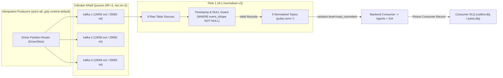

# PULSE Kafka KRaft & Apache Flink Streaming Architecture

---

## 1. Distributed Topology & Cluster Guarantees

PULSE runs a 3-node Apache Kafka KRaft cluster (`docker-compose.kafka.yml`, zero ZooKeeper dependency) paired with Apache Flink 1.18.1 SQL normalization:

- **Brokers:** `kafka-1`, `kafka-2`, `kafka-3` (combined `controller,broker` KRaft quorum).
  - External host bootstrap listeners: `localhost:19092,localhost:19093,localhost:19094`
  - Internal Docker container listeners: `kafka-1:29092,kafka-2:29092,kafka-3:29092` (internal listener on port `29092`, explicitly isolated from host listeners `19092..19094`; prevents Docker bridge `UnknownHostException` failures)
- **Replication & Durability:** Default `replication.factor = 3`, `min.insync.replicas = 2`, `unclean.leader.election.enable = false`, survival across any single-broker outage (`test_t2_single_broker_failure_zero_data_loss`) and fail-safe write stall under 2-broker loss (`test_t3_two_broker_failure_not_enough_replicas_safety`).
- **Apache Flink 1.18.1:** `calibre-flink-jobmanager` (`localhost:8081` REST) + `calibre-flink-taskmanager` (`4` TaskManager slots, `parallelism.default=2`) running `pulse-canonical-normalizer-v3` (`18` operators/vertices executing **`36` running subtasks**, Kafka SQL connector + JSON format + periodic checkpointing).

---

## 2. Partitioning Strategy (`DriverSlots`)

Driver-scoped telemetry preserves strict causal lap/segment ordering per car without requiring global total ordering across all 20 cars:

- `DriverSlots` deterministically hashes/maps each driver number `(1..99)` modulo topic partition count `P` (default production `P = 11`, benchmarked across `P in {1, 3, 6, 11, 22}`).
- **Observed Multi-Session Skew (`P = 11`, 20 drivers, `3 x 6,000 = 18,000` msgs):** 9 partitions receive 2 drivers (`~1,800` events each) and 2 partitions receive 1 driver (`900` events each), yielding `max / mean = 1.102` (Phase I [`phase_i_kafka_sustained.json`](../../reports/benchmarks/phase_i_kafka_sustained.json)) and `1.10` in Phase J [`phase_j_kafka_sustained.json`](../../reports/benchmarks/phase_j_kafka_sustained.json).
- Session-wide events (`driver_number = None`: flags, VSC/SC, weather, `SESSION_ENTRY_LIST`) route deterministically to partition `0` or session hash key.

---

## 3. Complete Topic Catalogue (29 App Channels, 70 Catalogued Specs, 71 Live Runtime Topics)

Why do [topics.py](../../backend/pulse/topics.py), `build_topic_catalogue()` (`--verify`), and live cluster topic counts differ?
- [topics.py](../../backend/pulse/topics.py) (`ALL_TOPICS`) exports **29** primary application channel names (`RAW_TOPICS` 9, `NORMALISED_TOPICS` 5, `FEATURE_TOPICS` 3, `AGENT_TOPICS` 6, `INTELLIGENCE_TOPICS` 4, `OPS_TOPICS` 2).
- [kafka_io.py](../../backend/pulse/stream/kafka_io.py) (`build_topic_catalogue()`, verified `70/70` against live cluster via `python -m pulse.stream.kafka_io --verify`) provisions **70** `TopicSpec` entries: **`41` `calibre.*`** legacy/compat/DLQ topics (`calibre.dlq` included) plus **`29` `pulse.*`** topics (`28` from `topics.py` plus `pulse.dlq`).
- The 29th `topics.py` entry, **`pulse.agent.integrity.findings.v1`**, is created dynamically by `KafkaBroker.ensure_topics()` on backend startup, bringing the active live broker topic set to **71** topics when the Integrity Agent runs.

| Domain Tier | Source Inventory | Exact Active Topic Names | Partitions |
| :--- | :--- | :--- | :--- |
| **Raw Telemetry & Control** (`RAW_TOPICS`) | `9` in `topics.py` & catalogue | `pulse.raw.{race_control, track_status, timing.laps, timing.positions, telemetry.car, weather, tyres.stints, pit.events, session_status}.v1` | `11` (driver-affine) / `3` |
| **Flink Canonical Normalized** (`NORMALISED_TOPICS`) | `5` in `topics.py` & catalogue | `pulse.norm.{race_events, driver_laps, driver_state, track_segments, tyre_stints}.v1` *(with `upsert-kafka` on `race_events`, `driver_state`, `track_segments`, `tyre_stints`)* | `11` / `3` |
| **Derived Features & Agent Findings** | `3` feature + `6` agent (`5` in catalogue + `1` dynamic) | `pulse.features.{vehicle_response, tyre_stints, race_context}.v1`; `pulse.agent.{event_context, track_state, vehicle_response, tyre_strategy, race_impact, integrity}.findings.v1` | `11` |
| **Fusion & SIA Intelligence** | `4` in `topics.py` & catalogue | `pulse.intelligence.{driver_impact, track_alerts, strategy_alerts, race_timeline}.v1` | `11` / `3` |
| **Ops, DLQ & Compat Streams** | Remainder (`2` ops + `2` DLQ + `41` `calibre.*`) | `pulse.ops.{agent_health, pipeline_metrics}.v1`, `pulse.dlq`, `calibre.dlq`, plus `calibre.*` test/compat channels | `1–11` |

---

## 4. Apache Flink SQL v3 Normalizer (`normalizer_job.sql`)

[normalizer_job.sql](../../backend/pulse/stream/flink/jobs/normalizer_job.sql) replaces v2 (which omitted high-frequency position/car telemetry mappings into `driver_state`) with full 9-to-5 canonical normalization across all 9 raw topics:
- Filters malformed null identifiers inline (`WHERE event_id IS NOT NULL AND event_type IS NOT NULL`) and deduplicates by primary key (`WHERE row_num = 1`) into `pulse.norm.*` sinks (`kafka` / `upsert-kafka`) before downstream Python agents consume events. *(It does not route rejected rows into a separate Flink DLQ topic; consumer poison messages use `calibre.dlq`.)*
- [manager.py](../../backend/pulse/stream/flink/manager.py) automatically inspects `http://localhost:8081/jobs/overview` on startup in `KAFKA` mode and ensures `pulse-canonical-normalizer-v3` is running.

---

## 5. End-to-End Semantics, Fault Recovery & Throughput Separation

1. **Producer Idempotency & Compression:** `acks="all"`, `enable.idempotence=True`, `max.in.flight.requests.per.connection=5`, runtime default **`compression.type="gzip"`** (`CalibreProducer` and `KafkaBroker` — selected over `zstd` for Flink 1.18 Kafka SQL compatibility under `PULSE-ADR-015`). `zstd` is measured only in isolated Tier 1 Python broker sweeps.
2. **Read-Committed Consumer & Manual Commit:** Consumer uses `isolation.level="read_committed"`, `enable.auto.commit=False`, explicit synchronous `commit(asynchronous=False)` only after batch processing completes.
3. **Consumer Idempotent Sink:** [IdempotentVerdictSink](../../backend/pulse/stream/kafka_io.py) backs SQLite WAL primary key `(topic, partition, offset)` (`INSERT OR IGNORE`) — duplicate delivery on cooperative rebalance (`test_t4`, `test_t6`, and sustained runs) yields `0` duplicate verdicts.
4. **Dead-Letter Queue:** Non-transient poison JSON/schema records caught by Python consumers publish asynchronously via `CalibreProducer.publish_dlq()` to `calibre.dlq` (with `pulse.dlq` provisioned in the topic catalogue) rather than halting partition progress (`test_t7`).
5. **Broker Ingest vs Complete E2E Throughput (`phase_j_kafka_sustained.json`):** Isolated broker sweeps reach `73,662 msg/s` (`gzip`) to `83,809 msg/s` (`zstd`), 3-session concurrent fan-in reaches `30,569 msg/s`, and batched SQLite consumer draining reaches `18,471 msg/s`. By contrast, the **complete E2E pipeline** (`Kafka -> Flink v3 -> 6 Agents -> unpaused SIA WAL -> per-event SQLite VerdictSink`) sustains **`9.67 ev/s`** across `110.86s` (`24` Flink checkpoints, `0` failed, `0` backpressure vertices, `978/978` SIA WAL decisions intact after mid-stream consumer crash/restart), proving per-event synchronous SIA WAL commits — not Kafka or Flink — bound E2E rate.
