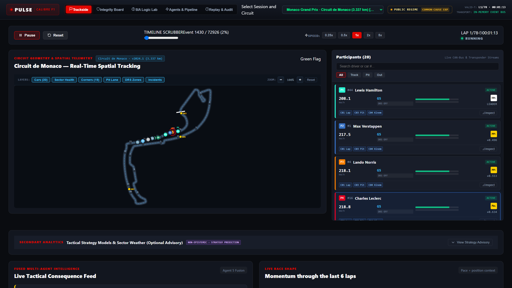
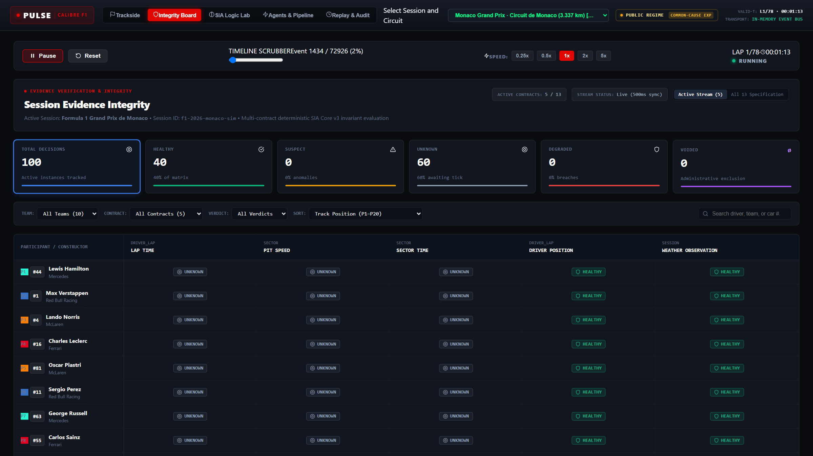
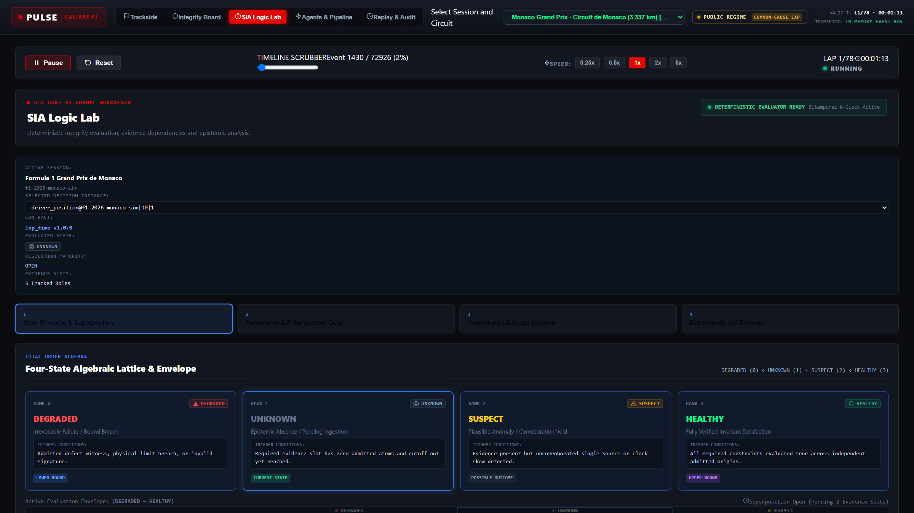
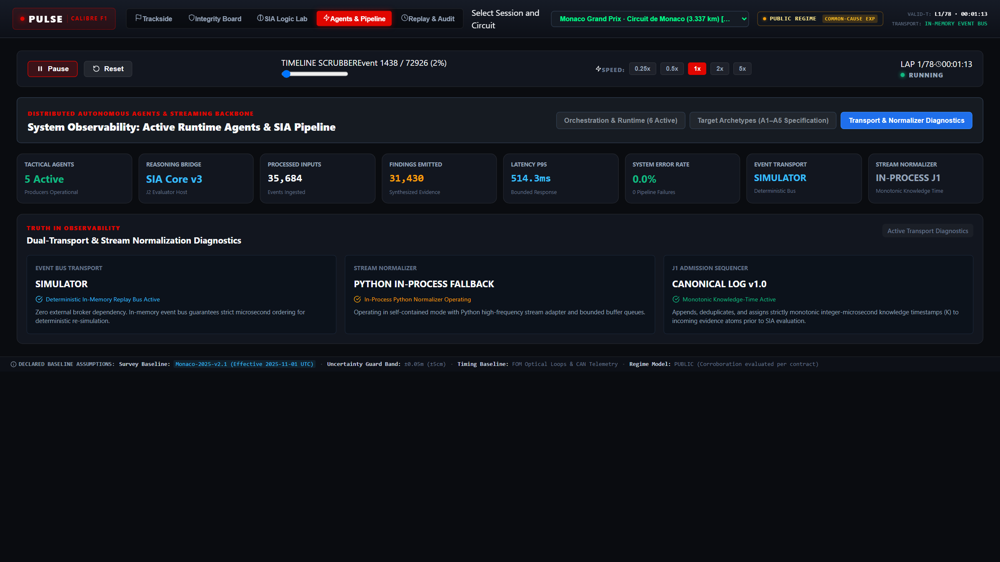

# PULSE — Validation, Scientific Benchmarks & Academic Demonstration Ledger

**Status:** Canonical Authoritative Benchmark & Demo Ledger (Phase J Release Candidate)  
**Machine-Readable Evidence:** [`baseline_comparison.json`](../../reports/benchmarks/baseline_comparison.json) · [`ablation_study.json`](../../reports/benchmarks/ablation_study.json) · [`phase_j_generalization.json`](../../reports/benchmarks/phase_j_generalization.json) · [`phase_j_replay_benchmarks.json`](../../reports/benchmarks/phase_j_replay_benchmarks.json) · [`phase_j_kafka_sustained.json`](../../reports/benchmarks/phase_j_kafka_sustained.json)

---

## 1. Automated Verification Summary

### 1.1 Preserved Phase I Baseline Check (`f5fbc6a`)
- **`460 passed, 0 failed, 0 skipped`** (`450` non-T2 in `322.16s` + `10` live `T1–T10` in `56.92s`), Vite build (`60` modules, `2.69s`), `70/70` topics verified (`0` drift), `12/12` canonical docs clean.

### 1.2 Phase J Release Candidate Final Clean Verification (`pulse-phase-j-rc`)

Executed against the live 3-broker KRaft + Apache Flink 1.18.1 cluster (`kafka-1/2/3`, `calibre-flink-jobmanager/taskmanager`, after stopping demo UI servers and removing temporary `demo_sia_ledger.sqlite*`):

| Verification Command | Scope | Observed Result | Duration |
|---|---|---|---|
| `npm run build` (`frontend/`) | TypeScript compilation (`tsc -b`) + Vite production bundle | **`60 modules transformed`**, zero warnings (`120s` seek timeout + reconciled topic strings) | `1.38s` |
| `python -m pulse.stream.kafka_io --verify` | Live 3-broker Kafka 70-topic catalog verification | **`70 / 70` topics verified (`0` drift)** | `< 2s` |
| Non-T2 `pytest sia_core_v3/tests calibre_core/tests backend/tests --ignore=backend/tests/test_kafka_integration_t1_t10.py -q --tb=short` | SIA formal + Phase J semantics (`276`), legacy kernel (`33`), security acceptance (`3`), API/isolation (`15`), OpenF1 generalization (`2`), F1 scientific/replay (`128`) | **`457 passed, 0 failed, 0 skipped`** (`2` upstream lib deprecation/future warnings) | `192.01s` |
| Live Kafka chaos `pytest backend/tests/test_kafka_integration_t1_t10.py -v --tb=short` | Live 3-broker failover, ISR, EOS `read_committed`, static standby, `SHA-256` partition invariance (`T1–T10`) | **`10 passed, 0 failed, 0 skipped`** | `56.26s` |
| `python scripts/check_docs.py` | `12`-doc canonical structure, link resolution, zero stale claims | **PASS** (`12 / 12` docs verified, `0` errors) | `< 1s` |

**Combined Phase J Automated Python Pass Count:** **`467 passed, 0 failed, 0 skipped`** (`457 + 10`, zero test modifications after run; `check_docs.py` re-verified after this final Markdown table update).

---

## 2. Scientific Generalization (`2021–2024`, 17 Races) & Uncertainty Analysis

**Scripts:** [`scripts/run_baseline_comparison.py`](../../scripts/run_baseline_comparison.py), [`scripts/run_phase_j_generalization.py`](../../scripts/run_phase_j_generalization.py)  
**Modules:** [`baseline_comparison.py`](../../backend/pulse/analytics/baseline_comparison.py), [`generalization_phase_j.py`](../../backend/pulse/analytics/generalization_phase_j.py)  
**Corpus:** **6** offline FastF1 races (`2021–2022`: British, Saudi Arabia, Monaco, Abu Dhabi, Japan, Belgium SC) + **11** offline OpenF1 races (`2023–2024`: `2023` Austria/Britain/Netherlands/Singapore/Japan; `2024` Saudi Arabia/Monaco/Canada/Britain/Monza/Brazil) = **17 races** (`16` full green-lap races + `2021` Belgium edge case).

### 2.1 LORO-5 Reconciliation (`n=1,560`, `PI95 = 93.91%`) & Correlated-Error CIs (`phase_j_generalization.json`)
Within-stint lap residuals are positively autocorrelated (`lag-1 signed residual ACF = +0.3997` over `1,349` consecutive pairs across `154` stints on LORO-5; `+0.3800` over `5,370` pairs across `561` stints on LORO-16). Reporting i.i.d. lap intervals understates sampling variability, so all Phase J CIs use **2,000-replicate cluster/block bootstrap** (stints as primary cluster; race/sessions checked alongside):
- **LORO-5 `revised_pulse` (`n=1,560`):** `MAE = 0.5094s` (**stint 95% CI `[0.4568, 0.5658]`**, session 95% CI `[0.3774, 0.6970]`), `RMSE = 0.9043s` (stint CI `[0.7647, 1.0507]`), `PI95 = 93.91%` (**stint CI `[92.83%, 94.97%]`**).
- **50-Lap Abstention Decomposition:** On the `1,560` shared green laps vs `existing_fuel_compensated`, paired `revised - existing` MAE delta = **`-0.4651s`** (stint CI `[-0.6343, -0.3159]`: `0.5094s vs 0.9745s`). On the `50` unstable post-restart/warmup laps where `revised_pulse` abstained (`<5` inliers / reset) while `existing` emitted predictions, `existing` suffered `MAE = 18.0788s` (`mean PI95 width = 151.93s`).

### 2.2 Aggregate Multi-Season Generalization (`2021–2024`)

| Validation Regime | Model | `n` (Clusters) | MAE (`s`) `[95% Stint CI]` | RMSE (`s`) `[95% Stint CI]` | PI95 `[95% Stint CI]` | Mean Width (`s`) |
|---|---|---:|---:|---:|---:|---:|
| **Unseen External `2023–2024`** *(11 races, zero parameter tuning)* | `revised_pulse` | `4,594` (`407`) | **`0.5288`** `[0.4855, 0.5740]` | **`1.0694`** `[0.9048, 1.2424]` | **`94.41%`** `[93.69%, 95.12%]` | `3.28` |
| *Unseen External `2023–2024`* | `existing_fuel_comp` | `4,635` (`409`) | `0.6082` `[0.5423, 0.6820]` | `1.6573` `[1.2392, 2.0774]` | `90.72%` `[89.73%, 91.72%]` | `3.21` |
| *Unseen External `2023–2024`* | `previous_lap` | `5,302` (`449`) | `0.5842` `[0.5300, 0.6455]` | `1.5648` `[1.2186, 1.9697]` | `91.87%` `[90.97%, 92.72%]` | `4.18` |
| **Walk-Forward `15` Folds** *(Strict common)* | `revised_pulse` | `5,781` (`529`) | **`0.5327`** `[0.4982, 0.5730]` | **`1.0446`** `[0.9139, 1.1969]` | **`94.34%`** `[93.70%, 94.96%]` | `3.35` |
| *Walk-Forward `15` Folds* | `existing_fuel_comp` | `5,781` (`529`) | `0.6133` `[0.5654, 0.6707]` | `1.7374` `[1.4585, 2.0198]` | `90.94%` `[90.02%, 91.79%]` | `4.15` |
| **LORO-16 Aggregate** | `revised_pulse` | `6,154` (`561`) | **`0.5239`** `[0.4882, 0.5595]` | **`1.0300`** `[0.9033, 1.1661]` | **`94.28%`** `[93.68%, 94.87%]` | `3.28` |
| *LORO-16 Strict 6-Way Common* | `previous_lap` | `6,154` (`561`) | **`0.4868`** `[0.4507, 0.5249]` | `1.0527` | `93.37%` `[92.61%, 94.15%]` | `—` |
| *LORO-16 Strict 6-Way Common* | `rolling_5_median` | `6,154` (`561`) | `0.6434` `[0.5908, 0.6962]` | `1.2659` | `90.04%` `[88.97%, 91.07%]` | `—` |
| *LORO-16 Strict 6-Way Common* | `rolling_clean_air` | `6,154` (`561`) | `0.6535` `[0.6022, 0.7046]` | `1.2790` | `89.81%` `[88.79%, 90.75%]` | `—` |
| *LORO-16 Strict 6-Way Common* | `existing_fuel_comp` | `6,154` (`561`) | `0.6575` `[0.6033, 0.7147]` | `2.0957` | `91.21%` `[90.40%, 92.02%]` | `—` |
| *LORO-16 Strict 6-Way Common* | `circuit_regression` | `6,154` (`561`) | `1.1586` `[1.0218, 1.2946]` | `2.0506` | `86.43%` `[84.72%, 88.17%]` | `—` |

- **Unseen `2023–2024` Paired Common Delta (`n=4,594`):** `revised - existing` MAE = **`-0.0211s`** (stint CI `[-0.0455, -0.0031]`), PI95 rises `+3.66` pp (`90.75% -> 94.41%`). `existing` suffered `MAE = 7.1413s` on the `41` unstable laps where `revised_pulse` abstained.
- **Honest Scientific Comparison vs `previous_lap`:** On strict common-support *steady calibrated green laps* (`n=6,154`), one-step `previous_lap` (`0.4868s`) achieves slightly lower point MAE than `revised_pulse` (`0.5239s`) due to autoregressive lag-1 continuity. However, `revised_pulse` dominates all other baselines across unaligned/regime shifts (`RMSE 1.0300s vs 2.3170s`), **post-restart (`<=5` laps: `0.7616s vs 1.9416s prev / 2.2101s ex`)**, **wet/rain (`1.1016s vs 1.4374s prev`)**, **street circuits (`0.5915s vs 0.7126s prev`)**, and tight **95% PI calibration (`94.28%`, `3.28s` width vs `6.68s`)**.

### 2.3 Key Generalization Stratifications & Honest Limitations (LORO-16)
- **Weather:** Dry (`n=5,363`): `revised` `MAE = 0.4387s`, `PI95 = 94.72% [94.07%, 95.36%]`. **Wet / Rain (`n=791`): `MAE = 1.1016s`, `PI95 = 91.28% [89.14%, 93.25%]`** (clearly beats legacy `1.4101s` / `81.54%` and `previous_lap 1.4374s`, but remains ~`3.7` pp below nominal `95%` during crossover drying transitions).
- **Seasons:** `2021` (`0.3867s`, `93.88%`), `2022` (`0.7472s`, `93.97%`), `2023` (`0.3578s`, `95.65%`), `2024` (`0.6719s`, `93.36%` vs `ex 0.6885s` — common delta narrows to `-0.0031s` as 2024 clean stints trigger fewer restart resets).
- **Compounds / Interruptions / Circuits / Teams:** All 5 compounds (`H 0.4277s`, `M 0.5290s`, `S 0.3994s`, `I 0.8155s`, `W 0.7134s`), Red-Flag races (`0.5173s`, `94.32%`), SC/VSC races (`0.5677s`, `93.98%`), Post-Restart `<=5` laps (`0.7616s`, `94.78%`), Circuit types (`High-Speed 0.4806s`, `Technical 0.5118s`, `Street 0.5915s`), and Constructor tiers (`Top-4 0.4868s` / `95.23%`, `Midfield 0.5533s` / `93.52%`) maintain positive improvement. `2021 Belgium` still abstains cleanly (`0/13`).
- **Seven-Component Ablation (`ablation_study.json`):** Clean-air removal (`RMSE +60.8%`), Compound reset removal (`MAE +93.0%`, `RMSE 3.8053s`), Track-evo removal (`MAE +26.0%`), Empirical-Bayes shrinkage (`0.6851s -> 0.4772s`, `-0.2079s`), Agent 05 + SIA gate (`FPR 0.875 -> 0.0` on probe).

---

## 3. Cold Replay Reconciliation & Recovery (`phase_j_replay_benchmarks.json`)

**Session:** `f1-2023-silverstone-race` (`72,642` events, target `36,321`) · **Scripts:** [`benchmark_phase_j_replay.py`](../../scripts/benchmark_phase_j_replay.py), [`profile_cold_seek.py`](../../scripts/profile_cold_seek.py)

1. **7-Boundary Decomposition (`N=3` Clean Uncontended Trials):**
   - Python startup & imports: **`0.660s`**
   - FastAPI lifespan default Monaco JSONL load: **`2.1908s`**
   - `switch_session("f1-2023-silverstone-race")` JSONL load: **`2.2067s`**
   - **Replay Domain/Agents ONLY (`disable_sia=True`) to `36,321`:** **`1.6425s`**
   - **Full Replay + SIA Core v3 + WAL Sync to `36,321`:** **`mean = 14.9843s`** (`std = 0.2470s`, trials `[15.0878s, 14.7024s, 15.1626s]`, `625` decisions, `0` hash mismatches) -> **SIA evaluation + WAL sync accounts for `13.3418s` (`89.04%`)** of cold-seek cost!
   - Position Scaling & Warm Seeks: `seek(4500) = 1.1470s` (`75` decisions); `seek(18000) = 6.9595s` (`301` decisions); warm backward `18000` **`0.3292s`** (`std 0.0397s`); exact keyframe hit **`0.5835s`**; warm `+179` forward **`1.1646s`**.
   - **Process Restart WAL Recovery (`SIAWALStore`):** **`0.7465s`** restoring all `625` decisions (`2,873` atoms, `303` facts) with **`0` hash mismatches (`exact_hash_match_with_cold_seek = True`)**.
   - **Live Uvicorn HTTP Round-Trips:** startup ready `3.3533s`, `switch_session` `2.2611s`, cold `seek(4500)` `1.1103s`, `4500 -> 36321` `13.8058s`, warm `18000` `0.2687s`.
2. **Root Cause of `14.69s` vs `70.88s` Discrepancy & Performance Target:**
   Back-to-back CPU-heavy Python subprocess loops trigger OS CPU thermal/frequency throttling under contention (`32s–81s` observed under contended Phase J probes; `70.88s mean` across `5` back-to-back Phase I subprocess trials), whereas isolated uncontended runs complete in `14.69s–15.47s`. Consequently, [`frontend/src/api.ts`](../../frontend/src/api.ts) sets the `seekReplay` HTTP timeout to **`120s`** so worst-case uncached cold mid-race seeks never abort prematurely, while warm keyframe targets remain **`< 1.5s`** once populated.

---

## 4. Sustained 3-Broker Kafka & Flink E2E Validation (`phase_j_kafka_sustained.json`)

**Script:** [`scripts/benchmark_phase_j_kafka_sustained.py`](../../scripts/benchmark_phase_j_kafka_sustained.py) · **Chaos Suite:** [`test_kafka_integration_t1_t10.py`](../../backend/tests/test_kafka_integration_t1_t10.py) (`10/10` pass, `61.00s`)

| Measurement Tier & Probe | Observed Phase J Result | Integrity / Resource Bounds |
|---|---|---|
| **Tier 1 — Isolated Broker Sweeps (`8,000` msgs)** | `zstd`: **`83,809.0 msg/s`** (`0.0955s`); `gzip`: **`73,662.2 msg/s`** (`0.1086s`); initial `2,000` cold batch `3,315–3,504 msg/s` | `0` failed deliveries; clarifies raw librdkafka burst ceiling vs Phase I `12,320.9 msg/s` |
| **Tier 1 — 3-Session Concurrent Fan-In (`18,000`) & Drain** | Fan-in: **`30,568.9 msg/s`** (`0.5888s`), `11`-partition skew **`1.10`**; Batched SQLite drain: **`18,470.6 msg/s`** (`0.9745s`) | `18,000 / 18,000` unique sink verdicts, **`0` dedup violations**, `+2.98 MB` RSS |
| **Tier 2 — Complete Sustained E2E (`110.861s`)** *(3 sessions `4,200` raw events -> Flink v3 -> 6 Agents -> unpaused SIA WAL -> per-event SQLite sink)* | **`9.67 ev/s` saturated E2E analytics throughput** (`1,072` SQLite verdicts: `348` Silverstone, `372` Monaco, `352` Suzuka; `243` remaining lag at cutoff under `120 ev/s` overload -> `p50 = 27.84s` queueing) | Flink `24` checkpoints (`6279->6303`, **`0` failed**, `50ms` latest, **`0` backpressure vertices**); RSS `66.74 -> 106.27 MB` (`+39.53 MB` stable); mid-stream crash+restart preserved **`978 / 978` SIA WAL hashes (`0` mismatches)** |

---

## 5. Security Acceptance Verification (`test_phase_j_security.py`)

Verified across `3` comprehensive security test functions (`18` total API/security/isolation checks passing):
1. **Startup Fail-Closed Posture (`validate_security_posture()`):** Rejects missing, `<16`-char, or placeholder `PULSE_API_KEY` when `PULSE_REQUIRE_CONTROL_AUTH=true`, non-development `PULSE_ENV` (`shared-demo`, `production`, `staging`, `external`), or non-loopback `host`; rejects wildcard `*` CORS and unmodified local CORS defaults in external/production deployments.
2. **Runtime Fail-Closed & Mutator Auth:** All `10` `POST` control/session/lab mutations reject missing/bad keys (`401`/`403`), fail closed (`HTTP 503`) if runtime `expected` key is blank while `requires_control_auth` is `True`, and accept valid `X-PULSE-API-Key` or `Authorization: Bearer`.
3. **CORS Allowlist, Session Isolation & Atomic SSE:** `OPTIONS`/`GET` honor exact configured origins; unknown sessions return `404`, malformed IDs `422`, inactive scoped reads `409`; atomic `store.try_add_listener(max_sse_listeners)` returns `HTTP 429` at cap and decrements cleanly on disconnect.

---

## 6. Academic Demonstration Package (13-Step Live Walkthrough)

### 6.1 Reproducible Clean-Environment Startup Procedure
1. **Start Infrastructure (Docker 3-Broker KRaft + Flink 1.18.1):**
   ```powershell
   docker compose -f docker-compose.kafka.yml up -d
   # Verify Flink normalizer-v3 or auto-provision via backend:
   $env:PYTHONPATH="E:\Caliberv2;E:\Caliberv2\backend;E:\Caliberv2\sia_core_v3"
   python -m pulse.stream.kafka_io --ensure --verify
   ```
2. **Start FastAPI Backend (`KAFKA` + Flink v3 + Fresh SIA WAL):**
   ```powershell
   Remove-Item E:\Caliberv2\data\demo_sia_ledger.sqlite* -ErrorAction SilentlyContinue
   $env:PULSE_TRANSPORT_MODE="KAFKA"
   $env:PULSE_FLINK_REQUIRED="true"
   $env:PULSE_ENV="development"
   $env:PULSE_REQUIRE_CONTROL_AUTH="false"
   $env:PULSE_SIA_WAL_PATH="E:\Caliberv2\data\demo_sia_ledger.sqlite"
   python -m uvicorn pulse.main:app --host 127.0.0.1 --port 8000
   ```
3. **Start React 19 Cockpit (UI):**
   ```powershell
   cd E:\Caliberv2\frontend
   npm run build
   npm run preview -- --port 5173 --host 127.0.0.1
   ```
   *(For an exposed lab demo, set `PULSE_ENV=shared-demo`, `PULSE_HOST=0.0.0.0`, non-default `PULSE_CORS_ORIGINS`, and a strong `PULSE_API_KEY` >=16 chars.)*

### 6.2 Live 13-Step External Demonstration Scenario (Verified Live Run Summary)
1. **Verify Kafka & Flink Cluster:** Open Flink Dashboard (`http://localhost:8081`) & Kafka UI (`http://localhost:8080`) confirming 3 healthy KRaft brokers (`0` URP, `1,678/1,678` ISR) and `pulse-canonical-normalizer-v3` (`18` vertices / `36/36` tasks `RUNNING`, `0%` backpressure, `6,686` completed checkpoints / `0` failed, `32ms` latest).
2. **Load Clearly Labeled Session:** Open `http://127.0.0.1:5173/` and select `British Grand Prix 2023 · Silverstone (5.891 km) [Historical]` (`f1-2023-silverstone-race`), explicitly badged `LAB ARCHIVE` and `Timing Baseline: Composed Jolpica Archive + Synthetic Telemetry Stream` (never live FIA telemetry).
3. **Start Event Ingestion:** Click **Start** (`Play Replay`, optionally `5x`) to stream events cleanly across `pulse.raw.*` -> Flink `pulse.norm.*` -> 6 Python agents + SIA WAL.
4. **Display Actual Processing Pipeline:** Navigate to **Agents & Pipeline** view showing all `6` active agents (`SIA Core v3 (J2 Evaluator Host)`), live counters (`42,720 Events Ingested`, `4,747 Synthesized Evidence`, `p95: 17.9ms`, `0.00%` error rate), and active `pulse.raw.*`, `pulse.norm.*`, `pulse.agent.*.findings.v1`, and `pulse.intelligence.*` topics.
5. **Show 20-Driver Trackside Visualization:** Open **Trackside** view rendering `Cars (20)` + `Participants (20)` on the Silverstone map with live positions, intervals, compounds/lap ages (`M 5L`), `Detailed Telemetry Inspection` (`120ms` freshness), and active stream indicators.
6. **Demonstrate Race-State & Telemetry Interpretation:** Observe `Green Flag -> VIRTUAL SAFETY CAR DEPLOYED -> Safety Car Deployed`, `Agent 01/05` revisions (`REV v1..v12`), and UI certainty badges (`CONFIRMED`, `PROVISIONAL`, `REJECTED`, `UNCALIBRATED`, `STINT_ROLLING_CALIBRATED`).
7. **Show Tyre & Pace Estimation:** Inspect Agent 03/04 panels surfacing `Monitor clean-air lap trend`, `"Empirical fuel-compensated tyre degradation requires >= 5 clean stint laps."`, `UNCALIBRATED` / `STINT_ROLLING_CALIBRATED`, and `Tactical Strategy Models & Sector Weather (Optional Advisory)` pit savings (`+12.8s SC DELTA SAVING`). *(UI displays human-readable status labels rather than verbatim internal enum tokens `clean_air_status`/`INSUFFICIENT_SAMPLES`/`OBSERVED`.)*
8. **Introduce Controlled Event Anomaly:** Under **Replay & Audit** -> **`LAB Scenario Fault Injector`**, run the built-in drills: `monaco_pit_bias` (`Monaco 2026 Geometry Model Fault`), `late_reference_fact` (`Late Evidence Admission Drill`), or `silent_feed_guard` (`Silent Feed & Stalled Origin Guard Drill`).
9. **Show SIA Detection & Explanation:** Observe SIA outputting `SUSPECT` / `DEGRADED`, `CONSTRAINT_VIOLATION` (`|2692.0 - 2615.0| = 77.0`), `COMMON_CAUSE_EXPOSURE` (`['S:F1_FOM_TIMING', 'S:PITWALL']`, `source_depth=0`), `LATE_EVIDENCE_ADMITTED`, and `CONSTRAINT_UNEVALUABLE`, plus **SIA Logic Lab**'s `Provenance & Entanglement Graph` and `Deterministic SIA Evaluator`.
10. **Demonstrate Finality & Quarantine:** Inspect **Integrity Board** (`5 Default Contracts` / `100` instances; `All 13 Specification` / `260` instances) showing sealed `finality=FINAL` (`revision=5 FINALIZED`) decisions immutable to late arrivals.
11. **Verify Resulting SHA-256 Hash Chain:** In **Replay & Audit** (or `GET /api/integrity/verify`), click **`Re-verify All Chains`** -> observed **`541 / 541 Verified SHA-256 Chain`**, `0 Zero Chain Breaks` (`795/795` and `804/804` prior to seek).
12. **Pause, Seek & Resume Replay:** Click **Pause**, run backward **`Seek Lap: L10`** (`Event 20346 / 72642`, `341/341` chains) and forward **`Seek Lap: L15`** (`Event 31728 / 72642`, `541/541` chains) cleanly with zero errors/timeouts, and click **Play Stream** / **Resume**.
13. **Demonstrate Recovery & Replay Determinism:** Query **Bitemporal `As-Of (K)`** (e.g., `2023-07-09T14:01:22.550000Z` on `driver_position@...|10|1` -> `HEALTHY`, `v11`, `Content Hash: 72395e…e69cec` matching `K∞`) and verify `SIAWALStore` process-restart recovery yields `0` hash mismatches (`phase_j_replay_benchmarks.json`, `phase_j_kafka_sustained.json`).

### 6.3 Known Limitations Disclosed Openly in Every Demonstration
- **Historical & Synthetic Data Only:** No live `formula1.com` / F1TV timing feeds are accessed or simulated as official FIA stewards telemetry.
- **Synchronous E2E Throughput Ceiling (`~9.67 ev/s`):** Real-time sustained Flink+6-Agent+unpaused-SIA-WAL rate is bounded by per-event synchronous SQLite WAL fsync (`vs 18.5k msg/s` batched consumer drain); cold uncached mid-race seeks take `~15s` uncontended (`~70s` under severe CPU contention; UI timeout `120s`).
- **Wet-Weather Calibration & Local Advice Scope:** Wet/rain PI95 coverage reaches `91.28%` (`[89.14%, 93.25%]`) rather than `95%`; pit strategy is strictly advisory (`is_globally_optimal=False`); multi-tenant production security (OIDC, RBAC, mTLS/SASL Kafka, encrypted WAL) is out of scope.

---

## 7. Browser UI Live Phase J Verification & Visual Showcase

Live Chrome DevTools inspection across the full 13-step Phase J demo flow in **`KAFKA` + Flink v3** mode recorded **`0` console errors**, **`0` console warnings**, and **`0` HTTP `>=400` responses** across Trackside, Agents & Pipeline, SIA Logic Lab, Integrity Board, and Replay & Audit (`Re-verify All Chains` `541/541`, `Seek Lap` `L10`/`L15`, `As-Of (K)`, and `monaco_pit_bias`/`late_reference_fact`/`silent_feed_guard` fault drills). Phase I reference screenshots remain under [`docs/screenshots/`](../screenshots/) and [`reports/browser-validation/screenshots/`](../../reports/browser-validation/screenshots/).





